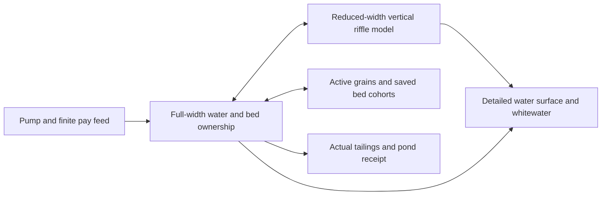

# Hybrid simulation for consequential mining

28 October 2026. Research and implementation specification. The complete coupled hybrid mining mode remains unfinished; water-only prototype progress and measurements are reported below. Historical research baseline: `40a6aea`, after the verified direct-upload change. Simon explicitly authorized reduced-width and other approximations provided water, soil and processing still have convincing consequences. This supersedes treating exact original particle counts, grid sizes and iteration counts as mandatory for every future playable mode. Keep the original mode as a reference.

The recommendation is a reduced-width, vertically resolved sluice model combined with cheap full-width hydraulic/bed state and fine visual detail. Separately investigate bulk wet-sand fields for ground, tailings and pond berms. A single cloned strip is a useful first experiment; lateral blockage, spill and off-centre feed require additional state before it can represent the complete plant.

Implementation progress: the [complete water-only periodic loop](../playtests/2026-10-28-periodic-water.md) now passes35 distinct Metal controls, including evolving riffle/repeated-domain/resize and exact resident-versus-sync complete-state checks. Resident water-only widths38/12/8cm measure0.769/1.472/1.769 physical seconds per wall second in the declared finite-pulse benchmark. A shared full-depth W-boundary dispatch bug is also fixed. These are not whole-game or calibrated mineral results. Periodic conservative phase geometry, width-consistent material/bed ownership, lateral loading/clogging/diversion, rendering/saves and native combined qualification remain open. The installed app stays unchanged.

## Published implementations and what they support

| Primary source inspected | Technique worth borrowing | Limit for this game |
|---|---|---|
| [Sebastian Lague, Fluid-Sim](https://github.com/SebLague/Fluid-Sim/tree/4717b7259718d349b0001c82836f24ce5fec81d7), especially [fluid kernels](https://github.com/SebLague/Fluid-Sim/blob/4717b7259718d349b0001c82836f24ce5fec81d7/Assets/Scripts/Simulation/Compute/FluidSim.compute) and [screen-space renderer](https://github.com/SebLague/Fluid-Sim/blob/4717b7259718d349b0001c82836f24ce5fec81d7/Assets/Scripts/Rendering/ScreenSpace/FluidRenderTest.cs) | Spatially hashed/reordered SPH; separate depth, thickness, smoothing, normal reconstruction and secondary whitewater. Detailed-looking water need not require a physical particle for every visible droplet. | Its SPH solver is a different model. Porting the whole engine is not an established speedup. Borrow rendering and data organization independently. |
| [Crest 4 source](https://github.com/wave-harmonic/crest/tree/db0658ff0b2e93e4a9e28cc2867509658b0ecc00) and [simulation documentation](https://crest.readthedocs.io/en/4.13/user/ocean-simulation.html) | Flow, dynamic waves and foam have distinct simulation layers; interaction forces are distributed across resolutions. | Ocean-wave layering is a rendering/interaction precedent, not a sediment or gold-recovery model. |
| [Fluid Flux, developer writeup](https://imaginaryblend.com/2021/09/26/fluid-flux/) | Practical game water uses a 2D shallow-water simulation with separate rendering, sampling and optional baked states. | Top-down height fields have geometric limits; baking a changing plant would remove its response. Useful for river/pond architecture, insufficient alone for vertical riffle eddies. |
| [OpenFOAM periodic/cyclic boundaries](https://openfoam.org/release/2-0-0/meshing/) | Connect opposite lateral boundaries to represent repeated geometry. | A periodic strip represents a repeating region, not two closely spaced walls. Full-width structures and side spill do not fit that assumption. |
| [Chentanez and Müller, 2010](https://matthias-research.github.io/pages/publications/hfFluid.pdf) | Hybrid height-field water plus non-interacting secondary particles, with volume/momentum exchanged at waterfalls and splashes; fine waves advect with flow. | A coupled particle has physical ownership; a decorative particle does not. These roles must remain explicit in saves and budgets. |
| [Su et al., SIGGRAPH Asia 2023](https://kuiwuchn.github.io/rtsw.html), [paper](https://kuiwuchn.github.io/RTWaterAndSand.pdf) | Depth-integrated sand/water fields include saturation, friction, momentum exchange and elastoplastic sand. Published examples include eroding/breaching sand dams. | Strong candidate for wet terrain, tailings and pond berms. It is not a demonstrated gold separator or a full 3D digging/overhang model. |
| [Narrow Band FLIP, 2016](https://visualcomputing.ist.ac.at/publications/2016/NarrowBandFLIP/) and [SideFX documentation](https://www.sidefx.com/docs/houdini/fluid/narrowband.html) | Keep particles near the free surface and grids in the interior, with a carefully designed transfer between representations. | Lower priority for this shallow sluice. Naive coupling can introduce energy errors; particle-carried attributes need field ownership when interior particles disappear. |
| [Box2D sleeping](https://box2d.org/documentation/md_simulation.html) | Resting contact groups can stop expensive integration and wake on relevant changes. | Water shear, bed erosion, support removal and impacts must wake material. A low-velocity flag alone must not permanently trap gold. |

These are design precedents, not interchangeable drop-in libraries or proof of our performance. Two repositories were inspected at pinned revisions without executing their code. A separately indexed NarrowBandFlip repository returned a live API 404, so its advertised speed figures are not used. No third-party code is imported by this research checkpoint.

## First prototype: a periodic strip

Preserve downstream length and vertical resolution initially. Compare full width, a 12-cell strip, and an 8-cell strip at the current 1 cm reference spacing. The actual reference channel is 38 cm wide. Account for guard cells and dispatch overhead when measuring reduction; width ratios alone do not predict frame rate. The 12-cell case is the first representativeness check, with 8 cells as the more aggressive candidate.

1. Make lateral periodicity consistent in P2G, G2P/APIC relative offsets, cell marking, density correction, pressure/gradient, vorticity, collisions and particle advection. Wrapping only particle positions is insufficient. Minimum-image offsets matter for APIC near a seam. The physical inlet and outlet remain open downstream.
2. Scale inlet discharge and represented inventory by physical width. For replication factor `r = full_width / strip_width`, `Q_strip = Q_full / r`. Full-width water ownership is either the strip's inventory multiplied by `r`, or a separate coarse field; never count both. Choose and document one owner before integration. Mineral stock and gold are not multiplied when rendered.
3. Start with laterally uniform geometry/feed. Measure water depth, velocity, pressure residual/flux, riffle recirculation and per-size gold/deposition statistics against the original mode. Preserve real physical time, inlet flux and grading across the comparison; identical full-width particle counts inside a narrow strip would change concentration.
4. Add purely visual lateral copies only after the field is qualified. Use spatially varied, flow-advected surface detail at the current physical time. Time-offset copies are unsuitable during pump changes, jams and draining. Rendered replicas own no inventory and cannot become collectible duplicate gold.
5. Exercise off-centre feed and a local blockage. Failure to reproduce lateral diversion marks the single-strip applicability limit. Introduce coarse full-width head/flux and independent lane bed/loading state, or activate local 3D patches; do not describe globally mirrored clogging as a successful plant model.

For real full-width mineral parcels coupled to a representative strip, reaction forces and displaced volume require width-consistent reduction into the strip. Sampling its velocity for every grain while applying every full-width reaction to the small water volume would over-couple the phases. Coarse/lane state also needs explicit source terms and saved continuation; prototype it separately from cosmetic replication.

This is the proposed integrated architecture. It is not yet implemented. The initial strip benchmark does not require every box to exist, but full operation does.

## Other high-value approximations

| Candidate | Keep consequential | Simplify | First decisive check |
|---|---|---|---|
| Multi-lane 2.5D sluice | Vertical riffle separation, varying water/bed loading, lateral head exchange, grade-dependent movement | Long-range spanwise turbulence and fine lateral detail | Local jam diverts flow into adjacent lane and changes downstream transport without multiplying stock. More lanes consume the strip's speed gain; measure total work. |
| Active bed and sleeping grains | Saved solids/gold by size and depth, obstruction/porosity, shear-driven release and excavation | Repeatedly solving every settled grain contact | Pump surge, mat cleaning and support removal remobilize the correct finite inventory; size classes remain conserved through save/load. |
| Fewer physical water markers plus fine rendering | Fluid volume, boundary flux, bed feedback and current-time flow | Physical marker density; add visual samples separately | Thin-water continuity and riffle response across several particle densities. Marker weights and saved water ownership must change together. |
| Adaptive/multirate stepping | Fast contacts, current mass transfers and rapid pump/blockage response | Expensive water updates during genuinely slower flow | CFL-aware water cadence, subcycled solids, and surge/stop tests with reported lag. Interpolated pictures do not count as faster physical time. |
| Bulk wet-sand/water fields | Saturation-dependent mobility, solids/water transfer, berm erosion, pile growth and actual breach volume | Individual internal grain contacts across the claim | Build a finite berm, saturate/overtop it, retain released sediment/water and altered terrain. Show wet slump and dry stability under stated model parameters. |
| Local detailed patches and background processing | Finite plant throughput, pond storage, incidents and inventory while away | Fine droplets/contacts outside active interaction regions | Leave and return during an overload; preserved physical consequences and saved continuation, with no material creation when detail returns. |
| Residual-controlled pressure or a different pressure algorithm | Adequate divergence/flux response and plausible water depth | A fixed iteration count as a universal requirement | Compare residual, mass/flux, gold transport and total cost. Previous exact active-list experiments lost; the new permission allows a measured approximation, not an assumed gain. |

Full SPH replacement and a fully shallow-water-only sluice are not the first experiments. We already have a working vertical-resolving reference, and both would require new gold/bed coupling. Narrow-band FLIP is more promising for deep pools than this thin film: in one saved reference, about 89% of markers lie within 3 cm of the maximum marker height in their own 1 cm column, and 96% within 4 cm. This is a column-height heuristic, not a signed-distance free-surface classification.

## Acceptance follows mining consequences

- Pump off/start/surge: flow and downstream transport respond in physical time, drain/backwater is plausible, and the same water/gold is counted once.
- Flow, slope and riffle changes: report per-size entrainment, residence, deposition and outflow. Excessive flow can flush fine gold; insufficient washing can cause deposition, burial and clogging. Preserve those operating regimes without a fixed recovery bonus.
- Feed changes: off-centre feed, wet/clayey feed and increasing solids loading alter passage, water levels, obstruction and tailings. A local obstruction must not become a magical width-wide wall.
- Maintenance: opening/clearing one actual location changes its stored material and flow route. Decorative copies cannot create inventory or duplicate interaction targets.
- Site failures: deposits reduce pond/storage/clearance; overflow, wet weakening, erosion and failure move the finite stored materials into the world. State remains saved and repairable.
- Reference comparison: compare declared domain applicability, statistics and error, not bitwise trajectory identity for an intentionally approximate mode. The original mode itself remains uncalibrated in several regimes; matching it alone does not prove realism. Existing finite mass/water/gold accounting tolerances remain meaningful.
- Performance: report render FPS and physical seconds per wall second separately, including loaded operation and incidents. Qualify sustained native operation before adopting a new default. No speed result is claimed by this document.

## Cost evidence and order of work

The last serial A/B/B/A reference has approximately 27.007 ms per fixed tick: 9.245 ms Session and 17.762 ms hydraulics, including 14.485 ms fluid/readback. Fluid is about 53.6% of that measured headless total. If every part of fluid time scaled perfectly, a 4x fluid-only improvement would yield about 1.67x total, and an 8x fluid-only improvement about 1.88x. These are optimistic Amdahl bounds, not measured strip performance or native predictions. The latest native build remains approximately 57 FPS and 0.50x physical time.

The isolated 12/8/full-width water experiment and periodic seam controls are now available; retain their measured cadence and finite-pulse limits. Next implement required periodic conservative phase geometry and width-consistent material/bed ownership, then coarse/lane blockage, active bed/remobilization, saved continuation and the renderer. Profile Session/plant/world costs alongside these experiments so GPU gains are not mistaken for end-to-end readiness. Wet-sand terrain/berm work is a parallel design track to execute sequentially on this workstation, with separate qualification. The complete mining, equipment, construction, failure and gameplay scope in the [operation plan](../../plans/2026-10-22-realistic-operation.md) remains active.

Pinned source hashes, GLM critique, local depth/cost diagnostics and research limitations are in [the receipt](hybrid-sluice-research.json). Full local evidence remains under `/Users/simonheikkila/.codex/visualizations/2026/10/18/01a14ce3-309f-7782-9a7c-ccd0efaf3227/hybrid-physics-20261028`.
