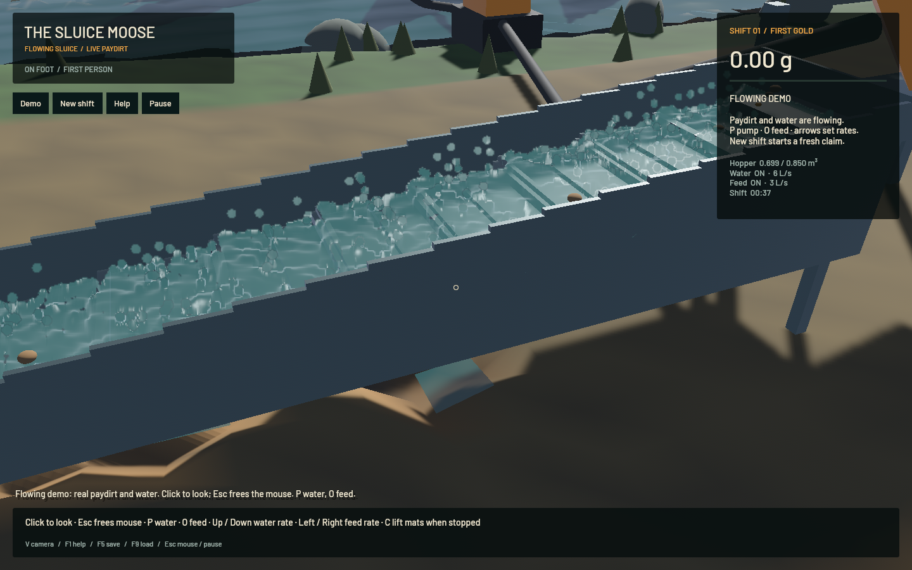
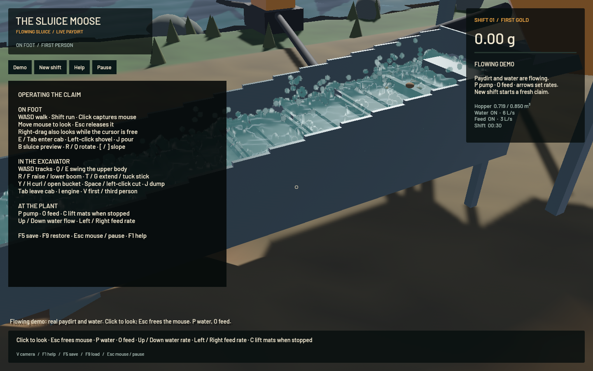

# Flowing demo, blended water and controls — 20 October 2026

The packaged application opens beside an installed sluice already washing finite paydirt. The Demo button restarts this view, New shift starts an untouched claim, and Help/Pause are clickable. Demo saves use a separate file from the mining shift. Click the scene to capture mouse look; Esc frees the pointer. Normal play stops movement on focus loss and while help is open.

The previous particle spheres are replaced by a screen-space fluid surface: particle nearest depth, two separable bilateral smoothing iterations, depth-aware upsampling, and a single shaded composite tested against scene depth. The live FLIP state is read only. Detached spray remains three-dimensional. A reusable upload buffer caps rendering at 65,536 sampled particles; half-resolution depth/blur targets are allocated only on resize. The original FLIP/APIC, DEM and terrain SWE/erosion/transport/collapse code is unchanged in this update.

The demo fixture contains an actual solver-warmed shift: three finite cuts from the terrain supplied the hopper, then 3,362 original FLIP substeps and 560 terrain steps advanced the model to 28.02 simulated seconds. Water and gangue had reached the outlet, 0.084 m³ had been processed, and 0.725 m³ remained in the hopper. The full particle/affine/contact/terrain state is embedded as a losslessly compressed normal save; generation is reproducible using `make_demo.rs`.

| Final standalone demo check, 1440×900 / M2 Max | Result |
|---|---:|
| Mean rendering rate | 57.43 FPS |
| Sampled frames after warmup | 811 |
| Actual simulated water particles | 124,168 |
| Rendered particle proxies | 62,084 |
| Gold ledger error | 4.55e-12 g |
| Particle centres below floor threshold | 1 |
| Fluid render passes ready | passed |

[Timing receipt](2026-10-20-flowing-timing.json) · [Native input receipt](2026-10-20-controls.json)

Controls now agree with Bevy's right-handed camera basis: D strafes screen-right, D turns the tracks right, and E swings the upper body right. Tests compare resulting movement against the actual camera transform, including multiple headings. Short key taps are retained across a busy solver interval; on-foot inputs cannot leak into cab joints during entry. Walking resolves horizontal axes separately so a blocked diagonal can slide along equipment. Placement colour uses the same complete validation as placement commit.

The native integration check passed all 18 behaviours: mouse-look request/direction, one-frame walking taps, strafing, help blocking, both scene buttons, cab entry/exit, held joints, tracks, pause/resume, live F5/F9 and balanced gold. It feeds synthetic Bevy input and toolbar interactions through the application and real worker/solvers. It does not claim OS keyboard delivery or a manual playtest. The scripted mode leaves the desktop cursor free and does not alter window focus; normal focus/cursor protection is exercised separately by CPU input-system tests. Early harness attempts exposed background focus and a scene-dependent capture deadline; those failed checks were preserved and corrected rather than counted as passes.

22 CPU regressions, strict targeted Clippy, mining-crate formatting, the native build, locally signed app packaging and launcher syntax checks passed. The six earlier GPU regressions remain documented in the first-shift report; they were not counted as rerun here. The original solvers were exercised by fixture generation and by the live native restore. All builds/tests/game runs were sequential, with one compiler job. No new WindowServer/panic report appeared; this does not establish a fix for the prior macOS incident.

The simulation remains slower than real time under load. Weighted grain parcels/recovery and vehicle dynamics retain their previously documented limitations; this update improves presentation, input and startup inspection. Existing legacy workspace formatting is still a separate CI failure tracked as `sluice-legacy-fmt`.
