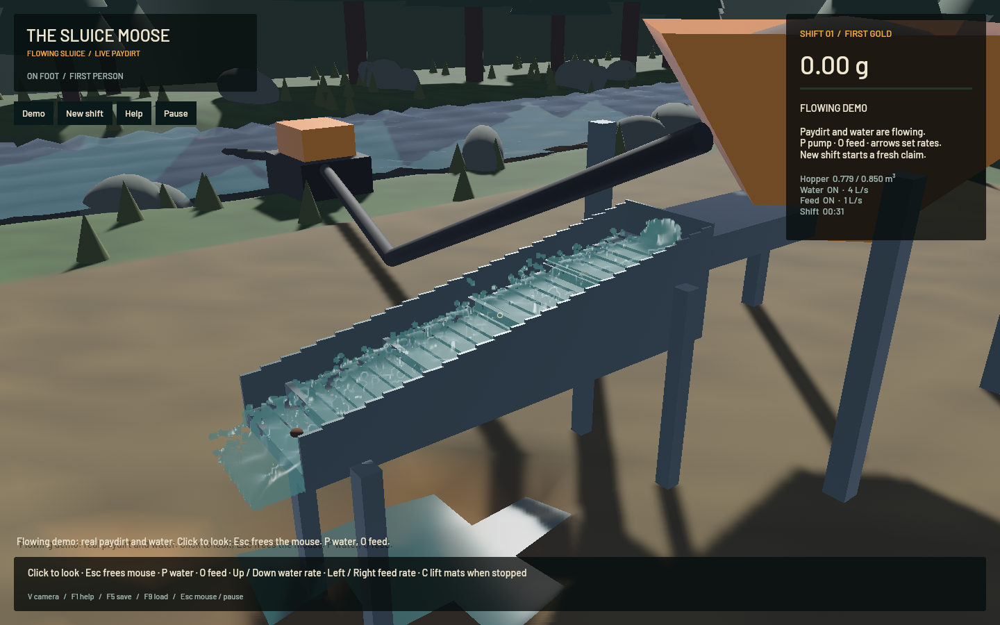

# Original sluice flow restored — 20 October 2026

The reference is the standalone sluice in `origin/main:crates/game/src/main.rs` at `3af9f06`, compared with the playable adapter at `79f560f`. The original `detail_zone` world example uses a separate 2 cm setup. This change restores the standalone sluice setup in new playable shifts and in the bundled running demo.

The playable adapter had enlarged the channel, doubled cell spacing, reduced its slope and substep count, removed the downstream drive, and ended simulation at the metal outlet. New shifts use the original 150×52×40 geometry cells at 1 cm spacing, a 12-cell outlet buffer, 26 cm floor drop over 1.5 m (about 9.8°), original 32 cm riffle spacing/3 cm height/2 cm thickness, 40 cm slick plate, and four substeps per 1/60-second domain tick. Pressure remains 80 iterations and water FLIP/PIC remains 0.95. The original sheet inlet footprint, drop and velocity are restored with deterministic samples. Horizontal drive is again gravity × floor drop / channel length, as in the standalone demo.

The underlying original FLIP/APIC, water density projection, pressure/advection, CPU DEM contact integration and terrain SWE/erosion/transport/collapse remain in use. The original demo's sediment packing/porosity heuristics are disabled for this profile, matching its setup; CPU DEM still handles grain contacts on every substep. Restoring the old horizontal drive is behavioural parity, not proof that gravity/drag/recovery are physically calibrated.

Existing saves without a hydraulic profile load as Legacy. Their 3.4 m channel, 2 cm grid, two substeps, water particle volumes and positions remain unchanged. Capacity accounting, collision geometry, placement guides, clearances, render radius and water return all use the saved profile. No live particle state is silently rescaled.

The requested blended particle surface is retained. Render-only velocity prediction spans at most one authoritative tick, follows the worker's measured cadence and stops on pause/reset. This reduces visible stepping without increasing physics throughput or writing predicted positions into the save. Both original particle depth and smoothed surface depth are tested against opaque geometry, preventing smoothing from painting water over a side wall. The feed chute now ends before the inlet, and the demo view shows the whole channel and outflow.

## Measured scene comparison

Both scenes were warmed by the real solver for 28.0167 simulated seconds. The previous running demo used 6 L/s water and 3 L/s feed; the restored compact demo uses 3.75 L/s water and 1 L/s feed. Geometry and operating rates differ, so this is a scene comparison rather than a controlled hydraulic or recovery calibration.

| Warmed state | Previous playable | Restored standalone profile |
|---|---:|---:|
| Mean downstream water velocity | 0.0902 m/s | 0.1719 m/s |
| Water moving downstream faster than 0.2 m/s | 11.10% | 43.65% |
| Live water particles | 123,784 | 232,395 |
| Water returned to terrain | 0.04432 m³ | 0.07601 m³ |

The regenerated finite fixture contains 27 grain parcels, 0.028 m³ processed and 0.78119 m³ remaining in the hopper. It ran 6,724 original FLIP substeps and 560 terrain steps. Water accounting error is under 7.4e-11 m³ and gold error under 1e-7 g. The final camera-only reframe preserves the warm-up's fluid/terrain/contact/ledger bytes. Full settings and metrics are in [the receipt](2026-10-20-original-flow-metrics.json).

## Verification

- 25 targeted CPU tests passed, including original geometry, legacy save interpretation, one-tick presentation limits and existing controls/conservation coverage.
- Real Metal tests explicitly run with `--ignored --nocapture --test-threads=1`: original pipeline passed 360 ticks / 1,440 FLIP substeps / 120 terrain steps with live restore and conservation; actual G2P terminal settling passed at 120 and 240 Hz. The default CPU run's ignored GPU tests are not counted as passes.
- All 18 scripted native input/toolbar checks passed, including New shift, cab controls, Demo reset and live F5/F9. These exercise Bevy handlers and the real worker, not OS keyboard delivery or a manual playtest. [Controls receipt](2026-10-20-original-flow-controls.json).
- Final signed standalone application ran from outside the checkout, rendered the custom shaders successfully and captured the running default scene at 1440×900 on Apple M2 Max. Mean rendering rate: 57.26 FPS over 811 measured frames. Live particles: 226,213; render proxies: 56,554; water centres more than 2 mm below the channel's voxel floor: 0; gold ledger error: 9.09e-13 g. [Timing receipt](2026-10-20-original-flow-timing.json).
- Targeted Clippy, rustfmt and whitespace checks passed. The prior-head Linux CI's newer `chunks_exact_to_as_chunks` lint is fixed using stable `as_chunks::<3>()`; the local installed toolchain is Rust 1.95 nightly, while that CI used stable 1.99.
- One local heavy job at a time, one Cargo compiler job, bounded native runs and scoped cleanup. No new panic/WindowServer report; task-owned game/build processes exited. Other tasks' browser/Node services were left alone.

## Remaining limits

The finer simulation still runs below real time. This final default capture advanced 3.65 simulated seconds in 19.77 wall seconds including startup (about 0.18×), while camera/rendering remained responsive. This run includes no new complete mining-to-cleanup operator replay; the earlier full-shift report used the previous hydraulic profile. Performance work is tracked in `sluice-realtime`; recovery, grain parcel representation, bed packing, wall tolerance and slope/drag calibration remain in `sluice-calibrate`.

Full-workspace CI is not certified green: the existing workspace formatting drift remains in `sluice-legacy-fmt`, and the prior-head Linux game job failed `test_dem_density_separation` at 0.0677 m versus its required 0.1000 m. That test and its stepping equations are unchanged from origin/main; the branch's contact save/remove helpers are not called by it. Investigation is tracked in `sluice-dem-ci`. Excavator traction/tipping/force-based digging remain in `sluice-machine-dynamics`.
