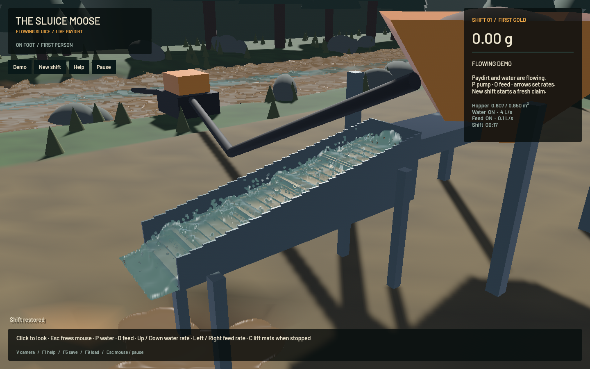
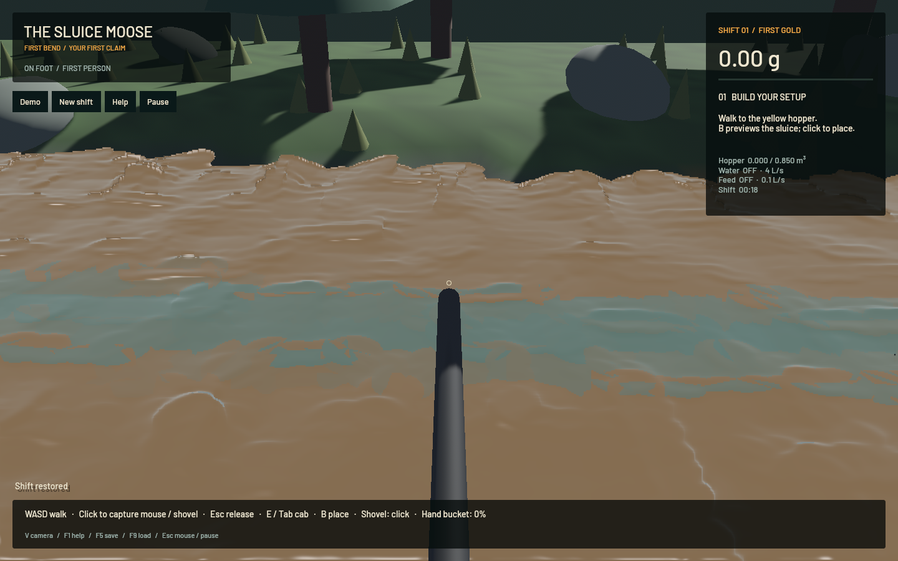

# Terrain-water splats and real-time investigation — 20 October 2026

Terrain-water splats are implemented. **Sustained real-time acceptance still fails** and `sluice-realtime` remains open. The final signed app renders at 57.15 FPS while advancing at 0.746x real time in the default loaded washing scene. Passing rendering and physics regression checks does not turn that result into a real-time pass.

The work continues from `ba4a080` on `codex/direct-mining`, based on verified `origin/main` `3af9f067`. The original dirty checkout and its existing stash are preserved. The user confirmed splat rendering over the existing terrain-flow solver.

## Simulation contract

The sluice retains FLIP/APIC, 1 cm cells, 120 Hz water/contact substeps, 80 velocity-pressure sweeps, 40 density-pressure sweeps, physical grain diameters, parcel-volume inertia, wet/dry DEM contacts, riffle solids and the free outlet. The complete conservative terrain SWE, erosion, settling, transport and collapse pipeline remains authoritative. Particle counts, grid resolution, physical steps and pressure sweeps were not reduced for speed.

River/runoff water uses four bounded surface splats per wet cell, at most 65,536. Their centres, tangent slopes, advection and optics come from saved water level, velocity and suspension. They share the depth/bilateral/composite renderer with the three-dimensional sluice particles. The water mesh and artificial sine-height animation are removed. A close-bank inspection exposed lattice ripples from curved ellipsoid caps; slope-following discs replace those caps. Rendering adds no water volume and never writes to the solver state. Shoreline coverage and grazing-angle optics still need polish, tracked as `sluice-water-polish`.

## Retained overhead reductions

- GPU passes and required particle-range copies share one ordered submission per substep. Five result planes share one bounded mapping/completion callback; intermediate substeps read only the grain suffix, with full particle output on the final substep. CPU contacts still consume the completed state before the next coupled transfer.
- Paired water/mixed P2G accumulation traverses particles once, combines integer phase sums before float conversion and keeps the original water-only field. Direct checkerboard dispatch and cached neighbour boundary types retain every pressure sweep and its arithmetic order.
- Cached 27-cell contact candidates retain sequential index order. Conservative SIMD rejection, the centred-sphere path, cached inverse masses and contact-only SDF gradients retain the reference contact calculation. Exact comparisons cover dense mixed sizes, multiple-sphere clumps and rotated centred spheres.
- One simulation worker accepts at most active plus pending packets. A packet can run two already-due fixed 1/60-second domain steps, applying discrete actions and mouse deltas once. Scheduling debt is bounded.
- Particle/sediment uploads follow fluid revisions. Exact terrain mesh-input comparisons avoid unchanged bank uploads. Restoring a shift changes a generation token, so paused restores and cleanup invalidate cached visuals even when solver counters match.
- On macOS, unpaused simulation owns one user-initiated process activity that permits idle system sleep, released on pause/exit. Ordinary user-initiated QoS applies to the one solver thread. No workstation configuration or real-time scheduling policy is changed.

## Final native measurement

Default flowing demo, five seconds of warm-up, then one measured minute at 1440x900 on Apple M2 Max. This final run had no stack sampler attached. It wrote exactly one receipt, closed normally and returned exit code 1 for the unmet performance target.

| Measurement | Result |
|---|---:|
| Measured wall time | 60.019 s |
| Simulated time advanced | 44.767 s |
| Simulation/wall speed | **0.746x — failed** |
| Mean render rate | 57.15 FPS |
| p95 frame time | 24.67 ms |
| Water particles | 121,920 |
| Grain parcels | 1,995 |
| Terrain-water splats | 10,147 |
| Mean downstream water speed | 0.379 m/s |
| Water-ledger error | 0.0 m³ |
| Absolute gold-ledger error | 4.55e-13 g |
| Worker busy fraction | 97.8% |

The gate requires at least 0.98x simulation/wall speed, 50 mean render FPS, ready water rendering and balanced water/gold. See the [native receipt](2026-10-20-realtime-native.json). Rendering passes; physical throughput does not. One-second rates start around 0.9x and fall as the bed develops. The worker remains busy, so expanding its queue cannot solve the deficit.

A separate ten-simulated-second probe starting from a native endpoint also failed without rendering: 0.814x, with 2,236 final grains. It measured 12.68 ms fluid/readback and 5.54 ms DEM per domain tick. This is a matched starting-state diagnostic followed by further bed evolution, not the same measured native interval. See the [headless receipt](2026-10-20-realtime-headless.json). A different earlier dense fixture reached 0.948x with 1,956 final grains; short probes are diagnostic evidence, not sustained native acceptance.

## Verification and limits

- 232 affected-package CPU/integration/doc checks pass. App/worker checks were rerun after cache-generation changes; app sampling checks were rerun after the final terrain-splat change.
- Five explicitly executed Metal checks pass: uniform momentum/volume and batching; exact nonuniform mixed water/quartz/gold transfers, APIC state and range readback; exact pressure-cell equivalence for odd extents, three boundary masks and 1/7/40/80 sweeps; full excavation/pumping/terrain/FLIP/DEM/live restore; physical size/density/dry settling at 120/240 Hz.
- All 18 [native Bevy input/toolbar/save checks](2026-10-20-realtime-controls.json) pass. They use synthetic Bevy events; OS focus and OS key delivery are not exercised. Normal focus/cursor logic has separate input-system tests.
- The default-demo capture renders 56.27 FPS, reports zero particle centres more than 2 mm below the voxel floor, restores the running save and keeps the gold ledger balanced. See its [timing receipt](2026-10-20-realtime-demo-timing.json).
- The world-only riverbank capture loads a valid fresh shift with only player/camera pose changed, has zero sluice particles and reports ready water rendering at 57.72 FPS. See its [receipt](2026-10-20-terrain-splats-timing.json).
- Targeted formatting, strict Clippy and signed app packaging pass. Full-workspace formatting has pre-existing failures tracked separately; no full-workspace pass is claimed.
- The final benchmark exits both success and failed-performance cases normally and writes one receipt. A short empty-shift run verifies successful shutdown; it is not a loaded washing performance test. An intermediate one-shot guard timed out after writing a failed receipt; the corrected guard repeats only the exit signal across frames, and the final minute verifies the fix.
- The complete dig-to-cleanup operator route was not rerun at the current physical feed. The earlier [complete first-shift replay](2026-10-20.md) predates the latest feed/profile. Recovery calibration, multilayer bed packing, first-shift pacing and force-based excavator dynamics remain open.

## Excluded experiments and workstation checks

Individual active-cell pressure lists, occupied pressure tiles, refittable contact trees, dynamic size indexes and compact contact storage did not deliver sufficient measured gains. A paired temporal pressure tile passed a small comparison but timed out at full grid size; it was removed. Micro-grain shadow removal did not materially help and was removed. Hardware timestamp queries returned zeros on this adapter and were not accepted as timing evidence. Backups of experiments remain outside the repository.

Heavy work was sequential, with Cargo `--jobs 1`, one native app at a time and one test thread. Native checks had finite supervisors, did not activate windows or capture the desktop cursor, and monitored new crash reports. No new panic/WindowServer report appeared. An initial dependency-build timeout was diagnosed and resumed with a larger finite bound; timeouts and failed performance checks are retained as failures, not passes. The remaining cost is dominated by fluid/readback and the developing packed bed; reducing that cost while retaining the simulation contract remains `sluice-realtime`.

## Native views

