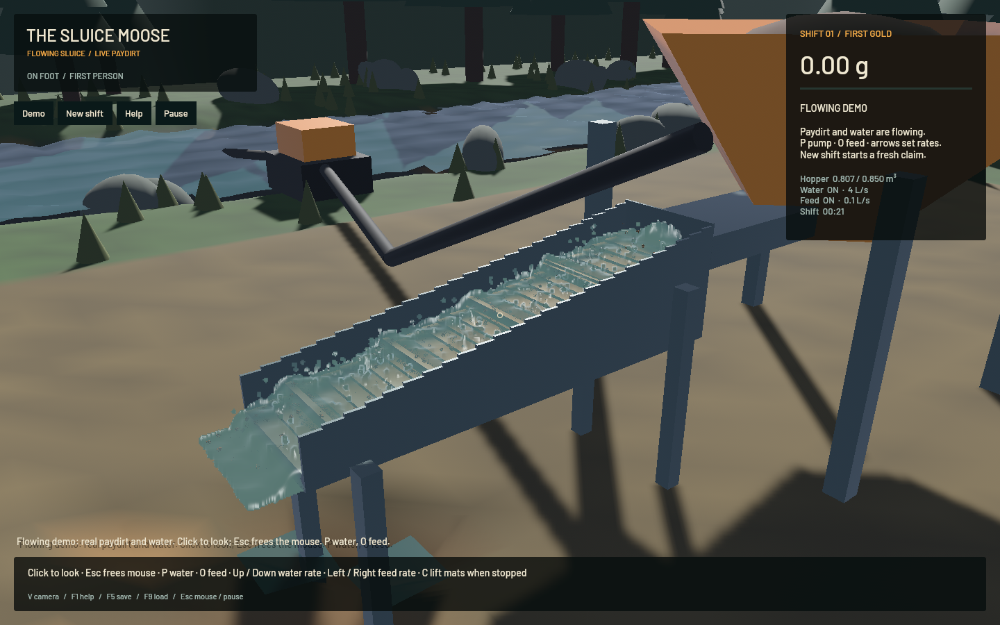

# Sluice water, grain representation and riffle dynamics — 20 October 2026

The user reported slow water, oversized/unrealistic sediment and little riffle behaviour in the original-flow checkpoint `05cffd3`. This change keeps the original FLIP/APIC pressure/advection, CPU DEM contacts and terrain SWE/erosion/transport/collapse. It changes physical coupling, representative sediment, GPU scheduling and presentation.

## Confirmed causes and changes

Density correction multiplied every water velocity by 0.95 on every fluid substep, including zero-correction particles. This was an artificial momentum sink. Correction now preserves velocity. The former constant 1 m/s velocity limit is replaced with a limit derived from timestep and cell spacing. New granular shifts use vertical gravity and inlet momentum; the extra horizontal force that duplicated the resolved ramp's gravity is retained only for older saves.

Every substep previously performed full CPU/GPU copies and many queue submissions. Ordered submissions and pressure sweeps are batched, preserving all 80 velocity-pressure and 40 volume-pressure iterations. Water remains on the GPU between four substeps; intermediate readback/upload covers only the sediment range needed by CPU DEM contacts. New shifts run fluid/contact substeps at 120 Hz, with a fluid update every 1/30 second. Terrain and domain controls retain their existing cadence. Water presentation follows that fluid cadence and predicts at most one fluid update. Camera and rendering do not advance authoritative physics.

The previous two-litre representative parcels were displayed as centimetre-sized balls and used fixed class settling speeds. New feed uses two-millilitre weighted parcels, physical diameters (sand 0.2–1.2 mm, gravel 1–6 mm, gold 80–500 micrometres), parcel volume/mass in momentum transfer and DEM, and diameter/density-dependent slip. Trace gold accumulates conservatively until an actual grain can be emitted; remaining assay stays in the ledger and returns to the hopper on stopping feed. Existing saves retain their prior parcel interpretation through defaulted serialization fields.

Locally sampled water occupancy controls buoyancy/drag and wet/dry contact friction; dry grains fall under gravity. Slow, floor-supported sediment contributes a volume-rasterized bed fraction, Darcy resistance and dense-cell obstruction to water. DEM uses a spatial neighbour search above 64 clumps, mass-weighted normal impulses and a contact tolerance small enough for fine grains. Cleanup requires settled material and only collects the mat section; stopping the pump no longer grants every airborne/upstream grain as concentrate. Cleanup rebuilds cached contact templates.

Sediment presentation uses three combined meshes containing sampled grains at their physical size, with flattened gold, instead of oversized sphere entities. Sampling is bounded and does not change material quantities. Water optical transmission depends on scene depth and suspended fines, so shallow water can reveal the bed and sediment colours the flow. Optical constants are visual tuning, not measured turbidity calibration.

The size-dependent slip uses the explicit Ferguson–Church equation with C1=18, C2=1 and water viscosity 1e-6 m²/s. Those are the paper's intermediate/natural-grain parameters; flake shape is not yet resolved in the drag law. [Ferguson & Church (2004), original paper](https://geoweb.uwyo.edu/geol5330/FergusonChurch_GrainSettling_JSR04.pdf). The implementation combines weighted mixture transfer and bed feedback; it is not a fully resolved, validated two-way CFD–DEM model. [Robinson, Luding & Ramaioli (2013)](https://arxiv.org/abs/1301.0752) illustrates the separate validation required for coupled fluid/particle sedimentation. Riffle geometry and quiet regions affect sluice operation, but a paper's optimum for one geometry is not a universal setting. [Yin et al. (2024), sluice CFD study](https://journals.umat.edu.gh/index.php/gmj/article/download/700/186).

## Controlled real-GPU comparison

`cargo run -p mining-physics --example riffle_probe -- metrics.json` runs three cases serially through the actual solver on Apple M2 Max. Each starts with an empty channel, warms water for eight simulated seconds, injects 32 gold and 32 quartz tracers of equal 0.3 mm diameter, then advances another eight seconds. The bare case removes only riffles. Samples cover the downstream lee regions at x=0.42–1.35 m and below 3.5 cm above the reference floor; reverse flow means vx < -0.02 m/s. Slow means total speed below 0.15 m/s. The reported crest region in the bare case is the same spatial band, without a physical crest, and is not interpreted as crest flow.

| Case | Mean downstream water | Crest velocity | Reverse pocket samples | Slow pocket samples | Gold still in channel | Quartz still in channel |
|---|---:|---:|---:|---:|---:|---:|
| Riffles, 3.75 L/s | 0.381 m/s | 0.546 m/s | 7.46% | 22.48% | 100% | 84.38% |
| Bare channel, 3.75 L/s | 0.493 m/s | — | 1.49% | 8.62% | 46.88% | 3.13% |
| Riffles, 7.5 L/s | 0.512 m/s | 0.814 m/s | 10.03% | 26.07% | 100% | 53.13% |

These are finite-time residence results, not final recovery efficiencies. The experiment demonstrates resolved backflow/quiet pockets, geometric retention and flow-dependent gangue washout. It does not establish a correct industrial gold recovery curve; no gold left the riffled channel in this short test. Water accounting error is zero at reported precision, gold error below 1.9e-12 g. [Raw matrix](2026-10-20-riffle-matrix.json).

## Performance and verification

The prior warmed scene advanced 2 simulated seconds in 15.08 wall seconds (0.133×); fluid work/readback averaged 120.5 ms per domain tick. The controlled new runs completed 16 simulated seconds in 18.12–23.46 wall seconds (0.68–0.88×). These scenes contain different particle counts and loading, so they are diagnostic measurements rather than a controlled speedup claim. Renderer FPS is reported separately in the native receipt.

The final finite fixture is a normal Session save warmed for 12.0167 simulated seconds with the real solvers. It contains 120,278 water particles and 1,025 sediment parcels, 1.2 L processed, 0.80799 m³ remaining in the hopper and 1,440 fluid/contact substeps. The chute uses a continuous deterministic footprint with separate material samples, replacing coincident spawns and a repeating 40-lane pattern. Both real gangue and gold have reached tailings. [Fixture receipt](2026-10-20-riffle-fixture.json).

The final warm loaded probe advanced 2 simulated seconds in 3.315 wall seconds (0.603×), with about 1,068 sediment parcels. Per-domain-tick means: fluid/readback 19.65 ms, DEM 4.69 ms, preparation 1.84 ms, finish 0.56 ms and terrain 0.88 ms. Averaged stages exclude some domain/worker overhead and do not sum exactly to wall time. [Phase timing](2026-10-20-riffle-flow-timing.json).

The signed final standalone app ran outside the checkout at 1440×900 on Apple M2 Max. Its uninterrupted default capture measured 55.92 rendering FPS over 811 frames; 120,779 water particles, 60,390 surface samples, zero water centres more than 2 mm below the voxel floor, and a gold error of 4.55e-13 g. It advanced 9.57 simulated seconds over 20.11 wall seconds including startup (0.476×). Physics is still below real time; higher rendering FPS is not a throughput pass. [Native timing](2026-10-20-riffle-timing.json).

- 133 CPU tests passed: 104 sim3d library tests, 16 mining-sim tests, four mining-physics tests and nine app tests. These include conservative trace-gold emission, noncoincident feeding, cleanup eligibility, legacy saves and deterministic spatial contact equivalence.
- Three actual Metal tests explicitly passed with `--ignored --nocapture --test-threads=1`: ordered batching/momentum/volume preservation/range readback; diameter/density/dry settling at 120 and 240 Hz; original terrain/FLIP/DEM integration with live restore and balanced ledgers. GPU tests ignored by the normal CPU run are not counted as passes.
- The native keyboard/mouse/toolbar suite passed 18 synthetic Bevy-handler checks, including cab controls, focus/help/pause handling, Demo reset and F5/F9. It does not inject OS keys or certify a manual playtest. [Control receipt](2026-10-20-riffle-controls.json).
- Targeted strict Clippy, rustfmt, whitespace checks, app build and ad-hoc signing verification passed. Shared particle metadata keeps the G2P storage-buffer binding requirement at the original 16.
- Work remained sequential with one Cargo compiler job, bounded task-owned native runs, crash-report monitoring and scoped cleanup. The older demo and other chats’ tests were allowed to finish before further heavy work when both slots were occupied.

The prior pushed head's Direct-control mining CI passed. Its full-workspace Format job and legacy game density-separation job failed; those remain tracked in `sluice-legacy-fmt` and `sluice-dem-ci`. Results for this new pushed head must be checked separately.

## Remaining limits

The 1 cm fluid grid and weighted DEM packets do not resolve sand pores, detailed riffle turbulence or flake orientation-dependent drag. Bed feedback currently represents slow, floor-supported material; multilayer packing, interparticle tangential friction, screening, fine gold loss, a full slope/flow/feed/size matrix and experimentally measured recovery remain in `sluice-calibrate`. Sustained real-time operation remains in `sluice-realtime`. The smaller physical feed takes much longer to process a full excavator bucket; this change has no new complete dig-to-cleanup operator replay. Plant/load/first-shift pacing is tracked in `sluice-feed-pacing`. Older saves load compatibly and retain their existing material representation; the rebuilt Demo starts the new model.
