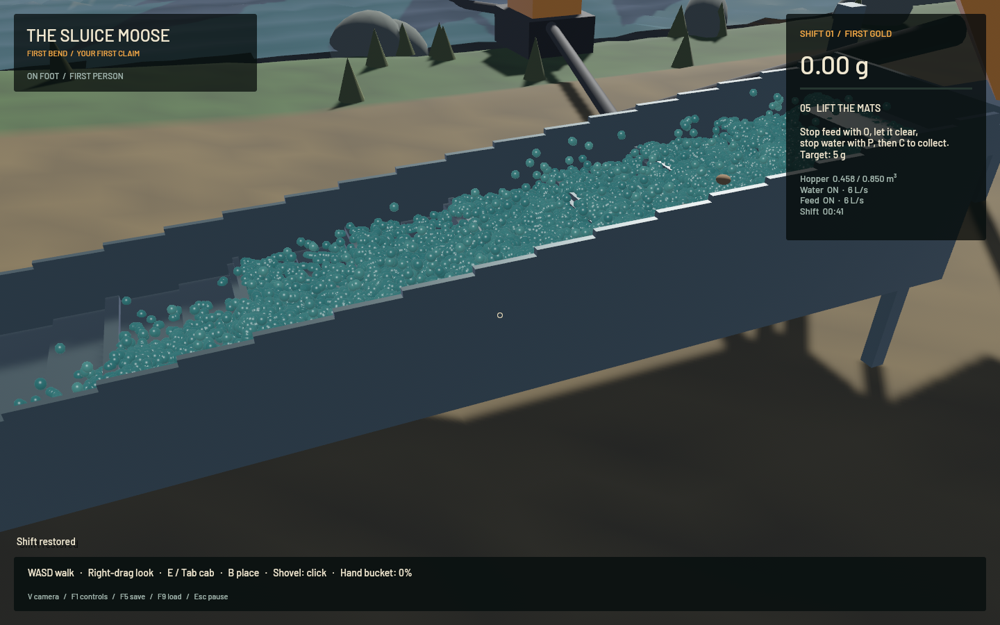
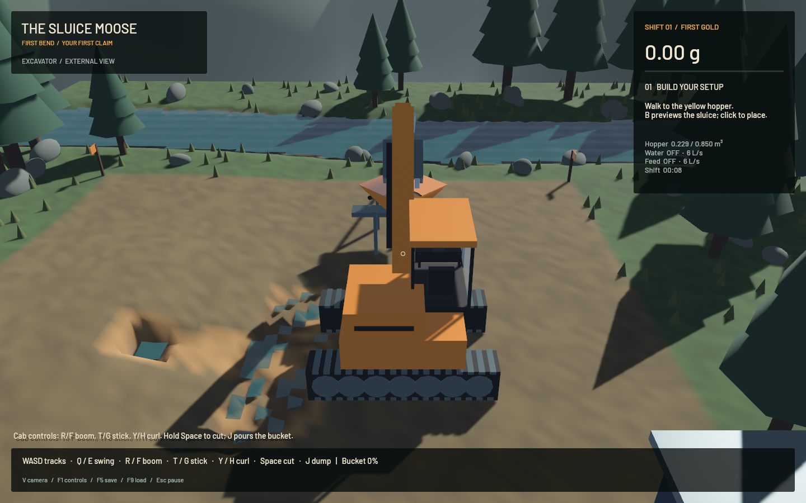

# First Bend native playtest — 20 October 2026

A playable direct-control prototype is available on `codex/direct-mining`, based on origin/main `3af9f067`. The original dirty checkout and stash were preserved. This is a first playable slice, with further performance and physical calibration work tracked separately.

The native scripted operator used the same domain actions and continuous joint axes as interactive play: entered the excavator, cut two finite bucket loads, delivered them to the hopper, walked around the equipment, placed the sluice, started water/feed, inspected washing, restored a live shift, flushed gangue and collected the mats. This was scripted native verification rather than a manual keyboard playtest.

| Result | Measurement |
|---|---:|
| Excavated / delivered / processed | 0.560 m³ |
| Gold collected | 8.208 g |
| Gangue discharged | 0.400 m³ |
| Water withdrawn | 0.650 m³ |
| Gold ledger error | below 1e-8 g |
| Active-wash rendering, earlier surface renderer, 1440×900, M2 Max | 57.47 FPS mean |
| Final particle-splat renderer, live saved shift | 49.62 FPS mean |
| Post-cleanup rendering, 20-second sample | 57.42 FPS mean; p95 21.86 ms |
| Active-wash simulation / wall time | 0.385× |
| Live restore during processing | passed |

The complete native operation passed twice. The final scheduling run, before the particle-splat presentation change, is recorded in [operation.json](2026-10-20-operation.json) and [timing.json](2026-10-20-timing.json).

The final standalone app was subsequently launched outside the repository, restored that actual live shift and rendered 106,660 simulated water particles as 53,330 sphere splats. It averaged 49.62 FPS over 811 sampled frames with the gold ledger balanced and zero particle centres below the collision floor. See [splat timing](2026-10-20-splat-timing.json). This separate check validates the final presentation and embedded shader; the complete operation was not rerun after this presentation-only change.

Water now uses one GPU-instanced batch, capped at 65,536 splats with render-only sampling/radius scaling. Analytic sphere shading and curved fragment depth preserve 3D droplets and occlusion. There are no per-particle scene entities or fitted water heightfield in the sluice. Buffers are reused and updated only when a new simulation snapshot arrives. The original terrain/SWE water remains unchanged. Native screenshots exposed inward Z-face winding in the legacy sluice builder; the presentation adapter corrects it, with all visible triangles now tested against the exact collision solids.

Verification completed sequentially on this Mac: 16 CPU tests across mechanics/storage, bounded worker ordering, camera/pause prediction, all-face mesh winding and bounded 3D splat mapping; four existing GPU sediment regressions; an actual-G2P terminal-speed/water-update regression; and a live original-pipeline GPU check (720 FLIP substeps, 120 terrain steps, restore and conservation). The GPU regressions were explicitly executed with an adapter before the presentation-only changes, not counted as passing from their default ignored state. The CPU regressions and targeted gates were repeated after the final rendering changes. Targeted formatting, strict Clippy for the three mining crates, native build and launcher syntax checks passed. The legacy game dependency still emits its pre-existing unused-constructor warning. Repository-wide legacy suites and future GitHub checks are separate from these targeted results.

Builds used one compiler job. Only one build/test/game workload ran at once. Checks were bounded and monitored against the six pre-existing WindowServer reports; none appeared during this work. No workstation safety configuration or personal-browser state was changed. This does not establish a fix for the earlier macOS hang.

The model retains original FLIP/APIC, CPU DEM and complete GPU heightfield water/settling/erosion/transport/collapse stages. The shader now integrates terminal slip consistently across substep counts and uses mass-correct submerged gravity. CPU DEM owns contact friction. One authoritative simulation worker accepts at most one active and one pending input packet. Rendering receives immutable snapshots; slow physics never queues a burst of overdue ticks.

Limits: the splats are an initial particle presentation with visible individual blobs. Simulation is slower than real time under plant load; weighted grain parcels and class terminal slips are qualitative; this nominal replay captured all tagged gold and does not establish a calibrated real recovery percentage. The excavator remains kinematic. Follow-ups: `sluice-realtime`, `sluice-calibrate`, `sluice-machine-dynamics`.

Cloud CI initially failed before compiling legacy jobs because origin/main used the host-specific channel name `stable-aarch64-apple-darwin`. This branch changes it to portable `stable`. The whole-workspace formatting gate separately has pre-existing drift; targeted mining-crate formatting passes. Cloud checks must be read separately from the local native receipts.
