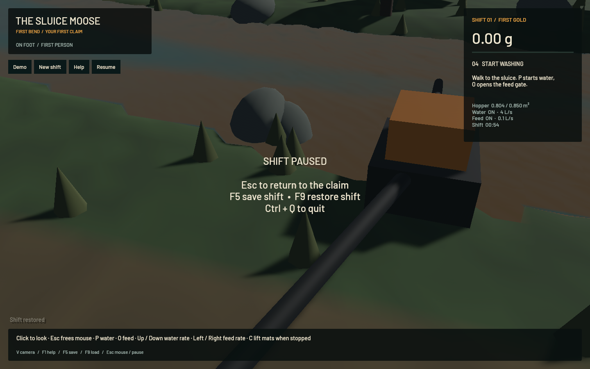
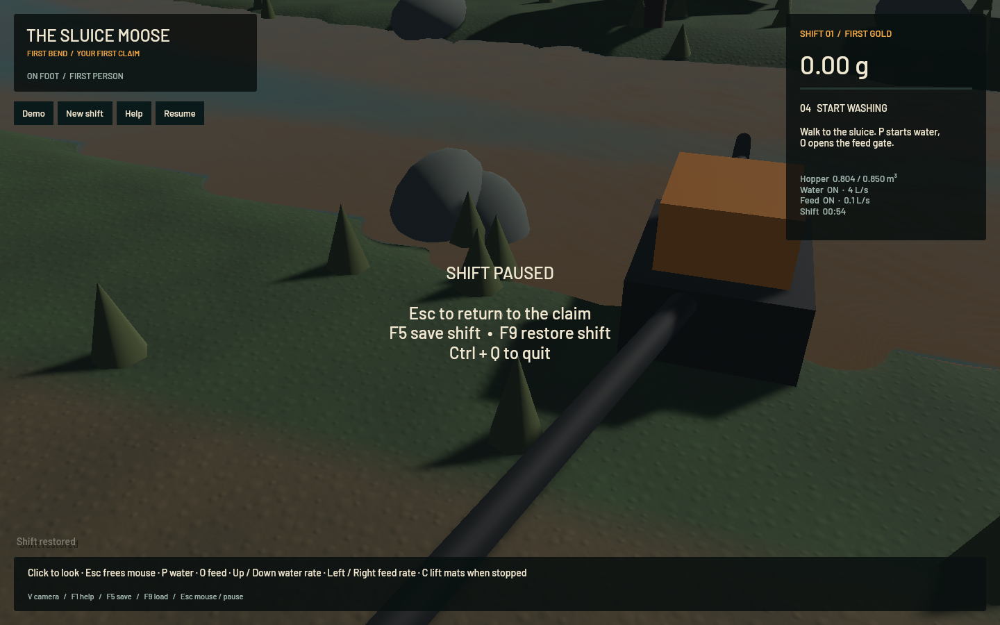
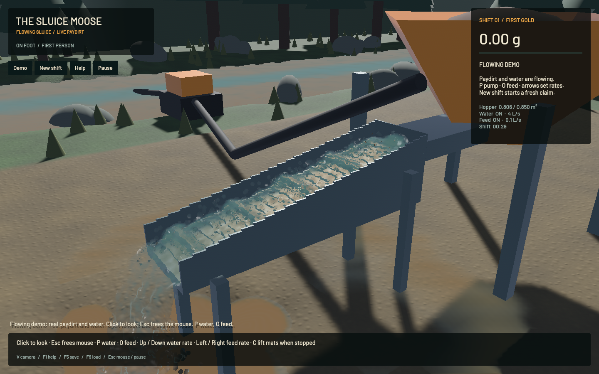

# Finer environment rendering — 21 October 2026

The visible environment was still exposing its 25 cm terrain/flow lattice. This pass separates visual detail from simulation resolution: matching terrain and river geometry at **6.25 cm near the camera**, continuous saved-flow interpolation, and filtered soil/gravel material detail. The existing detailed riffle physics remains intact.

## What changed

- One shared selection chooses at most **16** nearby 4 m terrain chunks. Both the ground and river use four subdivisions per physical cell there, retaining coarse geometry farther away. Selection has 0.75 m hysteresis to prevent boundary jitter from repeatedly rebuilding meshes. Camera/detail revisions invalidate both caches even when the simulation is paused; terrain restoration also checks simulation generation.
- CPU ground meshes and GPU river vertices use the same bilinear corner samples and triangle diagonal. Fine points along a coarse edge remain on that same edge; the geometric regression checks them within 2 micrometres. Shared signed shore depth still limits visibility to the saved wet state, with no phantom dry-corner water.
- River tessellation happens in the vertex shader using the existing one-instance-per-physical-cell data. Fine cells draw 96 vertices, coarse cells 6, and channel/outlet particles still 6. There is one additional draw group in the existing depth pass, with no additional water targets or simulation workers. At most 4,096 fine river instances generate 65,536 fine quads.
- Saved flow now interpolates at shared river corners rather than jumping between per-cell averages. This adds one vec4 to the instance layout (**128→144 bytes**, about 1.25 MiB extra at maximum buffer capacity), avoiding a 16× multiplication of uploaded river instances.
- Two periodic 256² soil/gravel textures add neutral albedo and tangent-normal detail beneath geological vertex colours. Both have all nine mip levels, trilinear filtering and 4× anisotropy, using **699,048 bytes** total texel data. The relief is visual and below 4 mm; it adds no simulated ore or collision pebbles. Fine/coarse terrain share the same material and smoothly reconstructed vertex colour/normal fields.

No source changed in `crates/game`, `crates/sim3d`, `crates/mining-sim` or `crates/mining-physics` relative to `7420567`. Physical terrain stays 25 cm and the FLIP/APIC channel stays 1 cm with the same DEM contacts, riffles, pressure sweeps, time steps and ledgers. The accepted outlet geometry and optical path remain unchanged. This rendering pass meets the 50 FPS render target with those physical solvers.

The alternative of refining physical cells everywhere would spend solver time and memory on visual grain. Fine shading can sit below geometric resolution, as described in [GPU Gems' water rendering model](https://developer.nvidia.com/gpugems/gpugems/part-i-natural-effects/chapter-1-effective-water-simulation-physical-models); [Bevy's repeat sampler](https://bevy.org/examples/assets/repeated-texture/) supports the repeated material detail. This pass uses the repository's installed Bevy 0.17.3 APIs, not a dependency upgrade.

## Same-state visual and performance checks

Baseline is the retained signed `7420567` app. Both apps load the exact same saved particle/terrain state and camera, then apply Pause before physical advancement. The dry-bank view puts material detail in the foreground; the second, wetter view is heavily obscured by saved suspension. The overlay remains visible in the frozen screenshots. These are **render-only comparisons**, not evidence of real-time physical throughput.

| Fixed camera | Baseline FPS | New FPS | Fine river cells |
|---|---:|---:|---:|
| Dry-bank foreground | 57.55 | 57.55 | 1,314 |
| Wetter riverbank | 57.20 | 57.38 | 1,543 |

Both pairs retain exactly 54.000002816 simulated seconds, 111,162 channel particles and 10,236 airborne particles, with zero sluice-water ledger error. These single, refresh-capped runs show no meaningful FPS loss in the inspected views; GPU time, thermal state and statistical significance were not measured.

The native render-only traversal moves the inspection camera between x 8 and 16 m across the shared detail boundaries while keeping physical time fixed. It averages **57.38 FPS**, with **19.81 ms p95**, ending at detail revision 8. This measures native camera/mesh transitions, not OS key delivery or collision-based player walking. The hysteresis/cap/seam/paused-update regressions also pass.

## Active washing

After five seconds of warm-up, the final signed app ran the default paydirt demo for 60.006 measured wall seconds:

| Measurement | Result |
|---|---:|
| Mean render rate | **54.32 FPS** |
| p95 frame time | 42.04 ms |
| Simulated seconds | 35.967 s |
| Simulation/wall speed | **0.599× — real-time gate failed** |
| Channel / airborne particles | 110,445 / 10,534 |
| Grain parcels | 1,793 |
| Terrain cells / fine subset | 3,108 / 822 |
| Sluice-water ledger error | 0.0 m³ |
| Absolute gold-ledger error | 1.36e-12 g |

The benchmark closes normally with exit 1 because physical throughput remains below 0.98×. The rendering target passes. `sluice-realtime` remains in progress; this live minute is not a matched speedup comparison to older runs with different developing beds and host conditions. The separate normal flowing capture reports 54.28 FPS, ready shaders and 0 channel particle centres below the sampled floor threshold.

## Validation and remaining work

All **24 app tests**, targeted strict Clippy, formatting, native shader checks and signed packaging pass. New coverage includes bounded shared detail, boundary hysteresis, fine/coarse seam positions, paused-camera cache changes, continuous corner flow, complete mip layout and periodic valid normal detail. The previous physical solver matrix and full operator replay were not rerun because their source is unchanged. Workspace formatting and DEM-density CI issues remain separately tracked.

This improves presentation, not the resolution of excavatable geology. The physical bank shape and some wet-boundary structure still originate on a 25 cm lattice, and tree/rock meshes remain placeholders. Very muddy water can obscure underwater material detail; it has not been cleared cosmetically. Those art/bank limits are tracked in `sluice-environment-art`; broader water polish remains open. A future physics simplification should state its effect on riffle/gold dynamics and conservation before being called equivalent.

All local heavy work ran sequentially with one compiler job/test thread/native app and finite task-owned crash monitoring. No new panic/WindowServer report appeared. Personal browsers and the original dirty checkout/stash were preserved.

Receipts: [checks](2026-10-21-environment-checks.json), [native minute](2026-10-21-environment-native.json), [camera traversal](2026-10-21-environment-walk-timing.json), [camera metadata](2026-10-21-environment-fixture.json). Additional wet-bank and live-bank captures, saves, logs and signed builds remain in the local environment artifact folder.
