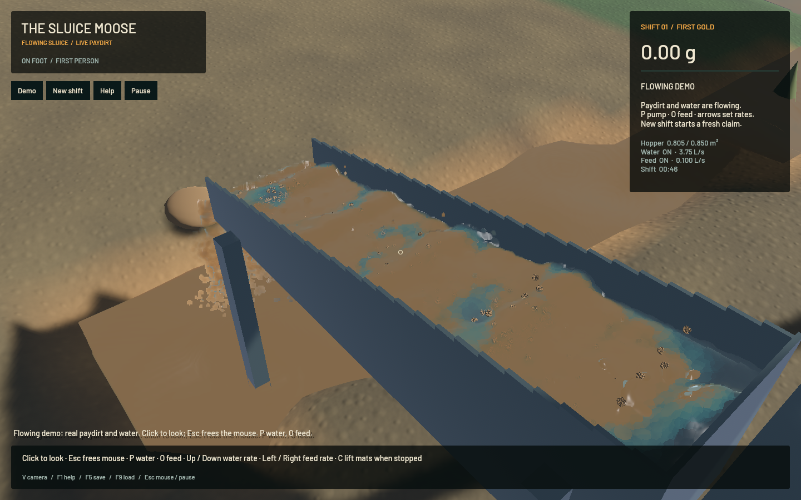
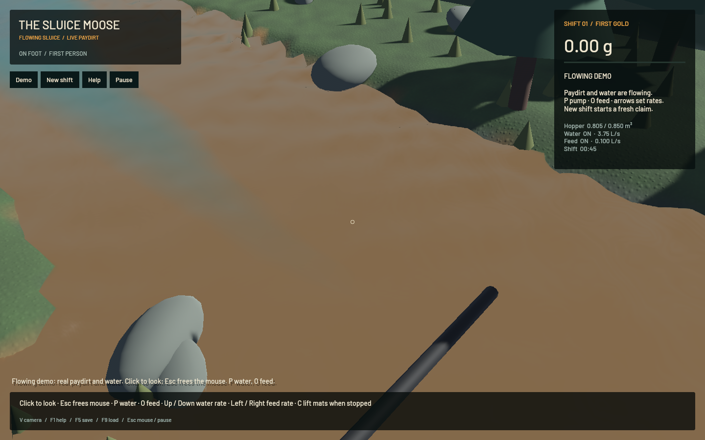

# Longer flow review and correspondence optimisation

The longer native captures confirm continuous downstream transport, but the water rendering is still unfinished. Close views show hard muddy colour patches, reflective blobs at some riffle crests, stippled outlet silhouettes, and a flat-looking river with faceted banks. The transport fix in `e210c9b` should not be described as a complete realism fix.

[Twelve-second sluice close-up, original wall-clock timing](2026-10-21-flow-recheck.mp4)

## What was double-checked

Four bounded native recordings provide **750 GPU frames**: 268 over 12 seconds at the sluice, 175 over eight seconds at the outlet, 178 over eight seconds over the tailrace, and 129 over six seconds at the actual receiving river. Frames and temporal contact sheets were inspected. MP4 durations preserve screenshot wall timestamps. These are native render-output captures, not OS desktop recordings or a human input playtest.

Capture settings are optional and bounded: `--capture-seconds` up to 20, `--capture-hz` up to 40, and presentation-only `--capture-view sluice|outlet|tailrace|river`. The ordinary game camera is unchanged. The initial camera labelled `river` actually framed the tailrace with the main river distant; the final river camera targets the real junction near `(Site::river_center(18.5),18.5)`. Initial capture source/hashes are preserved in the artifact folder, and that first view is reported as **tailrace** here.

The longer sluice run samples 252 distinct fluid states. Population statistics use every water particle in the central region, x 0.3–1.35 m and z 0.07–0.33 m, deduplicating by solver-step count. This avoids treating the deliberately highest 128 tracked particles as typical water:

| Central-water measurement | Twelve-second recording |
|---|---:|
| Mean downstream speed | 0.402 m/s |
| Mean absolute vertical speed | 0.122 m/s |
| Fraction moving upstream faster than 0.05 m/s | 1.95% |
| Fraction above the 5 cm floor reference | 0.035% |

The small elevated subset still often has vertically dominated velocity. Height alone does not establish detachment: some elevated water belongs to a crest or sheet. The reverse-flow fraction is compatible with local recirculation, but does not validate the vortex structure or gold washout model.

Every sampled presentation timestamp advances: no repeated or reversed presentation times in any of the four sampled sequences. Whole-frame underrun counters increase by 1/0/3/0 respectively, so occasional buffer pressure remains; the samples cannot establish that every intervening render frame is free of stalls. Captured cadence is approximately 21–22 FPS with screenshot overhead, separate from normal rendering.

## Optimisation retained

Particle correspondence aligns anisotropic eigenframes across snapshots. Each of six permutations reused dot products, but the old score comparator recalculated them. The new implementation computes the nine axis-pair similarities once, preserving score accumulation and tie order.

In the same bounded 65,536-sample fixture benchmark, median pairing time falls from **6.10 ms to 3.18 ms**; a final repeat gives 3.20 ms. The complete paired-instance byte fingerprint remains `e601ec8f1b7b727d`. Existing birth/death, channel-to-outlet, axis sign/permutation and interpolation regressions pass. Physical positions, velocities, solver parameters and particle counts are not changed by this optimisation.

That microbenchmark creates a second render fixture by displacing positions once with velocity. It exercises correspondence cost; it is not a physical trajectory test. The native recordings and benchmarks run the actual solvers.

The diagnostic high-kernel sampler now serializes JSON only for the selected 128 results. It previously constructed JSON for every candidate before sorting/truncation. This reduces capture overhead; it is not counted as a normal-game performance gain.

Sequential 20-second native benchmarks after five seconds warm-up:

| Measurement | `e210c9b` baseline | Optimised |
|---|---:|---:|
| Mean render FPS | 57.25 | 57.29 |
| p95 frame time | 29.05 ms | 28.64 ms |
| Mean background surface build | 23.90 ms | 21.09 ms |
| Simulation/wall-time multiplier | 0.686× | 0.681× |

The surface worker does less work; overall FPS and simulation speed are essentially unchanged in this single comparison. Both combined benchmarks **fail** the real-time threshold. The final sluice-water residual is zero, whole-world residual is about -10.82 mL, and gold residual is 5.9e-12 g.

A loaded, rendering-free solver probe advances at 0.731×. Average domain-tick costs are fluid/readback 14.07 ms, DEM 5.20 ms (4.53 ms pair contacts), preparation 1.04 ms, terrain 0.97 ms and finishing 0.76 ms. These averages include the 30 Hz fluid cadence within the 60 Hz domain ticks. They identify fluid work/synchronisation and grain contacts as larger remaining targets; they are not individual GPU kernel timings. Further changes require measured improvements and equivalence/conservation checks while retaining 1 cm cells, 120 Hz FLIP/DEM and 80/40 pressure/volume sweeps.

## Remaining work and validation limits

- `sluice-water-optics` tracks hard concentration patches, crest shading and detached-water coverage. The current depth pass selects the nearest kernel's optical sample while the thickness pass accumulates volume support. Optical-depth-weighted accumulation is a concrete hypothesis to test, not an implemented or measured fix.
- River shading and bank transitions remain visibly coarse. No detailed river reconstruction or terrain solver change was made here.
- `sluice-realtime` remains open. Original fluid, riffle, sediment and terrain solvers retain their settings; no physical stages were removed.
- `sluice-phase-coupling` and empirical calibration remain open; these captures do not validate conservative interphase exchange or real slurry rheology.
- The sluice and tailrace recordings exit normally. Outlet and receiving-river recordings save all frames/receipts, then stall during Bevy shutdown and require their scoped supervisor timeouts. That is a failure of process exit, tracked as `sluice-render-exit`; recording success is reported separately. Normal benchmarks exit with their expected real-time-gate failure rather than hanging.

The final source passes all **31** game/render checks including the explicitly enabled profiling test, strict package Clippy and scoped formatting. Native control validation, signed-build matching, crash baseline and final push verification are recorded in the [numeric receipt](2026-10-21-flow-recheck.json). Full frames, four videos, source snapshots and logs are retained at its artifact path.
