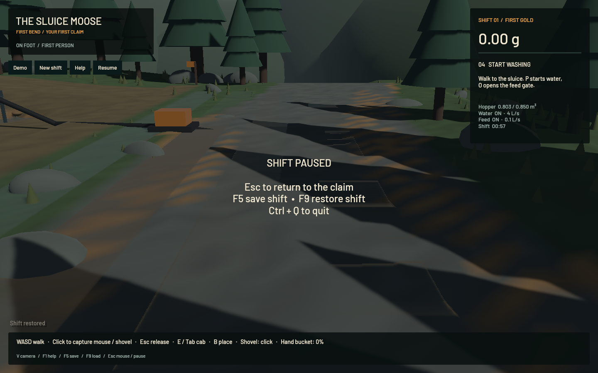
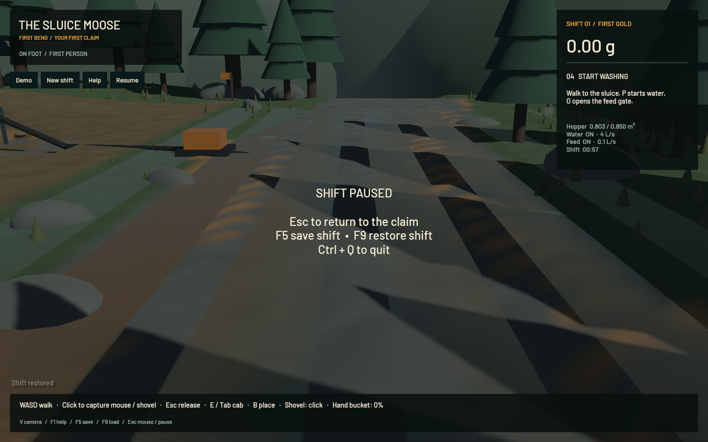
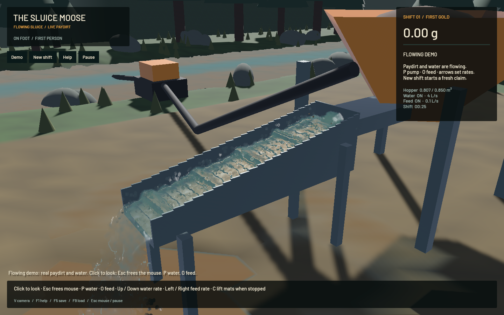

# Shallow water visibility — 21 October 2026

Water visibility was being limited by presentation thresholds rather than requiring a smaller physical grid. River/runoff cells were omitted below 1 mm, fragments clipped below 0.8 mm and surface coverage faded over 25 mm of view-ray thickness. Fixed reverse-Z depth tolerances also hid increasingly deep films with camera distance; particle depth smoothing could pull river water below the visible terrain.

## Retained correction

- Terrain water now starts rendering above **0.1 mm** and reaches full surface coverage at **0.5 mm** of vertical depth. Full coverage still uses transparent water optics. Layers thinner than 0.1 mm remain excluded as numerical residue.
- Channel and river occlusion use a 0.1 mm metric view-depth tolerance. The accepted airborne outlet retains its previous two clip-space occlusion checks, normal reconstruction, optics and geometry.
- River pixels reconstruct reciprocal view depth from raw samples rather than passing through the particle bilateral blur. This is exact within a projected plane; neighbours at triangle creases/silhouettes can still produce small shoreline artifacts. Full-resolution solid depth continues to reject water behind equipment.
- Shore height extension is constrained by the saved depth at each corner. A saved-dry corner cannot gain positive film coverage from an extrapolated wet surface. The first live iteration exposed this defect as rectangular runoff; it was corrected and covered by a regression before the final checks.

**Neither simulation grid changed:** terrain remains 25 cm and FLIP/APIC remains 1 cm with the same DEM riffles, time steps, pressure sweeps and particle state. There is no source change relative to `afbf908` in game, sim3d, mining-sim or mining-physics. This improves rendering of shallow saved water; it does not claim submillimetre physical resolution in the sluice. Halving terrain cell size across the same area would require about four times as many cells, so that cost is avoided here.

No new textures, workers, draw passes or instance capacity were added. Caps remain 65,536 fluid kernels and 16,129 terrain cells. Four raw-depth neighbour reads for river reconstruction replace the previous repeated filtered-depth reads used for river normals.

## Matched frozen scene

The baseline uses `afbf908` plus the same `--freeze` capture harness. Both apps load one diagnostic save with 0.25, 0.5, 1, 2, 5 and 10 mm strips on a 1.5% sloping plane. Load followed by Pause is applied in one worker packet before stepping. The pause overlay remains visible in both screenshots; these are **render-only measurements**, not active physics throughput.

Both finish at exactly 57.30000298842788 simulated seconds with 110,104 channel particles and 11,414 airborne particles, the same camera and zero sluice-water ledger error. Interior pixel probes show visible changes in all six strips, including 49/49 sampled pixels in each of the 0.25 and 0.5 mm strips. These colour differences demonstrate visible rendering changes, not calibrated thin-film dynamics.

| Measurement | Baseline | Final |
|---|---:|---:|
| Mean FPS | 57.45 | 55.54 |
| Render target | 50 FPS | 50 FPS — passed |
| Frozen simulation time | 57.300002988 s | 57.300002988 s |

The final frozen run is 3.32% slower in this single comparison. No zero-cost or statistically established performance claim is made: the window is refresh-capped, host activity can vary, and GPU timings were not collected. Both meet the render-rate target without grid refinement.

## Active washing

Five-second warm-up, then the final app ran the normal flowing paydirt demo for 60.024 measured seconds:

| Measurement | Result |
|---|---:|
| Mean render rate | 54.91 FPS |
| p95 frame time | 39.99 ms |
| Simulated seconds | 39.033 s |
| Simulation/wall speed | **0.650× — real-time gate failed** |
| Channel water particles | 111,162 |
| Airborne water particles | 10,236 |
| Grain parcels | 1,822 |
| Rendered terrain cells | 3,125 |
| Water-ledger error | 0.0 m³ |
| Absolute gold-ledger error | 2.27e-12 g |

The native benchmark returned exit 1 for physical throughput below 0.98× and closed normally. The 50 FPS rendering gate passes; `sluice-realtime` remains in progress. The developing bed and host conditions differ from older live minutes, so those are not matched physics-speed comparisons. The final normal flowing capture renders 54.30 FPS with ready shaders, zero sluice-water ledger error and 0 particle centres below the sampled floor threshold.

## Checks and limits

All **19 app tests**, targeted strict Clippy, formatting and signed packaging pass. New regressions cover bounded 0.5 mm film coverage without state mutation, exclusion of 0.05 mm residue and keeping saved dry corners dry. Existing outlet exclusion and input/pause/restore regressions also pass. The unchanged broader physics matrix and full operator replay were not rerun; this is a rendering-only correction. Prior full-workspace formatting and DEM-density CI issues remain separately tracked.

Every build, native capture, benchmark and lint check ran sequentially with one compiler job/test thread and finite task-owned supervisors. No new panic/WindowServer diagnostic appeared. The original dirty checkout/stash and personal browser were preserved. Broad river art and coarse-bank geometry polish remain open.

Receipts: [checks](2026-10-21-shallow-checks.json), [native minute](2026-10-21-shallow-native.json), [film probes](2026-10-21-shallow-film-probes.json), [fixture metadata](2026-10-21-shallow-fixture.json). Diagnostic saves, signed apps, generation/probe scripts and rejected first-pass captures are retained outside git in the shallow-water artifact folder.
