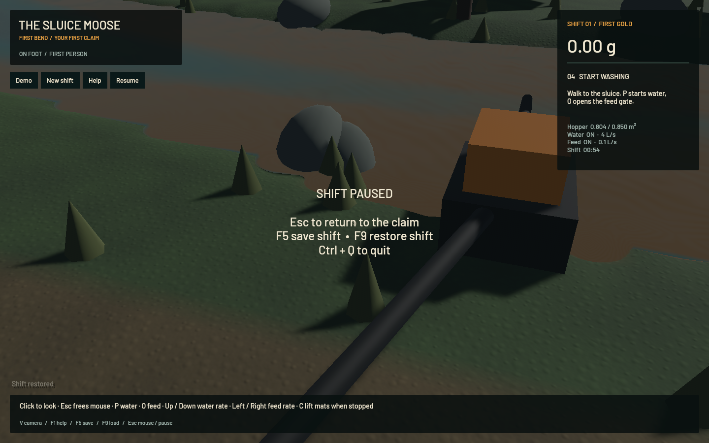
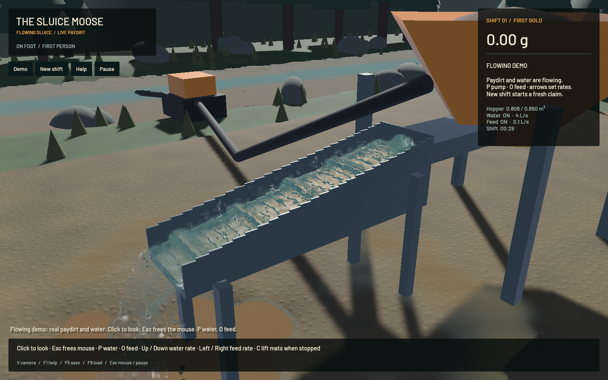

# River contact and shoreline — 21 October 2026

The finer terrain still met a coarse-looking water edge. River depth, normals and film coverage were sampled from half-resolution particle targets; the compositor estimated full-resolution depth from neighbouring triangles. Near banks, tiny triangles, wet/dry boundaries and changes in slope invalidated that approximation.

## Correction

River/runoff now rasterizes its existing connected geometry into **full-resolution depth/flow and normal/film targets**, with a separate depth attachment. Composition uses the actual river pixel and compares it with the full-resolution opaque terrain/equipment depth. The last pixel of signed-film and terrain contact fades using screen derivatives, calculated before divergent returns. Reverse-Z sky lanes stay finite. The river uses its continuously reconstructed surface normals directly.

The existing half-resolution particle depth, thickness, bilateral smoothing and accepted outlet optics remain. Terrain samples no longer enter the particle smoothing targets. Existing saved flow and sediment concentration still drive river motion and turbidity.

This costs **one river pass and three targets: 36,288,000 extra bytes (34.61 MiB) at 1440×900**, scaling with the viewport. It adds no simulation worker, particle, uploaded instance or change to the 144-byte instance layout. It avoids quadrupling the particle reconstruction/smoothing buffers.

No physical source changed relative to `a94ac6f`: original FLIP/APIC, DEM/riffles and terrain flow remain. Ground geometry/materials, the particle-depth shader and source wet/dry construction are also unchanged. Visible films still require saved depth above 0.1 mm; uniform 0.5 mm films retain full coverage.

A cell-identity reconstruction trial was rejected because projected subpixel triangles left gaps. A damp-soil tint was also rejected after the live outlet view exposed cell-shaped patches. **Neither experiment is in this build.** This correction improves rendering contact; it does not remodel the physical banks or simulate capillary wetting.

## Native evidence

Both signed builds loaded the identical frozen bank save before stepping. They retain 54.000002816 simulated seconds, 111,162 channel particles and 10,236 airborne particles, with matching ledgers.

| Same-state bank view | Mean FPS | p95 frame |
|---|---:|---:|
| Previous finer-environment app | 57.76 | 19.46 ms |
| Exact river contact | 57.83 | 19.39 ms |

These single refresh-capped runs establish inspected rendering behavior, not a statistically significant speedup or zero GPU cost. The shallow diagnostic still visibly renders the six 0.25–10 mm bands; it is a constructed visibility test, not a natural river. Native live sluice/outlet capture averages **50.58 FPS**, with zero water-ledger error and 0 particle centres below the sampled floor threshold. No OS keyboard-delivery or full operator replay is claimed.

## Sustained washing and checks

After five seconds of warm-up, the final app measured 60.002 wall seconds:

| Measurement | Result |
|---|---:|
| Mean render rate | **52.84 FPS** |
| p95 frame | 47.10 ms |
| Simulated seconds | 39.817 s |
| Simulation/wall speed | **0.664×** |
| Water-ledger error | 0.0 m³ |
| Gold-ledger error | 4.09e-12 g |

Rendering passes its 50 FPS target. The **0.98× physical-throughput target remains failed**, and the benchmark exits 1 for that reason. Different developing beds/host conditions do not establish a matched physics speedup/regression.

All **24 existing app regressions**, targeted strict Clippy/formatting, signed packaging and final native shader checks pass. The unchanged physical solver matrix and a full operator replay were not rerun. Broader legacy formatting and DEM density-separation CI failures remain separately tracked; full-workspace CI is not represented as green.

The bank's larger contour still comes from the 25 cm physical terrain. Some coarse shallow-puddle shapes, muddy-water opacity and placeholder environment assets remain visible; this is not final water art. `sluice-water-polish`, `sluice-environment-art` and `sluice-realtime` remain open/in progress for their respective work.

Local heavy work was sequential, with one compiler job/test thread/native app and finite task-owned crash monitoring. No new panic/WindowServer report appeared. The original dirty checkout/stash and personal browsers were preserved.

Receipts: [checks](2026-10-21-shoreline-checks.json), [native minute](2026-10-21-shoreline-native.json), [fixture](2026-10-21-shoreline-fixture.json), [before timing](2026-10-21-shoreline-before-timing.json), [after timing](2026-10-21-shoreline-after-timing.json), [shallow-film image](2026-10-21-shoreline-films.png). The signed app, saves, rejected trials and logs remain in the local shoreline artifact folder.
