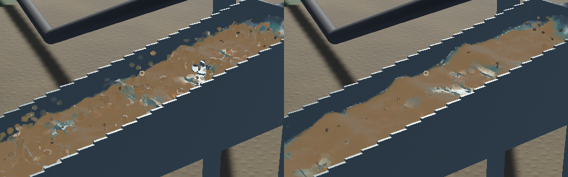

# Riffle water transport and sparse-water rendering

The updated native recordings show a more connected sheet flowing across the riffles, with substantially fewer raised bead outlines. Two defects in the production GPU kernels were reproduced independently and corrected. This is an improvement to the particle simulation and its reconstruction, not an empirical validation of spray or sluice recovery.

[Updated native motion, recorded wall-clock timing](2026-10-21-splash-fixed.mp4)

## Corrected causes

**Volume repair sampled the wrong locations.** The density-position grid stores forward pressure differences on positive faces, at `(i+1,j+0.5,k+0.5)` for X and cyclically for Y/Z. The particle sampler used offsets `(0.5,0,0)` instead of `(1,0.5,0.5)`, shifting all three components by half a cell. A real-GPU linear-field test failed before the correction and passes with the intended face coordinates. Correction still changes positions without introducing per-substep velocity damping.

**Occupied-cell contact snapped water and consumed forward momentum.** The old fallback selected the first available neighbour's centre, preferred same-level/upward cells, and multiplied the entire velocity by 0.3. A controlled packed-bed test reproduced the sideways snap and lost tangential motion. Contact now projects to the nearest free voxel face with a 0.01 mm skin at the 1 cm grid and removes only inward normal velocity. It searches both vertical directions equally. SDF contact, open boundaries, occupied packed-bed cells and external DEM contact ownership remain active.

**Sparse water inherited the bulk reconstruction diameter.** Connected water still uses overlapping covariance kernels. Sparse in-channel samples now blend toward a radius based on their represented water volume, rather than inheriting the approximately 2 cm bulk diameter. The optical kernel weight is recomputed with that radius. No water particles, physical volume, velocities or grain mass are removed. The accepted outlet's reconstruction support is unchanged; its incoming trajectories can naturally change with the corrected upstream solver.

The original 1 cm grid, four 120 Hz FLIP/DEM substeps per 1/30 s fluid update, 80 pressure and 40 volume sweeps, FLIP/APIC, CPU DEM and terrain-flow pipeline are retained. No additional force or restitution tuning was used to force downstream animation.

## Motion evidence

Three six-second runs produced 94, 91 and 93 native GPU frames. The third hides grain meshes while retaining actual sediment dynamics and suspended-fines optics. This distinguishes water outlines from the moving grain proxies. Side-by-side frames and all contact sheets were inspected.

The same intentionally biased selection method as the earlier investigation tracks the 128 initially highest particles in the central channel. Unique states above 5 cm relative to the mathematical floor reference are measured. These are not population-wide statistics, and elevated water is not necessarily detached spray.

| Selected elevated-water measure | Previous A / B | Updated A / B |
|---|---:|---:|
| Unique elevated samples | 208 / 253 | 38 / 31 |
| Vertical speed greater than downstream | 81.7% / 91.7% | 50.0% / 90.3% |
| Mean absolute downstream speed | 0.069 / 0.059 m/s | 0.289 / 0.076 m/s |
| High render kernels with planarity below 0.05 | 48.0% / 46.5% | 6.4% / 6.5% |

The repeated reduction in raised, low-planarity kernels agrees with the more coherent sheet visible in the frames. Run B still has vertically dominated motion among its much smaller elevated sample. The first run's higher downstream speed should not be generalized to every splash. Low planarity is not itself a count of sparse-fallback invocations.

Screenshot cadence is about 15 FPS and includes recording overhead. Videos use recorded wall durations; they are not normal-game FPS measurements. Both ordinary runs advance about 3.8 physical seconds during six recorded wall seconds.

## Verification and remaining limits

- 70 domain, physics-unit and game/render regressions pass. Thirteen GPU tests are ignored in that default command; seven relevant GPU checks were then explicitly run and pass, including APIC transfer, momentum preservation, DEM ownership and the three new projection/contact checks.
- The two new defect reproductions fail against the previous kernels and pass after correction. The open-face coverage check passes both versions. Uniform translation with/without density repair gives mean downstream velocity 0.389973/0.389912 m/s.
- Strict Clippy for the game/physics packages and tests passes; changed Rust files pass formatting. A pre-existing unused-function warning remains in the dependency `game`.
- All 18 synthetic native keyboard/mouse/toolbar checks pass, including pause, demo, live save/restore and the gold ledger. These do not exercise OS focus or physical key delivery.
- A signed native build is retained in the artifact folder. The final 20-second benchmark renders **57.38 FPS**, p95 **30.81 ms**, and advances at **0.678× physical speed**. A sequential comparison with the previous build gives 57.43 FPS and 0.727×. Both fail the combined benchmark's real-time threshold; corrected flow also retains more in-channel water (117,153 versus 105,966 at their respective endpoints). This is not a real-time-throughput fix.
- The updated benchmark's sluice water residual is zero; whole-world residual is about **-10.25 mL** across about 13 m³ stored, and gold residual is **2.3e-12 g**. Existing phase-coupling momentum-budget and experimental calibration work remain open.
- Runs A and the grain-hidden control exit normally. Run B saves every frame and its receipt, then stalls during Bevy's pipelined render shutdown. The bounded supervisor stops only that process at 60 seconds. Its native stack shows the main thread in `RenderAppChannels::drop` waiting for a render schedule; simulation/surface workers are idle. This is tracked separately as `sluice-render-exit`. No new panic or WindowServer report appeared.

Full source/media hashes, per-run measurements, benchmark and control results, plus the artifact path, are in the [numeric receipt](2026-10-21-splash-fix.json). Raw frames, the grain-hidden video, logs and shutdown stack remain in that folder. Splash transport/reconstruction work is recorded under `sluice-splash-motion`; real-time performance remains `sluice-realtime`.
