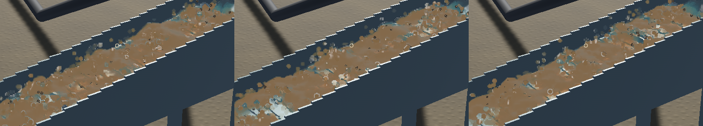

# Sluice splash motion: captured defect

**Confirmed visually in two independent native renderer captures.** The frame-pacing change in `293b100` makes motion more continuous, but the raised water still reads as bobbing beads or short columns around the riffles. Rounded outlines and bright reflective patches repeatedly swell, collapse and reappear at the crests. It does not yet read as a coherent turbulent sheet shedding spray. Some brown flecks are sediment proxies; those should not all be labelled water droplets.

[Six-second close-up video, original wall-clock timing](2026-10-21-splash-motion.mp4)

## Evidence and method

Added opt-in `--capture-motion OUTPUT_DIRECTORY`. It warms the default flowing demo for five wall seconds, requests native GPU screenshots for six seconds at at most 20 Hz/120 frames, logs source water IDs/positions/velocities and interpolated surface kernels, waits for the PNG writes, and exits. Normal gameplay does not enable it. Physics and the production water renderer are unchanged by this investigation.

Two separate runs produced **95 and 93 frames**, spanning 5.965/5.974 wall seconds and 3.967/3.833 physical seconds. The sampled image cadence is about 15–16 FPS; screenshot overhead and scheduling affect it. MP4s preserve recorded frame durations. A separate, clearly named simulation-time replay retimes the same frames using the presentation clock, so playback speed can be distinguished from trajectory shape. It is not a real-time performance result.

OS window lookup did not find the task-owned window. The successful evidence comes directly from Bevy's render output, not desktop capture or a personal browser. Initial unsuccessful window attempts and logs remain in the artifact folder.

## What the measurements establish

At capture start, select the 128 highest water particles in the central channel region, downstream X 0.3–1.35 m and grid Z 0.07–0.33 m. Follow their persistent IDs, including outlet transfer. These are deliberately selected raised particles, **not a representative sample of all water**. Deduplicate unchanged position/velocity states. For the elevated subset, use height greater than 0.05 m above the mathematical floor reference, not a verified air/water phase classifier. The fixed demo has zero yaw, so world Z is downstream.

| Elevated tracked water | Run A | Run B |
|---|---:|---:|
| Unique elevated samples | 208 | 253 |
| Vertical speed greater than downstream speed | 81.7% | 91.7% |
| Mean absolute vertical speed | 0.300 m/s | 0.342 m/s |
| Mean absolute downstream speed | 0.069 m/s | 0.059 m/s |

Thus the vertical appearance is present in the actual water velocities, not solely a missing animation interpolation. Over complete paths many tracked particles do progress downstream; the footage is not proof that the same particle hovers indefinitely or that every vertical jet is physically incorrect.

The high render-kernel sample has median **base radius 10.3 mm**, or about 20.6 mm base diameter. Actual ellipsoid axes can differ. The sparse-neighbourhood fallback in `fluid_surface.rs` uses round unit axes when fewer than twelve neighbours are available. This makes separated/sparse water readily read as large beads. Approximately 46–48% of the selected high render-kernel samples have low planarity; low planarity alone is not proof that the fallback branch ran.

Whole-water residuals after capture were -8.367/-8.765 mL; gold residuals were below 6e-12 g. This does not establish experimental splash accuracy.

## Causes to isolate before changing physics

- The SDF collision stage is inelastic; there is no simple elastic water restitution coefficient responsible for this appearance. However, its internal-solid escape branch moves water to a neighbouring cell centre, searches same-level cells before upward cells, and multiplies velocity by 0.3. That is a concrete candidate for lost downstream momentum and positional pops, but invocation counts were not measured here.
- Density-position correction and free-surface grid/particle transfers can also alter the raised trajectories. Source inspection alone cannot identify their relative contribution.
- All in-channel water continues through FLIP/grid transfers, while the already accepted airborne outlet uses an explicit ballistic phase. The capture does not yet provide per-stage impulse traces or a calibrated criterion for detachment/re-entry.
- Surface reconstruction, optical highlights and sparse round kernels amplify the underlying raised motion. Better interpolation does not change the authoritative velocities or supply sheet breakup, advected foam or a conservative spray model.

The next fix is to trace launch/contact/projection events for the captured IDs, correct transport or positional impulses supported by those measurements, then distinguish connected bulk water from appropriately sized detached spray. Preserve volume and momentum on any phase transfer, the original water/riffle settings and separate render/physical-time metrics. Include a water-only rendering control to distinguish fluid from the sediment proxies. Corrective work is open in **`sluice-splash-motion`**.

The new capture tooling passes all **29** game/renderer regressions, focused strict Clippy, formatting, signed packaging and both native capture runs. No physical parameters were changed or calibrated. The [numeric receipt](2026-10-21-splash-review.json) records source/media hashes, measurements, selection limits and artifact locations.
