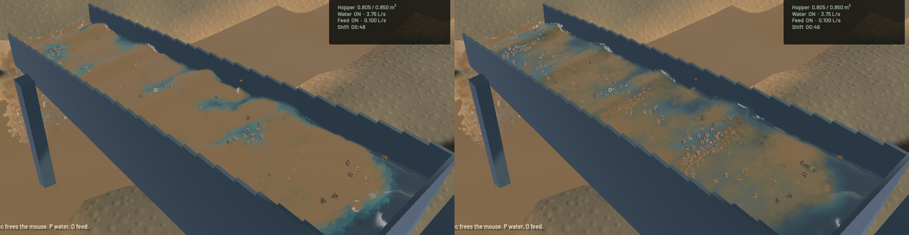

The sluice now blends visible-column sediment and surface normals across overlapping water particles. Native close-ups show softer muddy transitions and more connected crest highlights. Brown slurry remains where the physical fine-grain field is dense. Grain stippling, isolated outlet silhouettes and the coarse river surface remain visible; this is a bounded rendering fix, not final water art or calibrated slurry physics.

[Eight-second before/after animation, left before and right after](2026-10-21-water-optics.mp4)

The depth winner previously supplied a whole water column's extinction and much of its normal. Changing the nearest overlapping kernel could change colour or a highlight abruptly. The optical pass now adds path length and sediment optical depth, then divides their interpolated moments. A normalized poly6 column tapers at silhouettes while preserving the projected integral of represented render volume. Channel integration clips at opaque geometry, and the pass keeps channel/outlet columns separate, preventing hidden channel sediment from contributing through a riffle or wall. Channel normals accumulate with front-surface support and covariance confidence; reconstruction and flow detail use continuous confidence rather than a nearest-particle threshold.

Diagnostic captures separately checked raw water coverage and optical depth. They show that the broad brown regions contain water and have high sediment extinction, rather than exposing terrain through holes. Blending alone left those regions flat because their saturated scattering source was unlit. The final particle-water presentation lights that term and approximates unresolved forward scattering with reduced extinction. The reduction follows the reduced-scattering formulation described in [Physically Based Rendering](https://www.pbr-book.org/3ed-2018/Light_Transport_II_Volume_Rendering/Subsurface_Scattering_Using_the_Diffusion_Equation); the chosen phase asymmetry 0.85 and albedo 0.95 are visual coefficients, **not measured alluvial-soil data**. River optics retain their previous model. The channel and outlet share the new optical coefficients across the lip; outlet geometry, normal reconstruction and kinematics retain their existing paths.

No FLIP/APIC, DEM, riffle, terrain-flow, pressure-sweep, cell-size, particle-count or sediment-ledger settings changed. The optical kernel's mathematical volume normalization concerns rendering, not a new physical volume correction. The extra half-resolution moment target and second thickness channel cost 3,240,000 bytes at 1440×900; the existing optical draw pass writes both targets.

| Sequential 20-second native benchmark | Before (`7e2f68b`) | After |
|---|---:|---:|
| Mean render FPS | 57.29 | 55.28 |
| p95 frame time | 28.64 ms | 30.26 ms |
| Simulation / wall time | 0.681× | 0.731× |
| Mean background surface build | 21.09 ms | 20.79 ms |

This single comparison shows about 3.5% less rendering throughput. Solver code is unchanged; the different simulation multiplier is not evidence of a physics optimisation. The combined real-time gate still fails and the benchmark exits 1 for that expected gate failure. Final sluice water residual is zero; whole-world residual is -10.37 mL, and gold residual is 5.0e-12 g.

The reviewed motion set contains 180 sluice frames over 7.97 wall seconds, 139 final outlet frames over 5.98 seconds and 132 river frames over 5.96 seconds. Native frames and temporal contact sheets were inspected. Every sampled presentation timestamp advances, while whole-frame underrun counters rise by 1/1/0 respectively; occasional rendering pressure remains. The central-water population averages about 0.402 m/s downstream and 0.122 m/s absolute vertical speed. The videos preserve wall timing and include screenshot overhead. These are renderer-owned captures, not a human operator replay. The before/after stills share simulation time 46.3333 seconds across separate live runs; they do not establish bit-identical GPU trajectories.

Sluice/river footage uses the lit revision just before extending its optical coefficients to the outlet. Those channel and river branches are unchanged in the final shader; source snapshots and the earlier binary hash are retained in `lit-capture-source.json`. The final outlet recording and benchmark use the final signed app. All seven capture processes, including two short diagnostic views and the early trial, exit normally. No new WindowServer/panic report appeared. Heavy jobs ran sequentially with one compiler/encoder job.

Validation passes: **30** game/render regressions, **two explicitly enabled real-GPU tests** against the production WGSL, strict Clippy for mining and mining-physics tests, scoped rustfmt, native shader compilation and signed packaging. The profiling microbenchmark remains explicitly ignored and is not counted as passed. The GPU tests integrate an anisotropic kernel against independent ellipsoid volume, split it across a clipping plane, and vary nearest-particle colour/normal data while keeping the integrated column fixed. They validate render invariants, not real-world sediment calibration. The existing dependency dead-code warning remains.

`sluice-water-optics` is closed for this slice. Remaining river/bank art, grain aliasing and detached silhouette work stays in `sluice-water-polish`; `sluice-realtime`, `sluice-phase-coupling`, calibration and intermittent shutdown tracking remain open. Installed Beads lacks `sync`; exactly two changed project issue records are exported into the existing 110-record project file. No unrelated global issues are staged.

[Numeric receipt](2026-10-21-water-optics.json) records source hashes, benchmarks and capture measurements. Full frames, videos, diagnostics, logs and the signed app are retained at the artifact root listed there.
