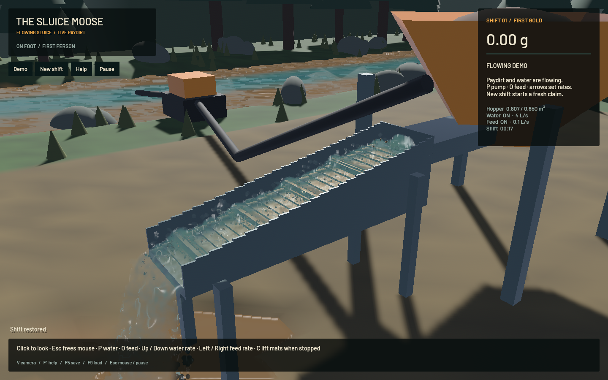
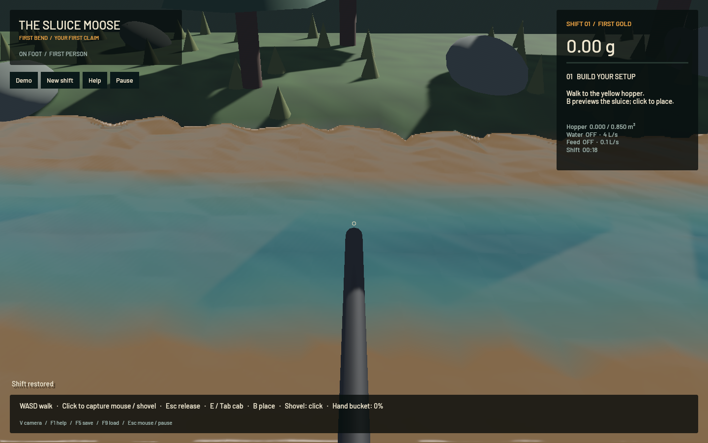

# Outlet handoff and continuous water — 21 October 2026

Water now leaves the sluice lip with its actual position and velocity, follows a saved ballistic trajectory, and deposits volume and horizontal momentum at its first terrain/water impact. The in-channel 1 cm FLIP/APIC solver, 120 Hz FLIP/DEM substeps, 80 velocity/40 density pressure sweeps and DEM riffle contacts remain. The terrain still runs the original conservative SWE, erosion, settling, transport and collapse stages.

## Confirmed fault and correction

Two previous native saves contained 4,244 and 4,101 water particles at the outlet buffer's invisible 11 mm bottom boundary. Most had their downward velocity clamped to zero. The buffer extended only 12 cm beyond the visible channel, and escaped water was returned at one fixed terrain point.

The channel's SDF still supplies its real floor. Opening the exterior lower boundary and handing water off at the lip removes that artificial catch floor. Existing live saves release their old buffer particles on the next fluid update. The new `outflow` array is optional when loading older saves, owns real particle volume, counts toward the existing particle cap and prevents relocation until drained. Loading a running shift restores the airborne stream.

Free flight integrates gravity with the actual exit momentum. Swept samples and a bracketed impact search prevent jumping over the terrain/water surface. Impacts accumulate small particle volumes before updating four terrain samples, preserve horizontal momentum and dilute all suspension concentrations to preserve sediment mass. Changed momentum and suspension reach the next original GPU terrain step. The ledger now counts channel water, airborne water, inlet credit and landed water.

This exterior model is ballistic free flight, not another pressure solve. It does not yet model pressure within the falling sheet, capillary breakup, equipment collisions outside the channel, secondary splash or foam. Those are separate improvements; the proper in-channel water and riffle model has not been replaced.

## Rendering

- The sluice and outlet use local particle covariance to orient anisotropic kernels. Occupied-bin moments and a bounded small eigensolve avoid an all-pairs particle scan. Kernel centre adjustments are render-only and bounded below a millimetre at the 1 cm profile.
- Ray/ellipsoid depth reconstruction, bilateral smoothing and opaque scene-depth tests form a connected surface while retaining detached spray. A separate volume-normalized additive thickness pass controls transmission through the falling stream, independently of the distance to the ground behind it.
- River/runoff discs are replaced with connected surface cells reconstructed from saved terrain water levels. Shared vertices, wet-level extension at shores, ground clipping and shallow-water optical fading remove the moving disc patchwork.
- Optical ripples advect with saved terrain velocity and simulation time, with two blended phases to avoid stretching/reset seams. They freeze on pause. They are shading detail, not additional simulated waves or water volume.
- The previous river renderer divided suspension by depth even though the GPU stores concentration already. Removing that division corrects excessive muddiness in shallow water.
- Rendering remains capped at 65,536 sampled fluid kernels and 16,129 terrain surface cells. Every physical water particle remains in the domain/save or the explicit exterior handoff.

The neighbourhood reconstruction follows the approach described by [Yu and Turk](https://faculty.cc.gatech.edu/~turk/my_papers/sph_surfaces.pdf); flow-normal advection uses the dual-phase principle described in [Valve's water-flow presentation](https://www.valvesoftware.com/en/publications). These are rendering techniques; neither replaces FLIP/APIC or terrain SWE.

## Sustained native measurement

Final signed native app, 1440 × 900 on Apple M2 Max, default flowing paydirt demo, five-second warm-up followed by 60.009 seconds of measurement:

| Measurement | Result |
|---|---:|
| Mean render rate | 56.66 FPS |
| p95 frame time | 37.25 ms |
| Simulated time advanced | 37.467 s |
| Simulation/wall speed | **0.624× — failed real-time gate** |
| Channel water particles | 110,241 |
| Airborne water particles | 10,581 |
| Grain parcels | 1,814 |
| Mean downstream speed | 0.383 m/s |
| Water-ledger error | 0.0 m³ |
| Absolute gold-ledger error | 1.36e-12 g |

The benchmark returned exit code 1 for its unmet 0.98× simulation target and closed normally. The worker remained 96.3% busy. Mean packet phases were 1.55 ms preparation, 36.43 ms fluid/readback, 4.61 ms DEM, 1.15 ms finish and 1.58 ms terrain. Rendering passes its 50 FPS criterion; real-time physics remains open. This run does not establish a speedup over the previous build: it has a different exterior handoff and developing bed, and shared workstation activity was present.

See [native receipt](2026-10-21-water-native.json). The earlier [pre-cache minute](2026-10-21-water-before-cache-native.json) also failed at 0.618× and 55.94 FPS. The final renderer avoids rebuilding unchanged channel kernels on an airborne-only tick and predicts flight from the rendered snapshot time; this reduces redundant work but does not resolve physical throughput. A full dig-to-cleanup operator replay was not rerun; the earlier complete shift remains separate evidence.

## Verification

- 241 unique CPU/integration/doc checks pass across core simulation and affected packages. The complete 240-check run passed, then the changed app passed all 16 tests after the cache refinement (one additional cache/drain regression).
- Five explicitly executed Metal tests pass: both uniform/nonuniform mixed-particle transfer checks, pressure-schedule equivalence including boundary mask 14, the complete terrain/FLIP/DEM integration with an airborne-stream restore, and physical sediment settling at 120/240 Hz.
- All 18 [native scripted control/save checks](2026-10-21-water-controls.json) pass. They inject Bevy keyboard/mouse/toolbar events; OS focus and actual OS key delivery are not exercised.
- The final [sluice capture receipt](2026-10-21-water-sluice-timing.json) reports 56.49 FPS, 10,544 airborne particles, zero water-ledger error and zero channel particle centres more than 2 mm below the sampled floor. The [riverbank receipt](2026-10-21-water-river-timing.json) reports 57.47 FPS with no sluice particles. Both views were visually inspected at 1440 × 900.
- Targeted strict Clippy, formatting, signed packaging and signature verification pass. The prior workspace-wide formatting and game density-separation CI failures remain separate tracked work; no full-workspace pass is claimed.
- No new panic/WindowServer diagnostic appeared. All task-owned build, test and game processes exited. Existing shared services and the original dirty checkout/stash were left alone.

The GPU integration test explicitly saves an airborne stream, restores it, checks no water remains beyond the lip in the channel array, and verifies that discharged water lands. Pressure equivalence now includes boundary mask 14 used by the open exterior.

No pressure sweeps, grid resolution, contact iterations, physical time steps, conservation gates or throughput thresholds were reduced. Native runs use finite task-owned supervisors, do not activate the game window or capture the desktop cursor, and watch for new panic/WindowServer reports. Builds use one compiler job; game, tests and builds run sequentially.

## Final native views

