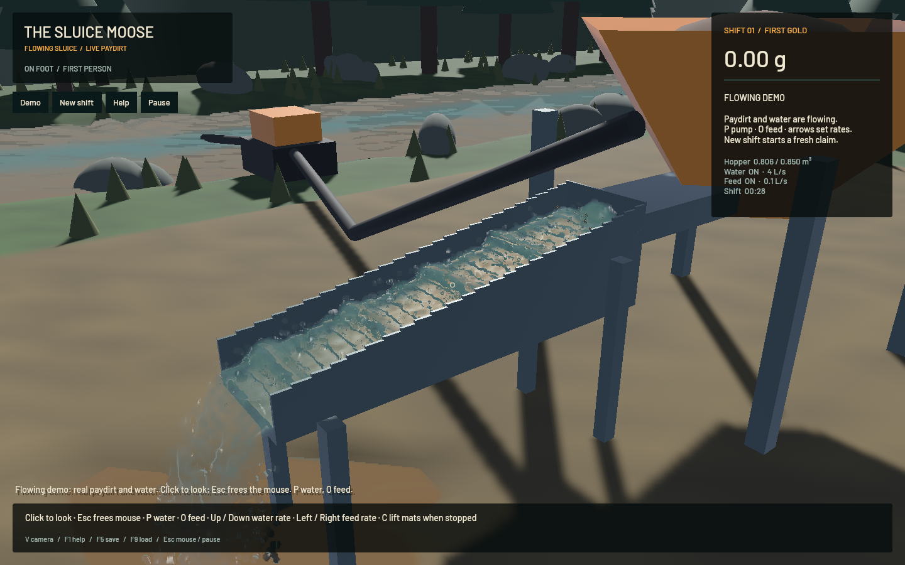
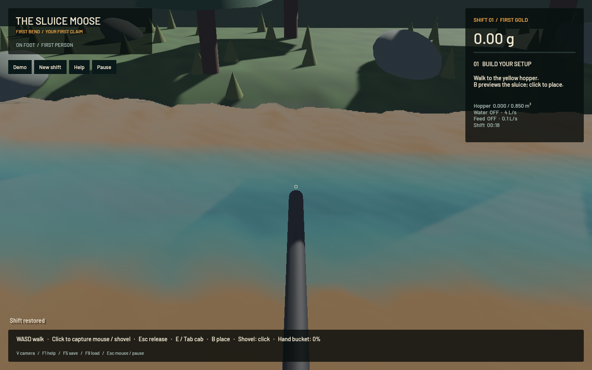

# Channel and river surface shading — 21 October 2026

The accepted outlet is the visual reference. This pass reduces separate particle highlights in dense channel water, supplies continuous river normals and refracts the visible bed/riffles through the water. Outlet particles retain their existing depth-derived normals, sky/specular treatment and thickness-based transmission. The accepted outlet build remains available separately.

## Retained changes

- Dense fluid kernels carry the smallest-covariance direction and a planarity confidence. Channel shading blends toward that coherent surface normal; detached drops with no clear sheet retain their particle/depth normals. The normal filtering respects depth jumps and water-domain boundaries.
- River corners share normals derived from the saved water surface. Unsupported dry neighbours cannot tilt those normals up a dry bank. Vertex normals interpolate continuously across cells rather than inheriting the coarse screen-depth triangle highlights.
- Band-filtered optical ripples follow saved flow and simulation time in the river and dense channel water. Filtering suppresses frequencies smaller than the projected pixel footprint. Optical detail stops on pause and never modifies water positions or volume.
- Refraction uses Snell's law with water index 1.333. Its screen offset is bounded to ten pixels and rejects a sample if opaque equipment would move in front of the water. It makes the moving channel layer visible through distortion of the riffles beneath it.
- Surface normals are written into an extra half-resolution RGBA16F target in the existing depth draw. Render storage remains bounded at 65,536 fluid kernels and 16,129 river cells. There is no additional simulation worker.

The outlet uses kind 2, zero normal-override confidence and no new refraction/ripple branch. Its positions, velocities, kernel axes, density-normalized thickness and original composition remain the reference path. A new regression covers that exclusion.

There are **no changes** relative to `82039d6` in `crates/game`, `crates/sim3d`, `crates/mining-sim` or `crates/mining-physics`. The complete FLIP/APIC, DEM riffle contacts, terrain-flow stages, time steps, pressure sweeps, particle caps and conservation thresholds are unchanged. The [outlet correction and previous physical checks](2026-10-21-water-outlet.md) remain the underlying model.

This is a focused rendering improvement, not final river art. The coarse terrain/flow field and scene lighting still limit the river's appearance; the broader `sluice-water-polish` issue remains in progress.

## Visual iterations

Native sluice and close-bank river cameras were inspected at 1440 × 900 after each retained stage. A first shader validation failed on a reserved variable name, closed normally and was corrected. A screen-space reflection trial produced unstable stripes at wet banks; that code was removed. The retained result uses coherent normals, filtered ripples and depth-checked refraction. Trial captures/logs remain outside the repository rather than being reported as accepted results.

The final [sluice capture](2026-10-21-surface-sluice-timing.json) reports 55.27 FPS, and the [riverbank capture](2026-10-21-surface-river-timing.json) 55.69 FPS. Both have ready water rendering, zero water-ledger error, negligible gold-ledger error and zero channel particle centres more than 2 mm below the sampled floor. Their physical states are evolving snapshots, not a pixel-identical A/B experiment.

## Loaded minute

Five-second warm-up, then 60.008 measured wall seconds with the default flowing paydirt demo:

| Measurement | Result |
|---|---:|
| Mean render rate | 55.58 FPS |
| p95 frame time | 38.36 ms |
| Simulated seconds | 41.117 s |
| Simulation/wall speed | **0.685× — real-time gate failed** |
| Channel water particles | 110,104 |
| Airborne water particles | 11,414 |
| Grain parcels | 1,898 |
| Mean downstream speed | 0.384 m/s |
| Water-ledger error | 0.0 m³ |
| Absolute gold-ledger error | 2.27e-12 g |

The benchmark returned exit code 1 for the unmet physical-throughput threshold and closed normally. Rendering passes its 50 FPS target; real time remains `sluice-realtime`. No speedup comparison is claimed against the earlier minute: the developing bed and shared workstation activity differ. See the [native receipt](2026-10-21-surface-native.json).

## Checks and workstation

All 17 app tests pass, including sheet-normal planarity, shared river normals, accepted-outlet exclusion, bounded rendering, input routing and pause/restore clocks. Targeted strict Clippy, formatting and signed packaging pass. The simulation source was explicitly checked unchanged; its previous five Metal checks and broader core/domain checks were not rerun for this rendering-only pass. No new full operator replay or OS key-delivery result is claimed.

Builds, game checks and the benchmark ran sequentially with one Cargo job, finite task-owned supervisors and no window activation or desktop cursor capture. No new panic/WindowServer report appeared. The original dirty checkout/stash and personal browser were preserved.

