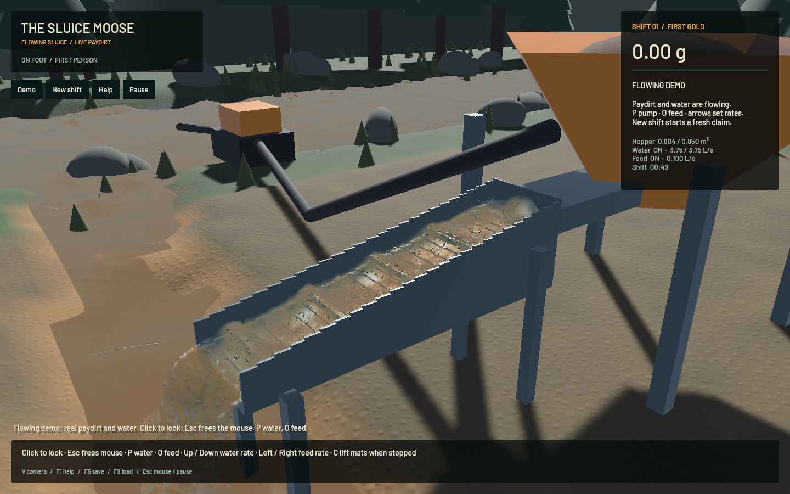

Terrain bed exchange now reads immutable slopes and transfers the actual stored layer change into or out of suspension. Moving simulation tiles also preserve concentrations edited by the CPU outside the active region. This is a numerical foundation for soil and settling-pool work; physical deposition calibration and the full operation remain incomplete.

[Ten seconds across three independent native camera runs](2026-10-22-bed-exchange.mp4): sluice, outlet and river. The clip preserves screenshot wall intervals within each run. Six temporal samples per view and full native frames were inspected. This is renderer-owned evidence, not a human input playtest. Isolated outlet kernels, grain stippling, flat-looking river shading and coarse banks remain.

The [model notes](../physics/terrain-bed-exchange.md) explain the snapshot/store/reconcile passes and their scratch-buffer lifetime. Erosion takes a fresh snapshot after deposition. Existing transport targets and auxiliary slot 7 provide the scratch storage; no new storage buffers or save fields are added. The complete step restores concentration targets once after both bed stages, avoiding a redundant intermediate copy. FLIP/APIC, DEM, riffle geometry, water substeps, particle counts, pressure iterations, material sizes and physical erosion/settling parameters are unchanged from `4323fc9`.

Nine new real-GPU controls cover independent f64 sloped erosion in all four materials, repeatability, post-deposition geometry, flat settling, tile boundaries, inactive CPU edits, exported-ledger isolation, dry/unrepresentable recipients, repeated budgets and constant-forcing timestep controls. The original 1024 m layer stress fixture lost up to 3.750 L through nominal-transfer accounting; stored-delta accounting reports zero at the measured precision. This deliberately large layer tests rounding and does not describe the game's ordinary soil depth.

Each class also undergoes 20,000 alternating stages at 0.3 m water depth: 1,000 seconds of prescribed isolated forcing. The fixed tolerance is one ppm of initial mobile material, excluding the background bed. This does not represent a constructed pond or a full-site duration test.

| Class | Final residual | Fraction of initial mobile inventory |
|---|---:|---:|
| Sediment | +1.084 mL | +0.565 ppm |
| Overburden | +0.289 mL | +0.151 ppm |
| Gravel | -0.499 mL | -0.260 ppm |
| Paydirt | +0.856 mL | +0.446 ppm |

The sloped erosion reference's maximum layer error is 4.142e-9 m. The independent constant-forcing erosion solution differs by at most 2.822e-7 m across 20/40/80 Hz. These controls do not establish general settling convergence: the inherited 1 mm per-step cutoff, concentration cutoff, calm boost and frame-count stability still require correction in `sluice-terrain-settling`. `sluice-geology-snapshots` remains in progress for that requirement.

| Serial loaded native window, 20 seconds each | Previous app | Final app |
|---|---:|---:|
| Mean render FPS | 57.68 | 57.31 |
| p95 frame time | 30.06 ms | 30.26 ms |
| Physical simulation / wall time | 0.655× | 0.612× |

The final measurement is slower than this turn's baseline; no throughput improvement is claimed. Four additional bed compute passes remain necessary in this protocol. The initial version, which restored buffers between both stages, measured 56.79 FPS / 0.617× and is preserved separately. Shared workstation load, evolving initial state and screenshot overhead limit attribution between these runs. Both final and baseline correctly fail the 0.98× physical-throughput gate. The final window has +24.28 mL bulk residual, -6.68 mL whole-world water residual, zero sluice-water residual and 7.73e-12 g gold residual. Short global bulk budgets do not validate long-duration terrain exchange or calibrated recovery.

The final native recordings contain 43 sluice frames, 28 outlet frames and 32 river frames. Sampled presentation never reverses or stops advancing. Presentation-underrun counters increase by 2, 6 and 0 respectively during capture, so smoothness under capture/load is still incomplete. The ordinary final benchmark reports zero underruns. Each app run exits normally through the final-render drain.

Validation passes 96 focused CPU/domain/application checks and 30 explicitly enabled real-GPU checks. The CPU invocation ignores the GPU controls and one profiling case; all 30 GPU controls are then executed separately, with no unavailable-adapter fallback counted as a pass. The original FLIP/DEM integration and live save/restore, pressure, contact, water/boundary/component budgets and optical regressions pass. Focused all-target strict Clippy, package/scoped formatting, whitespace checks and signed packaging pass. The prior-head cloud run [39721751980](https://github.com/doctorspritz/goldrush-sluice-3d/actions/runs/39721751980) passes Direct-control mining, Build, Clippy, Test sim3d and Build Examples, while legacy Format/Test game fail; full-workspace green is not claimed.

All task-owned heavy jobs ran sequentially with one compiler/encoder job. No new panic or WindowServer report appeared. The original dirty checkout and stash are preserved. The [receipt](2026-10-22-bed-exchange.json) records source/binary/media identity, native measurements and outstanding requirements. The full [operation plan](../../plans/2026-10-22-realistic-operation.md) remains active, including physical soil/porosity/contact, pads and pools, shaker/dense-phase behaviour, graphics and real-time throughput.
