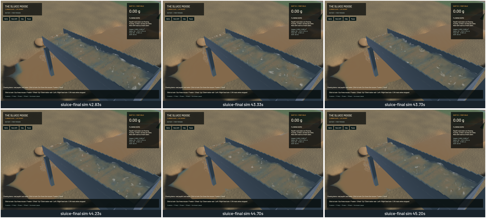

Thin water films now deposit all four sediment classes without requiring a 1 mm water depth or a full float-sized bed increment. Positive bed and mobile precision stores keep actual reference-bulk material owned through GPU exchange, cuts, fills, intake and saves. They remain separate from signed numerical exchange feedback. Save version 5 preserves the new inventory and queued water momentum; versions 2–4 load without invented material. The [model and limits](../physics/subgrid-bed.md) describe the custody and migration rules.

The original mixed-column settling model now acts at every positive depth. A magnitude-ordered, integer-anchored GPU residual preserves transfers into a two-part bed. Stationary water with no face transport keeps concentration exactly, avoiding repeated multiply/divide drift. Settling uses the immutable bed snapshot and one exchange pass. Scour retains its previous physical-time law and applicability floors. FLIP/APIC, DEM and riffle dynamics retain their existing equations, grids and timesteps.

Native validation exposed a second error: converting GPU depth into a World float surface could change the water volume. The bridge now rounds represented water downward and retains the positive difference and its horizontal momentum in the counted free-water queue. Actual mobile class volume survives concentration rounding, clean inflow, queue release and intake. Water too shallow for any representable depth strands its solids into counted bed stock. Outlet impacts use the finite-volume receiver. This corrects custody at float precision; it does not increase physical terrain resolution.

The native shallow sheet initially drifted +6.683 mL with the deposition change alone. After the bridge correction it drifts +0.079 mL during the four-second capture. The preceding 9fb8a32 sheet drifts +0.317 mL. These independent runs share the same initial v4 diagnostic save; they are not identical frozen states. A production GPU test separately checks two simulated seconds with a live save/restore: final water drift is +0.00664 mL from an initial 0.819214 m³ (819.214 L).

Independent numerical controls cover seven water depths, three cell spacings and four timesteps. Maximum concentration error is 0.922 ppm and material error is 0.135 ppm of initial mobile material. Four-class 20,000-stage settling/scour cycling remains below 0.042 ppm, against the unchanged one-ppm limit. A 0.25 mm quiet film deposits every class. Prescribed drying, quiet rewetting and deeper-flow remobilization preserve the same component budgets. Local production paydirt deposition retains its 0.007 g gold tag through restore, with a material residual of -2.08e-17 m³. Uniform and prescribed-level controls do not establish continuous sloping shoreline convergence.

[Native sheet, sluice, outlet and river review clip](2026-10-22-bed-precision.mp4). It contains the 177 captured images, repeated onto a 60 FPS review timeline; this is not a 60 FPS simulation measurement. The nearest encoded frame time differs from each capture time by at most 8.46 ms. Review covered six temporal samples per final view and a full-resolution sluice frame. No sampled presentation stall or reversal occurs. Buffer-underrun totals are 20/0/0/1 for sheet/sluice/outlet/river, so the empty-particle sheet is not claimed jitter-free. Captures use diagnostic cameras rather than an operator input replay.

The normal views show no new regression: the falling outlet remains intact and the joined sluice surface continues downstream. Detached droplet highlights and grain stippling remain visible. The river retains broad sediment colour and coarse bank transitions. The sheet fixture is flat and largely settled before recording begins, so its colour is weak visual evidence of settling dynamics. These observations do not complete the rendering/art stage.

| Sequential ordinary demo, 20 seconds | 9fb8a32 baseline | Final |
|---|---:|---:|
| Mean render FPS | 55.46 | 56.30 |
| p95 frame time | 30.84 ms | 30.37 ms |
| Simulation / wall time | 0.594× | 0.616× |

Both runs fail the combined real-time gate. Short sequential observations do not prove a performance gain. The final numerical gates pass: zero sluice-water residual, -7.12 mL whole-water residual, 11.01 mL reference-bulk residual, 0.020373 kg dry-mass residual and 3.18e-12 g gold residual. Whole-site tolerances do not replace the local mobile-material controls.

Validation: 115 application/domain tests and all 46 explicitly executed real-GPU checks pass, including existing optics, water projection, terrain transport/collapse, FLIP/DEM and wet-feed controls. One application profiling microbenchmark remains ignored. Focused strict all-target Clippy, stable touched-file formatting, whitespace, signed native packaging and Metal rendering pass. Previous full-workspace Format/Test game CI failures remain separate; workspace CI is not claimed green. The [numeric receipt](2026-10-22-bed-precision.json) records source and binary hashes, all native benchmark fields, timing and media hashes.

Builds, native runs and encoding were sequential with one compiler/encoder job. No new panic-full or WindowServer report appeared. Required scoped cleanup leaves zero task-owned native jobs, browsers or tests; 14 shared Playwright MCP and 56 Node processes were left untouched. The installed Beads version rejects `bd sync`; only the two changed project records are exported. The dirty original checkout and user stash remain preserved.

The bounded precision prerequisite is complete. The thin-film parent remains in progress for continuously evolving sloping films, pond margins, resolution/time convergence and shallow rough-bed scour. Subprecision material stays local until it can rejoin represented fields; coarse whole-step gold/collapse coupling still needs a local audit. Dynamic infiltration/seepage, pore pressure, compaction, arbitrary fill strata, dense slurry calibration, machine support, constructed pads/pools, shaker decks, art and real-time throughput remain open in the [complete staged objective](../../plans/2026-10-22-realistic-operation.md).
