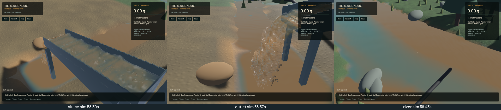

Ordered grain-contact candidate construction is faster while preserving the existing physical state. The change replaces 27 neighbouring cell-mask unions with the intersection of three dilated axis masks, and retains the source position/radius broadcasts between rejected SIMD blocks. It does not change impulses, friction, correction order or contact cadence.

| Same loaded save, 120 domain ticks after 12 warm-up ticks; A/B/B/A | Baseline mean | Final mean |
|---|---:|---:|
| Pair contacts per domain tick | 7.437 ms | 5.861 ms |
| Simulation / wall speed, without rendering | 0.614× | 0.661× |
| Wall time for 2 simulated seconds | 3.257 s | 3.027 s |

Pair-contact time falls 21.18%; overall measured solver throughput rises 7.59%. Each final state contains 117,765 water particles and 2,815 grains. All four final physical states compare exactly after sorting only the three unordered contact-history map arrays by their tuple keys. No particle/grain arrays were reordered and no float tolerance was used. The raw save bytes differ because hash-map serialization order varies. The [receipt](2026-10-22-contact-throughput.json) includes raw comparison results, canonical-state hashes, source/binary hashes and the smaller first trial.

A cell belongs to the original 27-cell search exactly when its x, y and z offsets are each at most one. Each axis mask contains precisely those members; intersecting the three masks therefore reproduces the original candidate set. Candidates remain in ascending index order. The source position is refreshed after every resolved pair, so earlier corrections still affect later contacts. Axis-mask active length is capped at 8 MiB; the existing ordered hash path handles larger/elongated footprints. Two contact sweeps per substep, 120 Hz fluid/contact cadence, grid sizes, particle counts/capacities, 80/40 pressure work and all water/riffle/terrain equations remain.

Validation passes: **115 solver-library CPU checks, 123 app/domain CPU checks and the explicitly executed original GPU FLIP/DEM excavation/pump/camera/live-restore check**. New exact controls include moving wet/dry Coulomb contacts with mixed sphere/clump shapes, rotation and angular velocity, plus elongated negative-cell fallback. Strict all-target app/domain/physics Clippy passes. Solver library/test Clippy completes with 28 existing warning diagnostics and none on changed lines; cleanup remains in `sluice-sim3d-lint`. Touched-file stable format, whitespace, signed packaging and Metal rendering pass. Other 56 GPU checks and one profiling microbenchmark were not run. The completed baseline CI still fails workspace Format/Test game; no full-CI pass is claimed.

| Sequential loaded native windows, 60 seconds each after warm-up | Baseline | Final |
|---|---:|---:|
| Mean render FPS | 56.28 | 56.32 |
| p95 frame time | 25.30 ms | 25.33 ms |
| Simulation / wall speed | 0.370× | 0.382× |
| Final active grains | 3,792 | 3,837 |

Both start from the same earlier loaded save, rather than the younger ordinary demo used for previous 20-second windows. Wall-based warm-up means the measurement starts at 57.17/57.30 simulated seconds and ends at 79.37/80.20 seconds. Those evolving populations limit isolated attribution of the modest native difference; the fixed-step comparison above provides the controlled computational result. Both combined real-time gates correctly fail. As the bed population grows, one-second physical rates fall toward 0.30×. The final worker packet averages 50.03 ms fluid/readback and 26.26 ms DEM. Real-time throughput and sustained dense-bed behavior remain unresolved, not exceptions to the full objective.

Final numerical gates pass: zero sluice-water residual, -7.76 mL whole-water residual, 0.799 mL reference-bulk residual, 0.001439 kg dry-mass residual and 2.27e-12 g gold residual. No budget or throughput threshold was loosened. The existing stage profiler points toward particle transfer/cell expansion, pressure and G2P for further investigation, but it inserts blocking fences; its timings must not be presented as normal batched GPU device timings. The full phase-coupling and physical calibration requirements remain open.

[Native motion](2026-10-22-contact-throughput.mp4) retains all 134 source captures in a 60 FPS clip with at most 16.56 ms first-display delay. Review covered six temporal samples per view and a full-resolution sluice frame, not the entire video or a new operator replay. The 44/45/45-frame sets advance presentation every frame with zero buffer underruns during recording. Falling outlet discharge and travelling channel ridges remain; river opacity, granular stippling and remaining rounded silhouettes are still visible. Renderer and terrain source hashes match the preceding rendering build. A separate observed gameplay issue, `sluice-restored-washing-hint`, tracks the restored HUD instructing the operator to start an already-running pump/feed.

All heavy work and native runs were serial, with one compiler/encoder job. Scoped cleanup leaves no owned game, browser or test process; eight shared Playwright MCP and 32 Node processes remain untouched. No new panic-full or WindowServer report appeared. `sluice-contact-throughput` covers this bounded optimization; `sluice-realtime`, `sluice-terrain-throughput`, the complete realistic-operation plan and the goal remain in progress.
