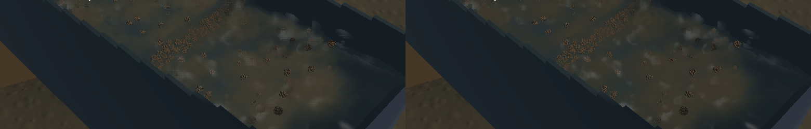

Channel crest highlights and sediment colour now blend across adjacent water samples. This removes a reproduced sampling-grid artefact and reduces false muddy patches. Isolated droplets and grain stippling remain visible; this is a focused rendering correction.

[Native sluice, outlet and river motion](2026-10-22-crest-continuity.mp4). The 10.081-second clip preserves screenshot wall timestamps to millisecond precision. Review used six temporal samples per view and a full-resolution sluice frame, alongside the identical-state comparison. This is renderer-owned capture evidence, not an operator replay.

The previous normal and optical filters sampled every other half-resolution texel. Moving between pixel phases could select alternating source populations instead of their shared water column. An independent real-GPU control supplies alternating extinction of 10/m and 90/m with the same water path: the area average is 50/m, but the old filter returns approximately 90/m at one checked phase. The updated filter keeps all sixteen interior phase cases within 1.5/m of the expected average, with a stable upward normal. Existing deeper-surface and outlet-contamination controls also pass.

The shader now gathers every texel in a 9×9 neighbourhood, sharing depth and domain checks between additive normal and optical moments. It normalizes after accumulation. Gaussian optical weights resolve the plume across the existing bounded, approximately 12 mm footprint. The channel draw evaluates that shared gather once. No textures, passes, particle capacity or solver work were added; shader sampling work changed and is measured below.

Suspended mineral scattering also stops using a Lambert lighting term from each reconstructed surface bump. That term made sediment brighten and darken with individual crest normals. The channel uses a fixed diffuse irradiance approximation of 0.8; reflection, refraction and sun highlights still follow its surface, while actual fine-grain extinction and water path determine turbidity. This is an art approximation, not calibrated sediment radiative transfer. The accepted airborne outlet and river shading branches retain their previous calculations.

| Sequential loaded native window, 20 seconds each | Initial baseline | Fixed | Repeated baseline |
|---|---:|---:|---:|
| Mean render FPS | 50.22 | 57.85 | 57.46 |
| p95 frame time | 40.41 ms | 29.93 ms | 30.54 ms |
| Simulation / wall time | 0.583× | 0.625× | 0.628× |
| Presentation underruns | 18 | 0 | 0 |

The first baseline had a 299 ms surface-build spike, so it was repeated once. The repeat and fixed run show no measured rendering regression; these short runs do not establish a speed improvement. All three correctly fail the combined real-time gate. The fixed benchmark has zero sluice water residual, -6.63 mL world-water residual, +24.71 mL bulk-material residual and 4.55e-12 g gold residual. Short-run ledger checks do not validate the full physical model.

The live recordings contain 44 sluice, 33 outlet and 32 river frames. Every sampled presentation time advances, with no reversal or buffer underrun during any recording. The sluice shows connected travelling highlights and a more continuous sediment body; some detached beads remain. The outlet retains its falling discharge. The river remains opaque and its environmental art still needs work; this slice does not claim to improve that branch.

Validation passes: 33 application checks, four explicitly enabled real-GPU optics checks, focused strict Clippy, package formatting, whitespace checks and signed packaging. One profiling microbenchmark remains explicitly ignored. The pre-existing dependency dead-code warning remains. Full-workspace CI and a manual gameplay pass are not claimed.

Verification uses an export of `1ad9a8e` with only `water_compose.wgsl` and the optics test overlaid. The frozen runs retain identical selected particle tracks, flow fields and solver step 4800. Eight unfinished terrain-settling files were excluded and retain their hashes. FLIP/APIC, DEM, riffles, terrain flow, particle counts, timesteps and the bundled demo are unchanged. All heavy work ran sequentially, native runs drained their final render, and no new panic or WindowServer diagnostic appeared.

The [numeric receipt](2026-10-22-crest-continuity.json) records exact source, binary and media identities, all benchmark trials and remaining limits. `sluice-crest-continuity` covers the reproduced artefacts; broader water quality and real-time performance remain in `sluice-water-polish` and `sluice-realtime`.
