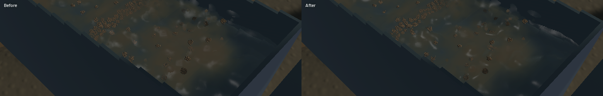

Channel crests now use a joined density interface and coherent wave normals. Sediment colour blends across a wider local footprint, and a separate bulk-to-grain conversion correction removes pore space from represented grain solids. This reduces the round kernel highlights and abrupt muddy patches; individual spray kernels, grain stippling and the coarse river presentation remain.

[Native sluice, outlet and river motion](2026-10-22-crest-density.mp4). The 113-frame clip preserves all 112 native captures plus a repeated final frame; every encoded timestamp matches the millisecond capture cadence. Review covered six temporal samples per view, a full-resolution sluice frame and the identical-state comparison. This is renderer-owned capture rather than an operator gameplay replay.

The channel splat pass samples summed, volume-normalized poly6 density 4 mm and 12 mm behind the visible front. A bounded two-probe crossing estimates the half-density interface; weak support fades continuously to avoid a 12 mm pop. Probes behind opaque geometry contribute zero, retaining shallow film visibility. This is an approximate screen-space reconstruction, not an exact isosurface solve or a new fluid simulation. Its existing 12 mm depth bound remains. Optical integrals retain their normalized volume and clipping controls.

The existing 9×9 gather also fits a local plane to the joined depth field. The normal blends toward that geometric slope rather than each kernel's shiny dome. A real-GPU control intersects camera rays with an independently specified tilted plane while deliberately supplying incorrect vertical kernel normals; it recovers the expected wave slope. Existing checker-phase, hidden/deeper column, volume and independent density-derivative controls still pass. The optical target footprint increases from 12 mm to 30 mm within the same bounded gather. No render targets, passes or particle capacity were added. Outlet shading, river geometry and water/riffle/terrain equations and timesteps retain their existing implementations.

The [material-mass foundation](../physics/material-mass.md) corrects physical grain mass and volume, so subsequent grain dynamics and extinction do change. This is not a renderer-only comparison. Material inventory and saves keep their reference bulk meaning; CPU handoff/save controls and actual registered DEM templates establish the conversion. The checked 564 weighted clumps carry 0.729455049468 kg versus 0.729455049440 kg of canonical inventory, a residual of 2.78e-11 kg. Legacy unweighted compatibility mode is reported separately and excluded from that proof.

| Sequential loaded native window, 20 seconds each | Before | After |
|---|---:|---:|
| Mean render FPS | 55.51 | 55.51 |
| p95 frame time | 30.14 ms | 29.85 ms |
| Simulation / wall time | 0.630× | 0.608× |

Both runs correctly fail the combined real-time gate. Rendering throughput is similar in this short pair; physical throughput is lower, so no optimisation gain is claimed. The final run has zero sluice-water residual, -8.05 mL whole-world water residual, 11.92 mL reference-bulk residual, 0.021949 kg dry-mass residual and 8.64e-12 g gold residual. All numerical gates pass. The global dry-mass limit is 0.807422 kg against an approximately 807-tonne site; the much smaller independent parcel tests are necessary to detect local handoff errors.

The final recordings contain 45 sluice, 34 outlet and 33 river frames. Every sampled presentation time advances, with no reversal, stall or buffer underrun during the recordings. The visible channel has connected travelling ridges and a softer sediment body. The outlet retains its falling discharge. The river still has opaque patches and coarse banks; it has not reached final visual quality.

Validation: 103 CPU/domain/application checks; 38 explicit real-GPU mass/terrain/flow checks, with the four changed optics checks rerun on the final shaders; strict focused all-target Clippy, stable package formatting, whitespace and signed packaging. One profiling microbenchmark remains ignored. An initial native trial rejected a reserved WGSL identifier; the delivered build renders successfully. The old nominal assay hit macro recursion before running; that compile issue is corrected and all-target Clippy now compiles the example, but this slice does not claim a rerun assay or calibrated recovery. Prior legacy workspace CI failures remain separate.

Heavy builds, native runs and encoding were serialized, compiler/encoder jobs were one, and each native run drained its final render. No new panic or WindowServer diagnostic appeared. The dirty original checkout and user stash are preserved. The [numeric receipt](2026-10-22-crest-density.json) pins source/binary identities, budgets, complete benchmark data and capture timing. `sluice-crest-density` covers this focused correction; water art, real-time speed, physical compaction and conservative phase coupling remain open.
