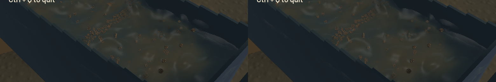

Thin channel crests now use less support along their measured minor axis, with tangent expansion preserving kernel volume. Sparse spray and the accepted outlet retain their original axes. A compact, smooth filter boundary prevents whole rows of optical and normal samples from switching when the camera/water moves by a fraction of a pixel. Refraction now interpolates four background taps, validating each against foreground depth.

The previous production shader fails a new real-GPU continuity regression: a 0.0002-pixel shift changes a deliberately high-contrast fixture from 13.0861 to 16.1736 per metre of extinction. The final shader keeps that jump below 0.01. This fixture tests filter continuity, not calibrated sediment optics. The remaining GPU controls cover joined normals, tilted planes, density-interface bounds, optical integration/volume and clipping.

Validation passes: **37 application CPU checks and five explicitly executed GPU optics checks**, strict scoped all-target Clippy, touched-file stable formatting, whitespace, signed packaging and native Metal rendering. One CPU profiling microbenchmark and unrelated GPU/domain suites were not run. Full workspace CI is not claimed; the completed base head still fails Format and Test game. The build came from an isolated snapshot of a9a680c plus only the four rendering/test changes. Existing unfinished profiler edits, the original checkout and the user stash were preserved.

| Same loaded save; separate 20-second native windows after warm-up | Before | Final |
|---|---:|---:|
| Mean render FPS | 56.30 | 56.41 |
| p95 frame time | 25.40 ms | 25.27 ms |
| Simulation / wall speed | 0.508× | 0.496× |

These short sequential windows show similar render throughput and establish no solver speed improvement; wall-based warm-up and evolving populations prevent attributing the small physics-rate difference to the visual change. Both combined real-time gates fail. Final numerical gates pass: zero sluice-water residual, -7.52 mL whole-water residual, 0.277 mL reference-bulk residual, 0.000498 kg dry-mass residual and 4.09e-12 g gold residual. No solver, grid, timestep, pressure work, capacity or budget threshold changed.

[Native sluice, outlet and river motion](2026-10-22-crest-edge.mp4) contains all **45/45/44 source captures**, with wall cadence approximated by frame repetition in a 60 FPS clip. First-display error stays below 16.66 ms. Review covered six temporal samples per view plus full-resolution sluice, outlet and river frames; the entire encoded video was not watched. Presentation advances at every recorded interval with zero recording underruns. The same-state comparison matches simulation/fluid clocks, solver steps, selected physical tracks, flow, machine, excavation and delivery data.

The sampled sluice has thinner connected wave lips and smoother background refraction, while the outlet retains falling discharge. This is a focused correction: coarse grain stippling, occasional round silhouettes and the broad opaque river colour remain under the existing water-polish issue. The full real-time and realistic-operation objectives stay open.

All heavy jobs were serial, with one compiler/encoder job. Scoped cleanup leaves zero owned game/browser/test processes; eight shared Playwright MCP and 32 Node processes were left untouched. No new panic-full or WindowServer report appeared. The [receipt](2026-10-22-crest-edge.json) records source/binary/media hashes, the failed old-shader control, frozen-state comparison, numerical results and capture timing.
