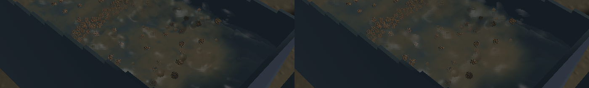

Channel crests now have broader, shared highlights, and suspended dirt blends across neighbouring visible water columns. This reduces the individual rounded highlights and hard muddy transitions in the previous build. Detached water kernels, grain stippling and coarse environment art remain.

[Six seconds of native sluice motion](2026-10-22-crest-followup.mp4). The clip preserves screenshot wall timestamps. Review covered nine temporal samples and full-resolution frames; this is renderer-owned evidence rather than an operator input playtest.

The final change expands the existing visible density-gradient normal filter from 25 to 49 samples, with a broader spatial weight. Channel optical filtering averages additive water-path and sediment-extinction moments before dividing. Its target footprint is 12 mm, bounded in screen space to keep cost predictable. Depth and domain tests exclude unrelated surfaces and airborne outlet samples. A deliberately extreme deeper/outlet contamination fixture verifies that exclusion at all four full-resolution pixel phases of the half-resolution buffers.

Depth-derived normal trials were rejected after native inspection exposed reflection facets and a sampling grid. The delivered shader retains the production volume-gradient reconstruction. It adds no textures, render passes, particle capacity, or solver work. FLIP/APIC, DEM, riffle geometry, sediment transport, terrain flow, timesteps and the saved demo are unchanged from `fcc33f2`. The frozen before/after runs have identical selected physical tracks, flow fields and solver step 4800.

| Sequential loaded native window, 20 seconds each | Before | After |
|---|---:|---:|
| Mean render FPS | 57.13 | 57.54 |
| p95 frame time | 30.77 ms | 30.05 ms |
| Simulation / wall time | 0.620× | 0.618× |

This single comparison shows no measured rendering regression; the small FPS difference is not evidence of an optimisation gain. Both runs correctly fail the combined real-time gate because simulation throughput remains below 0.98×. The final benchmark reports zero sluice water residual, -7.15 mL whole-world water residual, and zero gold residual. These short windows do not validate long-duration terrain exchange or calibrated slurry dynamics.

The final sluice recording contains 83 frames over 5.97 seconds, with no sampled presentation reversal, nonadvancing sample or buffer underrun during recording. A separate 33-frame outlet recording preserves the falling discharge and shows no reversal; it records one buffer underrun. The outlet shader branch is unchanged.

Validation: 33 application checks and four explicitly enabled real-GPU optics checks pass; one profiling microbenchmark remains ignored. The GPU checks cover column integration and clipping, density derivatives, shared front depth, and optical/normal continuity with contaminating samples. Required scoped strict Clippy (`--no-deps`), stable formatting of the edited Rust test, whitespace checks and signed packaging pass. An initial unscoped strict Clippy invocation encounters ten unchanged `sim3d` lints. Full-workspace CI is not claimed green; the prior Format/Test game failures remain separate.

All builds, game runs, GPU tests and encoding ran sequentially, with one compiler/encoder job. Native runs exit normally with the final-render drain marker, and no new panic or WindowServer report appeared. The unrelated unfinished terrain-exchange test is preserved. The [receipt](2026-10-22-crest-followup.json) identifies exact source, binary, native recordings and media hashes. Broader surface quality and real-time throughput remain tracked in `sluice-water-polish` and `sluice-realtime`.
