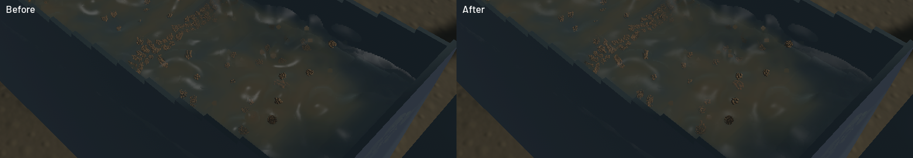

The channel renders sparse raised water with smaller support and softer highlights. Fine suspended sand uses the existing conservative optical field instead of opaque depth-writing meshes. This reduces false brown interruptions in the water. Coarse gravel clusters, detached droplets and broad river colour remain visible; this is a focused rendering correction.

[Native sluice, outlet and river motion](2026-10-22-crest-grains.mp4). All 133 source captures appear in the 60 FPS clip. Frame repetition approximates the recorded wall cadence with at most 16.65 ms first-display delay. Review covered six temporal samples per view, one full-resolution moving sluice frame and the frozen comparison. These are diagnostic cameras, not an operator replay or a claim that the entire video was watched.

The previous reconstruction gave full bulk support to twelve neighbours in a roughly six-centimetre region, even when that region contained sparse spray. A bounded occupancy estimate now uses represented water volume and covariance, including render subsampling weight. Half-cell variance regularisation retains thin sheets, and a continuous support weight blends toward the volume-derived droplet radius. This is a rendering heuristic, not a new density equation. Kernel volume normalization, particle trajectories and accepted outlet support remain. Channel highlight sharpness no longer depends on gradient agreement: a symmetric individual kernel can have high agreement without being a smooth liquid surface.

Non-resting sand below 1.5 mm contributes through water-column extinction rather than tiny opaque meshes that interrupt the water depth test. Deposited sand, gravel and individual gold keep geometry. The original display shares are reserved before suppressing fines; a rejected trial reused that quota and made gravel clusters denser. A nested spatial sample sequence also removes array-index and total-count dependence, so removal of an earlier DEM parcel does not reseed surviving proxies. The size threshold is a presentation approximation. Represented material is unchanged; the final native window contains about 1.84 billion represented grains and 8,635 displayed proxies.

The frozen comparison matches simulation time, fluid clock, solver steps, selected tracks, flow statistics, machine state, excavation and deliveries. CPU controls retain optical fine inventory, individual gold, bed geometry, global display bounds and proxy correspondence. Sparse/compact cloud, thin-sheet, anisotropic axes and reconstructed water-volume controls pass. Five explicitly executed real-GPU tests retain volume, clipping, density interface, optical/normal continuity and filter response. There are 123 distinct app/domain CPU passes; one profiling microbenchmark and 52 unrelated GPU checks were not executed. Focused strict all-target Clippy, touched-file stable formatting, whitespace checks, signed packaging and Metal rendering pass.

The final ordinary 20-second native window renders at **56.27 FPS**, with **25.95 ms p95 frame time**, while simulation advances at **0.573 times wall time**. All numerical gates pass: zero sluice-water residual, -7.49 mL whole-water residual, 0.0362 mL reference-bulk residual, 6.52e-5 kg dry-mass residual and 3.18e-12 g gold residual. The combined real-time gate fails. Short sequential windows do not establish an optimization gain, and physics has not reached real time.

The final sluice/outlet/river captures contain 45/44/44 frames. Presentation advances across every recorded frame, with zero buffer underruns during recording. Sampled channel ridges travel through the sluice and the outlet retains falling discharge. Coarse granular stippling, some rounded water silhouettes, opaque river colour and coarse banks remain under the broader water-polish/environment-art issues. FLIP/APIC, DEM contacts, riffles, terrain flow, grid sizes, steps, pressure iterations and capacities are unchanged.

Builds, native runs and encoding were serial, with one compiler/encoder job. Scoped cleanup leaves no owned game, browser or test process; 12 shared Playwright MCP and 48 Node processes remain untouched. No new panic-full or WindowServer report appeared. The [receipt](2026-10-22-crest-grains.json) pins source/binary/media hashes, all numerical results and capture timing. The separate [terrain profile correction](2026-10-22-terrain-profile.md) records the actual throughput bottleneck; the full realistic-operation objective remains in progress.
