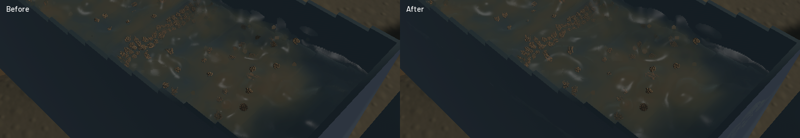

Channel crests now blend across wider, volume-normalized kernels. The shared interface owns the connected-water normal, and density-supported water receives a broader, continuously weighted smoothing footprint. This reduces the remaining rounded kernel highlights. Suspended sediment blends through a wider horizontal optical footprint, softening the cloudy patches while retaining the narrower vertical reconstruction.

[Final native sluice, outlet and river motion](2026-10-22-crest-polish.mp4). The clip retains all 125 captures plus a repeated final frame. Every encoded timestamp differs from the native cadence by less than 0.51 ms. Review covered six temporal samples per view, a full-resolution sluice frame and the matched-state comparison. These are renderer-owned diagnostic cameras, not an operator input replay.

Bulk kernel radius increases from 0.85 to 1.25 fluid cells; normalization retains represented water volume. Detached spray keeps its volume-derived radius and the outlet keeps its existing support. The connected-surface filter expands from 15 to 23 taps with density-weighted tails; sparse water and outlet columns retain the original response. The real-GPU control checks that unchanged response independently, as well as reduced single-dome amplitude, a continuous support transition, planar/uniform films and zero dry coverage. The tilted-plane control now rejects deliberately biased particle normals.

The slurry field applies an additional conservative horizontal binomial reconstruction to water, fine-volume and optical-area moments. Clamped destinations retain their integrals. This read-only field is used for rendering and diagnostics, including outlet turbidity; it does not diffuse physical sediment. Kernel widening, normal reconstruction and optical filtering change no particle trajectories, water/riffle/contact equations, terrain solver, resolution or timestep. Frozen simulation time, solver steps, sampled particle tracks, flow and machine state match the baseline exactly. The unfinished thin-film regression and surface-bed module are preserved outside this commit.

| Sequential ordinary-demo window, 20 seconds | Baseline | Final |
|---|---:|---:|
| Mean render FPS | 51.48 | 55.62 |
| p95 frame time | 42.50 ms | 36.67 ms |
| Simulation / wall time | 0.585× | 0.545× |

Both runs fail the combined real-time gate. These short sequential observations do not establish an optimisation gain; physical throughput is lower in the final run despite unchanged solver work. The final numerical gates pass: zero sluice-water residual, -7.81 mL world-water residual, 10.79 mL reference-bulk residual, 0.019861 kg dry-mass residual and 9.09e-12 g gold residual. Whole-site tolerances do not replace the independent local volume and sediment-inventory controls.

The final sluice/outlet/river recordings contain 41/43/41 frames. Sampled presentation times advance in every view, but 4/2/3 buffer underruns occur during the respective recordings. The channel has broader travelling ridges and softer sediment transitions; detached droplet highlights and grain stippling remain visible. The falling outlet remains intact. Coarse river banks, broad environmental sediment colour, art quality and real-time throughput remain open under the existing water-polish, environment-art and performance issues.

Validation: 105 application/domain tests and five explicitly executed real-GPU checks; focused strict all-target Clippy for the app/domain and strict Clippy for the changed GPU test; stable touched-file formatting, whitespace, signed packaging and native Metal rendering pass. One profiling microbenchmark remains ignored. Previous full-workspace Format/Test game failures remain separate; workspace CI is not claimed green.

Builds, native runs and encoding were sequential with one compiler/encoder job. Scoped cleanup ran, and no new panic-full or WindowServer report appeared. The installed Beads version rejects `bd sync`; only the changed project issue was exported into the tracked issue file. The dirty original checkout, user stash and two unfinished thin-film files were preserved. The [numeric receipt](2026-10-22-crest-polish.json) records source and binary hashes, budgets, full benchmark values and capture timing. The complete realistic-operation objective remains open.
