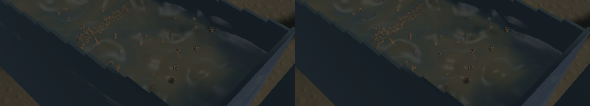
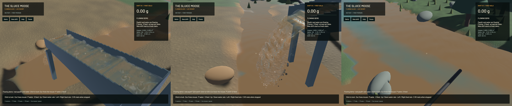

The channel uses a bounded, interpolated particle envelope to reduce rounded crest caps. Water and suspended dirt now use the same conservative optical projection, which removes a reproduced false concentration change as a uniform suspension crosses optical cells. Remaining isolated droplets, gravel stippling and opaque river art stay open.

The previous water histogram and linearly projected fines report 1402.704 per metre of extinction for a homogeneous mixture whose independent value is 1086.792 per metre: about 29% error. A 25-phase, three-offset control fails on the old implementation and passes with consistent conservative projection. Local turbidity still depends on represented fines and water, and projected integrals remain conserved. This corrects presentation; it does not calibrate real sediment optics.

Continuous centroid queries relax the channel render envelope by at most 6 mm, with density support retaining isolated spray. A noisy tilted-sheet control reduces sampling residual while preserving authoritative positions; negative-coordinate lattice-phase and sparse controls pass. Kernel axes, radii and normalization retain their prior volume. The initial trial exposed faint outer-wall water halos and excessive repeated lookups. Cached corner moments and clipping at the physical inner walls correct those problems. The finite stepped wall height comes from the existing geometry builder; above-wall spray bypasses the lateral clip. Channel optical path length now uses eye-ray metres consistently with the integrated column rather than camera-Z metres. Outlet geometry and its reconstruction branch remain; its inferred sediment optics benefit from the common projection. River shading is unchanged.

The signed native build is an isolated snapshot of 5b6011b plus the seven rendering/projection/test paths in the [receipt](2026-10-22-crest-reconstruction.json). All 294 other checked game/sim3d/domain/physics source files match that base. Unfinished storage/contact/HUD changes were excluded from this build and preserved with hashes in the active worktree. No FLIP/APIC, DEM, riffle geometry, terrain solver, physical grid, timestep, pressure work or physical capacity changed in this correction.

Validation passes: **117 distinct app/domain CPU checks and six explicitly executed GPU optics checks**, strict focused all-target Clippy, touched-file stable formatting, whitespace, signed packaging and native Metal rendering. GPU controls retain integrated volume, density-interface bounds, normal/optical continuity, filter response and rotated/parallel channel-wall clipping. One CPU profiling microbenchmark and unrelated GPU suites were not run. The completed base CI still fails workspace Format/Test game; this is not a full-workspace pass.

| Ordinary native demo, separate 20-second windows after warm-up | Before | Final |
|---|---:|---:|
| Mean render FPS | 57.53 | 57.43 |
| p95 frame time | 26.80 ms | 25.69 ms |
| Simulation / wall speed | 0.554× | 0.543× |
| Mean surface-worker build | 25.35 ms | 33.60 ms |

These short sequential windows use evolving populations, so they establish no overall speed gain. Reconstruction has additional CPU cost; `sluice-surface-wall-cache` tracks the remaining latency. Both combined real-time gates fail. Final numerical gates pass: zero sluice-water residual, -7.37 mL whole-water residual, 0.0268 mL reference-bulk residual, 4.84e-05 kg dry-mass residual and 5e-12 g gold residual.

[Native motion](2026-10-22-crest-reconstruction.mp4) retains all **45/44/44 source captures** in a 60 FPS wall-timed clip. First-display delay stays below 16.62 ms. Review covered six temporal samples per view, full-resolution final sluice/outlet frames and the matched frozen comparison, rather than the entire video or an operator replay. Selected physical tracks, simulation/fluid clocks, solver steps, flow, machine, excavation and deliveries match in the frozen comparison. All recorded presentation intervals advance. Recording underruns are 0/2/3 for sluice/outlet/river; the ordinary final benchmark records zero. Broader water art and motion buffering remain unfinished.

All heavy work was serialized with one compiler/encoder job. Scoped cleanup leaves no owned game, browser or test process; 12 shared Playwright MCP and 51 Node processes remain untouched. No new panic-full or WindowServer report appeared. The dirty original checkout, ten unfinished active-worktree paths and user stash remain preserved. Installed Beads rejects `bd sync`; only this task and its measured follow-up are exported into the tracked issue file. The complete realistic-operation objective stays active.
