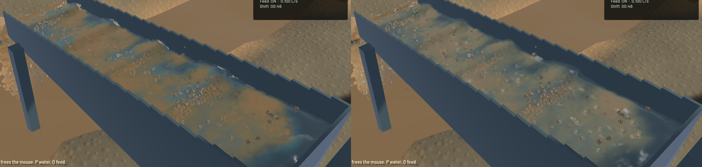

The sluice renders overlapping water as a shared front surface with broader ridge highlights and softer slurry transitions. This reduces the rounded crest highlights and flat ochre patches seen in the previous build. Some detached beads, visible grain stippling and placeholder environment art remain.

[Eight seconds of native water motion](2026-10-22-crests.mp4). The video retains wall timing, including screenshot overhead. Review used twelve temporal samples and full native frames; it is renderer-owned evidence, not a manual gameplay test. GPU trajectories in separate runs are not bit-identical.

The optical draw now accumulates relative front-depth moments as well as water path and sediment extinction. A bounded 12 mm front layer combines nearby overlapping kernels before the existing bilateral smoothing. Relative offsets retain precision in the half-float target. Empty pixels and the airborne outlet keep their existing depth, and the water column still clips against opaque geometry. This reconstructs the visible surface; it does not change physical water volume or claim an exact volume-preserving isosurface.

Channel normals come from the summed gradient of the normalized water-density kernels, rather than relying on a covariance plane where a crest contains volumetric water. A wider local filter and a normal-variation-dependent sun lobe suppress individual kernel highlights. The first gradient-only trial was rejected after native inspection because it made the beads more obvious; the delivered version includes the shared depth and highlight filtering.

The channel's water and mineral scattering source terms now mix according to their extinction, removing the second arbitrary concentration-to-colour threshold. Actual suspended fines still cloud the water. The chosen ochre source colour and existing scattering coefficients are presentation approximations, not calibrated soil measurements. Outlet and river shading retain their previous branches.

No FLIP/APIC, DEM, riffle, sediment transport, terrain-flow, particle count, pressure iterations, timestep or saved demo state changed. Verification built an export of `71a195b` with only the five water-rendering/test files overlaid. Unfinished excavation changes in the working checkout were excluded and preserved.

| Sequential 20-second native benchmark | Before | After |
|---|---:|---:|
| Mean render FPS | 55.34 | 54.27 |
| p95 frame time | 30.33 ms | 30.55 ms |
| Simulation / wall time | 0.726× | 0.709× |

The single comparison measures about 1.9% less rendering throughput. It adds one half-resolution reconstruction pass and 1,296,000 bytes of optical moment storage at 1440×900. Physics code is unchanged. Both runs correctly exit with a failed combined real-time gate because physical throughput remains below 0.98×; they are not reported as passed benchmarks. The after-run sluice water residual is zero, whole-world water residual is -10.33 mL, and gold residual is 2.3e-12 g.

The final sluice recording contains 136 native frames over 7.95 seconds. Presentation time never reverses; the whole-run buffer-underrun count reaches two, so occasional stalls remain. The recording's physical time advances at 0.746× wall time. A separate final-app outlet capture checks shader compilation and the accepted discharge path.

Validation: 30 application tests, four explicitly enabled real-GPU rendering tests, strict Clippy, scoped rustfmt and signed packaging pass. The GPU tests check normalized column volume, optical continuity when the front particle changes, density gradients against an independent finite difference, and relative surface moments with unchanged empty/outlet depth. The profiling microbenchmark stays explicitly ignored. The pre-existing dependency dead-code warning remains.

Sluice footage and benchmarks precede adding the new pipeline to the existing shader-error reporting list; their WGSL and draw paths match the final app. Their exact source and binary hashes are preserved separately. The final app includes that error check and is used for the outlet regression.

The [numeric receipt](2026-10-22-crests.json) records source identity, measurements and artifact paths. All heavy jobs ran sequentially with one compiler/encoder job. `sluice-water-polish` remains open for isolated silhouettes and grain/environment presentation; real-time throughput, phase coupling and physical calibration remain open. The independently reproduced terrain-collapse solid-budget defect is tracked separately in `sluice-terrain-solid-budget`.
