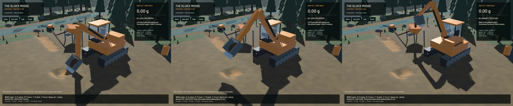

The excavator now cuts finite soil along its moving bucket floor and teeth. Holding a stationary tool no longer point-drills the bank. Passive ground/bedrock contact, remaining bucket capacity and an initial soil force/power envelope restrict movement. This completes the first earthwork stage; the full [operation plan](../../plans/2026-10-22-realistic-operation.md) remains active.

[Twenty-second native digging recording](2026-10-22-earthworks.mp4). The 188 source frames span 19.91 wall seconds at at most 10 Hz; playback preserves that timing. Review includes the scoop, changed terrain pocket, lift, swing and falling load. This is a scripted native inspection camera, not a manual playtest or a claim that the screenshot cadence equals game FPS. Equipment and soil clods still use placeholder meshes.

The complete native gate drove three scoops and delivered **0.584015 m³**, containing **7.375 g in unprocessed hopper material**. It restored a live cut from disk and finished with an empty bucket and no falling load. The original GPU terrain flow ran throughout; the sluice was idle. Its whole-claim bulk residual was **65.7 mL across 412.5 m³** (0.16 ppm), below the unchanged one-ppm gate. Water residual was **2.53 mL** and gold residual **6.4e-12 g**. An independent headless GPU replay also passed with the same delivered load.

Two terrain-accounting defects had to be corrected before this gate passed:

- The eight-neighbour red/black collapse wrote shared receivers concurrently. A production GPU regression lost **3.964 m³ from 64 m³ in 20 steps**. Source-owned transfers plus a gather now leave a **0.477 mL** residual in that case. Repose angles and rate remain unchanged; tile halos receive their material and inactive sources cannot reuse stale transfers. Seven GPU terrain cases also cover per-layer budgets, buried layers, direction/reference agreement, water/sediment discharge and shallow runoff. Pile-shape error decreases from 0.220% to 0.107% as the timestep is halved again.
- Clean river inflow increased water depth while keeping sediment concentration fixed, creating solid volume. The source now dilutes each of the four channels using actual old/new water depth and records represented source water. The intermediate native residual of **+4.659 L** falls to the final **+65.7 mL**. The footprint and 0.12 m³/s source rate remain. The earliest inventory checker also incorrectly treated concentration as layer thickness; the final ledger explicitly uses concentration times water volume.

Local cuts use actual representable layer changes, proportional trace gold and preserved water depth. The shared bounded column remover includes gravel, matching the GPU order: sediment, overburden, gravel, paydirt. It replaces the old full-array cloning/whole-claim scan. A swept-side-face correction removes timestep-dependent missed cuts; the final stroke test requires 0.1% volume agreement at 30/60/120 Hz. Force, power, capacity, passive retreat, bedrock contact and rejected chassis movement have separate regressions.

The force model is a generic passive-blade approximation, with manufacturer-class force limits and an assumed tool-power budget. The [model protocol](../physics/earthworks.md) gives its equations, primary references and limitations. The machine remains kinematic. Physical soil is still on 25 cm columns; failure wedges, realistic spill/retention, pore water, compaction and dynamic tracks are absent. Compaction needs grain mass/porosity accounting beyond this bulk-volume ledger.

Fresh machines park with floor/tooth clearance. The bundled demo changes only its boom angle from 0.48 to 0.56 radians; all other decompressed save bytes remain unchanged. Correctly rounded JSON parsing fixes a one-bit material-value loss that broke exact save continuation. Old saves retain their pose and receive defaults for the new fields. The temporary unbounded hand load remains.

| Native measurement | Render FPS | Simulation / wall time |
|---|---:|---:|
| Dig/deliver, terrain active and sluice idle | 57.46 | 0.999× |
| Loaded sluice, serial previous-build control | 56.25 | 0.713× |
| Loaded sluice, serial final build | 56.16 | 0.705× |

The loaded pair shows no material rendering change in this single comparison; it does not establish a speed improvement or real-time operation. An earlier separate after-run measured 50.58 FPS / 0.513× and is retained in the receipt. Its slowdown is not attributed to a proven cause. Every loaded run correctly exits with a failed combined throughput gate. The final paired run has zero sluice water residual, -7.59 mL whole-world water residual and 4.5e-12 g gold residual. These water/gold figures do not establish the complete loaded solid budget: the pump currently removes suspended material without transferring it into a plant stream, tracked in `sluice-intake-solids`.

Validation passes **48 domain tests, 31 application tests and 11 explicitly enabled real-GPU tests**, strict focused Clippy, scoped formatting, native shader compilation and signed packaging. The profiling test remains ignored; full-workspace CI is not claimed green. The existing dependency unused-constructor warning remains. All heavy jobs were sequential with one compiler/encoder job. No new WindowServer/panic report appeared; the original checkout and saved stash are preserved.

The full native ledger/save gate used the build immediately before capture-only fixes. All physical/domain files match the final build exactly. The final binary fixes fresh-claim capture without a sluice, widens the inspection camera and prevents simultaneous still/motion requests for the same render target. Bevy drops duplicate requests; the all-frames-written gate remains strict. Final motion and the paired-after benchmark use this binary. Earlier failed runs, sources and logs are retained separately; no failed capture is counted as passed.

The default small feed needs roughly **97 simulated minutes** to wash 0.58 m³. The short earthwork gate does not verify washing, recovery or cleanup. Plant capacity/pacing, conservative phase exchange, pump sediment/gold transport, immutable erosion/settling slope snapshots, calibrated recovery, local wet soil, pads, shaker decks and settling ponds remain open. The 20 October full shift is historical evidence under the previous excavation model.

[Numeric/source receipt](2026-10-22-earthworks.json) records exact code/binary hashes, every performance observation and the artifact directory. `sluice-swept-earthworks` and `sluice-terrain-solid-budget` cover this completed stage; the broader goal and its remaining issues stay open.

CI follow-up: the direct-control job initially stopped at stable rustfmt on one existing assertion in `tests/granular.rs`, before running compilation/tests. Its formatting is corrected; `cargo +stable fmt --package mining --package mining-sim --package mining-physics --check` passes. That follow-up changes no application or physical code. Full workspace formatting still fails in legacy code (803 diff hunks across 57 paths, versus 832 hunks on the preceding commit), tracked in `sluice-legacy-fmt`. The cloud test job after the focused fix must be assessed separately; local results above do not imply a cloud pass.

The subsequent cloud run `39713596608` passes focused formatting, all runnable mining package tests and all-target compilation, then stops at Rust 1.99's new `chunks_exact_to_as_chunks` lint. The auxiliary terrain readback loop and GPU test readers now use fixed-size array chunks with identical grouping and remainder behavior. Focused local strict all-target Clippy, stable formatting and all eleven explicit GPU checks pass after this correction. This is a syntax-only follow-up to the captured build; the native app and rendering evidence above remain from the recorded binary. The broader legacy formatting and DEM density-separation failures remain open; no full CI pass is claimed.
