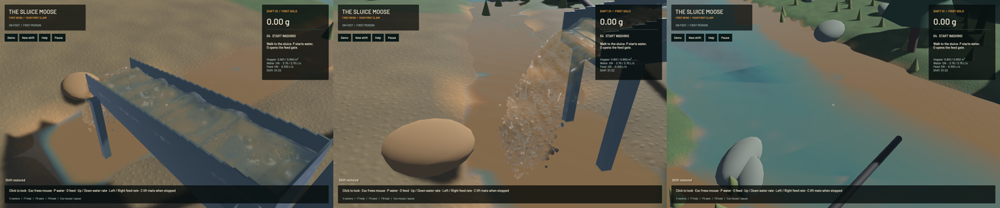

The production particle-to-grid (P2G) pass now skips atomic additions whose already-quantised integer value is zero. This reduces its measured GPU device time **7.40% on the young save and 10.88% on the accumulated-bed save**. It preserves the complete tested physical state. It does not make the overall game real time.

| Actual compute-pass timing; same save, 120 domain ticks after 12 warm-up ticks, A/B/B/A | Reference writes | Zero writes skipped |
|---|---:|---:|
| Young P2G, mean ms per domain tick | 2.4801 | 2.2966 |
| Dense P2G, mean ms per domain tick | 3.1242 | 2.7842 |

The scatter keeps the same 100,000 fixed-point scale, expressions, grid layout, interpolation, phase/volume weights and particle-count increments. Momentum and weight zeros are checked separately. The reference specialization retains every original write. A real-GPU control compares every raw integer accumulator and count across six stationary/moving, paired/mixed/water-only cases, with tiny gold, legacy weights, boundary support, odd grid dimensions and a partial final workgroup. All sixteen A/B/B/A full saves match the earlier production shader after sorting only the three unordered contact-map export arrays. No particle/grain arrays were reordered and no float tolerance was used. Final-source ordinary young/dense and profiled-young replays also match those physical hashes.

The new opt-in profiler attaches timestamps directly to existing compute passes, preserves the batched command buffer and resolves one bounded query batch after the substep. Unlike the older serialized stage profiler, it introduces no marker dispatches or per-stage fences. The main divergence, velocity-pressure sweeps and all three gradients are included. Direct API and 48-pass reuse controls require positive device work, retain ordered data dependencies and reject invalid counter results. Normal play requests no timestamp features and allocates no timer buffers. The [scope and commands](../physics/gpu-stage-timing.md) distinguish device time from host work, copies, readback, DEM, terrain and frame time. The initial same-input trace/ordinary controls show approximately 1.35%/2.58% wall overhead on young/dense cases; profile mode is not the ordinary throughput reference.

| Unprofiled fixed-step A/B/B/A; seconds for 2 simulated seconds | Reference | Optimized |
|---|---:|---:|
| Young mean wall time | 2.9989 | 2.9963 |
| Dense mean wall time | 4.9160 | 4.9895 |

These wall results establish no overall speed improvement: the young case is effectively unchanged and the dense case is 1.50% slower in these short windows. The separate profiled dense windows favour the optimized path, illustrating why device-pass gains must not be advertised as game speed gains. Dense ordinary DEM pair work averages about 18.38 ms per domain tick, substantially more than P2G. More fluid/data-movement and dense-contact/lifecycle work is required.

| Same accumulated-bed input; unprofiled 60-second native windows after warm-up | Reference | Optimized |
|---|---:|---:|
| Mean render FPS | 56.42 | 56.30 |
| p95 frame time | 26.55 ms | 26.59 ms |
| Simulation / wall speed | 0.31885× | 0.32049× |
| Final active grains | 4,089 | 4,091 |
| Final water particles | 75,850 | 74,665 |

Both combined real-time gates fail. These evolving, wall-warmed native populations prevent isolated attribution of the small rate difference. Both also reach the existing **4,096-grain admission quota**: final inlet delivery is zero and the carrier-water population declines. The saved intake neighbourhood still contains about 55 L of water. A direct 120-tick continuation after warm-up records **75 grain-limit-blocked ticks** and admits **2.812 L of the requested 7.500 L**: approximately 37.5%. The probe now exposes capacity/grain blocked counts and requested/admitted carrier volumes. This is numerical backpressure, not verified physical clogging or successful sustained washing. `sluice-dense-intake-capacity` remains open; do not bypass it with discarded particles, unvalidated larger parcels or a freely raised quota. The final worker packet averages 47.21 ms DEM and 46.19 ms fluid/readback; these packet units differ from the domain-tick table.

Final numerical gates pass: zero sluice-water residual, -7.84 mL whole-water residual, 0.971 mL reference-bulk residual, 0.001748 kg dry-mass residual and 5.46e-12 g gold residual. No grid, cadence, pressure iterations, contact sweeps, capacity, physical equation or budget threshold changed. Phase/momentum conservation and packed-bed calibration remain separate open requirements.

Validation passes: **123 distinct app/domain/physics CPU checks and five explicitly executed GPU checks** covering direct counters, reusable timestamp batches, raw P2G equivalence, constant-flow APIC transfer and the original excavation/pump/camera/live-restore pipeline. Two GPU controls were repeated after final wrapper cleanup; they are not counted twice. One CPU profiling microbenchmark and 55 other GPU checks were not run. Strict scoped all-target Clippy passes. Game-library Clippy completes with 100 existing warnings and zero on changed code; the four newly introduced warnings were fixed and the remaining debt is tracked separately. New/maintained Rust files and changed legacy regions pass format checks, as do whitespace, signed packaging and Metal rendering. The completed base CI still fails workspace Format/Test game; no full-workspace pass is claimed.

[Native motion](2026-10-22-gpu-throughput.mp4) retains all **33/34/34 source captures** in a wall-timed 60 FPS clip, with at most 16.05 ms first-display delay. Review covered six temporal samples per view and a full-resolution sluice frame, not the entire video or an operator replay. Presentation advances at every recorded interval with zero recording underruns. Channel ridges and falling outlet discharge remain; rounded silhouettes, coarse grain stippling, river art and misleading restored-shift guidance remain visible. All 27 renderer/asset source files match the preceding crest fix.

Heavy work was serial, with one compiler/encoder job. Scoped cleanup leaves no owned game/browser/test process; eight shared Playwright MCP and 32 Node processes remain untouched. No new panic-full/WindowServer report appeared. Installed Beads rejects `sync`; six project records were exported explicitly, preserving 136 other original records byte for byte. The dirty original checkout and user stash remain preserved. The [receipt](2026-10-22-gpu-throughput.json) records source/binary/media hashes, all controlled timings, canonical physical-state hashes, numerical gates and capture cadence. The complete staged realistic-operation objective remains open.
