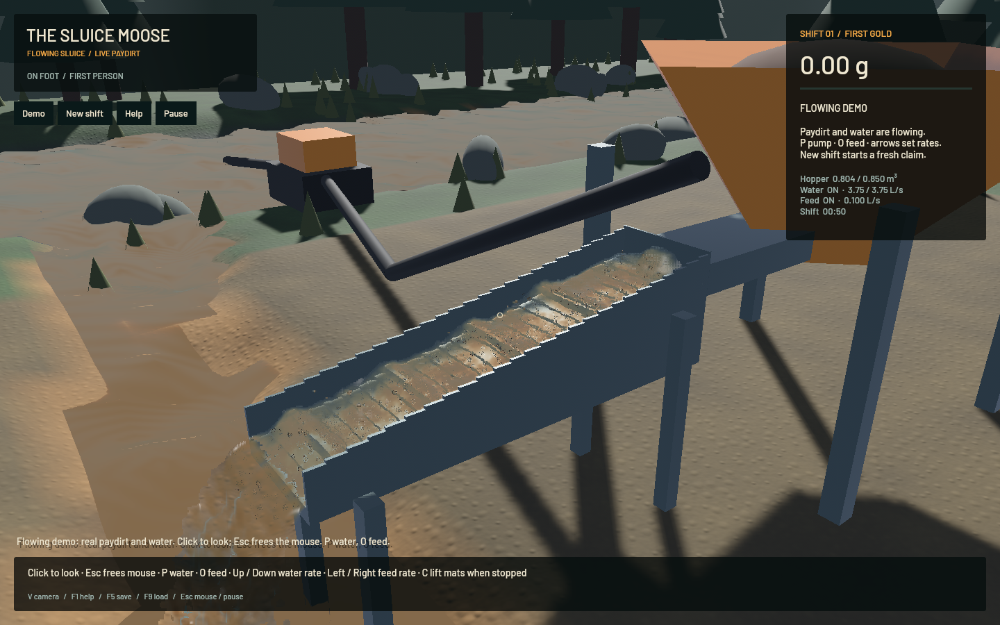

Pumped river dirt and trace gold now enter the real sluice grain solver instead of disappearing at the water intake. The transfer preserves the terrain's four suspension classes in saved inlet custody, samples a compact local mixture, counts actual represented water withdrawal and applies finite backpressure before editing the donor. Dry sources, pending gold, old saves and capacity states have regressions. The HUD shows actual/requested L/s. The [model and remaining limitations](../physics/intake.md) document the boundary and grading assumptions.

[Six seconds of native motion](2026-10-22-intake.mp4): four seconds at the sluice, then two seconds at the restored outlet, from separate serial runs. Native wall timing is retained; screenshots are held to encode 30 fps without synthetic interpolation. All 37 sluice and 10 outlet frames were written. Six temporal samples and full native frames were reviewed: downstream transport continues, while isolated beads, grain stippling, coarse banks and placeholder assets remain. Sampled presentation time never reverses; the sluice run records 1 whole-run buffer underrun, so occasional presentation stalls remain.

The first loaded trial exposed an emission bottleneck that artificially pulsed the pump. Admission now cycles fairly through classes with at most 32 bounded parcels per fluid update, and the carrier buffer holds a complete admission batch across the two domain ticks. Individual parcels retain the 2 mL cap or the size of one physical grain. Independent mixed/single-class and 20 L/s Session-boundary tests verify delivery without oversized parcels or alternating skipped source ticks. The 20 L/s test uses a known absorbing receiver; it is not a calibrated high-flow GPU recovery experiment. Numerical capacity can still restrict sustained dense operation, tracked in `sluice-dense-intake-capacity`.

| Controlled production-GPU pulse | Result |
|---|---:|
| Simulated duration | 12.00 s |
| Water pumped | 44.998531 L |
| Initial suspended solids | 76.500 mL |
| Sum of absolute component residuals | 0.000333 mL |
| Whole-system water residual | 0.370 mL |
| Gold residual | 2.17e-19 g |
| Mid-run save/restore inventory | Exact |

The pulse uses the actual GPU terrain and FLIP/DEM solvers, no hopper feed, all four suspended material classes and a local gold tag. Every class and gold enters actual weighted grains; sand reaches finite tailings. The per-component gate is 7.65e-09 m³, fixed before observing the run. This controlled flat initial-value case is not a full mining shift, constructed pool circuit or empirical recovery calibration.

The final **20-second native loaded window** renders at **57.40 FPS**, with **0.618× simulation/wall time**. Its bulk-solid residual is **25.53 mL** against the unchanged one-ppm stage tolerance (412.47 mL); water residual is -6.45 mL, sluice water residual is 0.00 mL and gold residual is 1.82e-12 g. Actual flow at the final sample is 3.7498 L/s for a 3.75 L/s set point. Conservation gates pass; the combined benchmark correctly exits unsuccessfully because simulation is below 0.98×. More actual source material now participates, so the early pulsing trial is not a valid speed control. No real-time optimisation is claimed.

A pre-fix capture saved 57/57 frames and its receipt, then stalled while quitting; the scoped supervisor stopped only that owned game. This matches the symptom of the existing `sluice-render-exit` issue. Its earlier retained native stack showed `RenderAppChannels::drop` waiting while the render schedule needed `MainThreadExecutor`. The pinned [Bevy pipeline](https://github.com/bevyengine/bevy/blob/v0.17.3/crates/bevy_render/src/pipelined_rendering.rs) waits with that executor during normal extraction, but its destructor uses a blocking receive. The app now drains the final frame with the executor before main-world teardown, retaining ordinary pipelining and resource destructors. Two manufactured regressions pass, followed by **three serial native exits** with the drain marker: sluice capture, restored outlet capture and the expected benchmark failure. None needed a timeout or sample. This fixes the identified game exit path; it does not establish a fix for the earlier macOS WindowServer problem.

Final verification: **58 domain + 33 application + 11 explicit GPU checks = 102 passed**, strict focused Clippy, stable package formatting, real shader compilation and signed packaging. One profiling microbenchmark stays ignored. All heavy jobs, compilers and encoders ran sequentially with one job/thread. No new panic or WindowServer report appeared. The original dirty checkout and saved stash remain untouched. Full-workspace CI still has the separate legacy formatting and DEM density-separation failures; a new cloud run must be assessed independently.

FLIP/APIC, riffle geometry, pressure/contact settings, physical timesteps and the terrain solver remain intact. Hose hold-up/pressure/cavitation, exact substep-local terrain gold transport, dense phase momentum/packing, grain-mass/porosity consistency, wet soil, constructed pads/ponds, shaker decks, calibrated recovery and loaded real-time throughput remain open parts of the full goal. `sluice-pump-handoff` closes this first transfer stage; `sluice-intake-solids` and `sluice-realistic-operation` remain in progress.

The [numeric/source receipt](2026-10-22-intake.json) identifies the final signed binary and exact source. All earlier trials, failed exit, sources and logs remain under the artifact directory. The delivered app is `release/First Bend.app` there.
