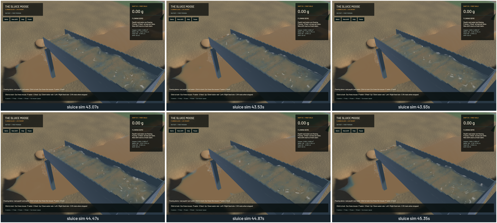

Gold in moving terrain water now follows the actual water substeps and separate deposition/scour phases. The old code conserved the global gold total while leaving its tag in the wrong cell: in a marked 0.8 mm film, neighbouring paydirt should carry 0.000220485467 g of gold, but only about 7e-13 g arrived. The corrected result is 0.000220485442 g, about 0.116 ppm from the independent local paydirt reference. The control passes in all four flow directions.

Read-only GPU passes capture actual old depth, limited shared face volumes and discharge per water substep, followed by paydirt geometry/precision/concentration after each bed phase. The host conservatively replays f64 provenance through those events. New arrivals can travel onward during the next substep; settlement followed by scour mixes provenance even when the net bed change is zero. Differencing bed components separately retains tiny counted deposits. Mobile precision tags remain with their local carrier, and tags without a remaining mobile paydirt carrier strand into the bed. See the [model and limitations](../physics/terrain-gold.md).

The capture code changes no physical buffer. A real-GPU control independently checks event depth/flux budgets and bit-identical physical channels with recording on and off for closed and open boundaries. Water/riffle/FLIP/APIC/DEM equations, resolution and timesteps remain. The current collapse law moves three non-pay classes while leaving paydirt stationary; a production control audits that assumption. Arbitrary gold-bearing soil failure is still unresolved.

A mixed bed/mobile load continues with exactly equal bed, mobile and exported gold arrays after live restore. A finite intake drain collects 0.450007617 L of water and 2.20636e-11 g of residual suspended gold. Saving the drained state and rewetting with a counted clean inlet preserves the deposited bed tag and finishes with zero gold residual. This controlled intake outlet is included in the external material/water/gold ledgers. It does not establish continuous pond-margin or unsaturated-soil convergence. Version 5 schema is unchanged; recorded events are transient and reconstructed after restore.

Native sluice/outlet/river capture sets contain 44/44/45 frames. Review covered six temporal samples from each view. Every sampled presentation time advances, with no recorded reversals or buffer underruns in these runs. The joined sluice and falling outlet show no new visual regression. Droplet highlights, grain stippling, broad river colour and coarse bank transitions remain visible. These are diagnostic camera checks, not a driving/digging replay or a completed graphics stage.

| Sequential ordinary demo, 20 seconds | 0dcb5a2 baseline | Final |
|---|---:|---:|
| Mean render FPS | 56.16 | 56.37 |
| p95 frame time | 30.31 ms | 30.26 ms |
| Simulation / wall time | 0.586× | 0.588× |

The short windows show no material throughput change and do not prove an optimisation gain. Both fail the combined real-time gate. Final numerical budgets pass: zero sluice-water residual, -7.14 mL whole-water residual, 10.21 mL reference-bulk residual, 0.018873 kg dry-mass residual and 9.09e-13 g gold residual. The local marked control detects the bug that those global budgets missed.

Validation: 117 app/domain CPU checks and 52 explicitly executed GPU checks pass (51 in the complete run plus the final drain/rewet control). The profiling microbenchmark remains ignored. Focused strict all-target app/domain/physics Clippy and the final test lint pass. Stable touched-file formatting, whitespace, signed native packaging and Metal rendering pass. A broader original-game-library strict lint audit reports 99 findings outside changed lines; it remains failed and is tracked as `sluice-legacy-clippy`. The preceding exact-head CI also fails Format and Test game. No full-workspace green claim is made. The [numeric receipt](2026-10-22-local-gold.json) records source/binary hashes, diagnostic locations and full native fields.

All builds, tests and native runs were sequential with one compiler job. The final verification-only test was added after capture; refreshing the cached package leaves its native binary hash identical. Required scoped cleanup leaves no task-owned game/browser/test process; 14 shared Playwright MCP and 56 Node processes remain untouched. No new panic-full or WindowServer report appeared. The installed `bd sync` command is unsupported; only changed project records are exported. The original dirty checkout and user stash remain preserved.

The local-provenance prerequisite is complete. Coarse environmental gold still follows paydirt rather than an independently settled grain. The bed exchange remains once after a full terrain tick: moving films need further reaction/transport timestep convergence, especially where terminal settling is much faster than that tick. Continuous wet/dry shorelines, shallow rough-bed scour, infiltration, pore pressure, compaction, finer cuts/machine support, constructed pads/ponds, wet shaker decks, calibrated phase coupling/recovery, art and real-time physics remain open under the [complete operation plan](../../plans/2026-10-22-realistic-operation.md).
