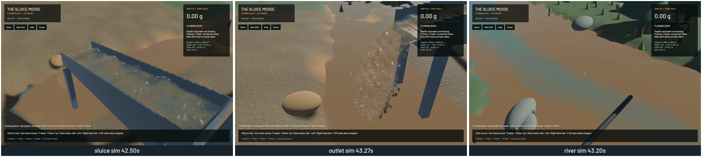

Terrain sediment now settles during travel through each existing water substep. The old pipeline first moved it for the complete terrain tick, then deposited it. In a 0.8 mm paydirt control with a 2.55 ms settling timescale, this delivered about 14.8 times the receiving-cell material predicted by an independently integrated frozen-flow finite-volume balance. The new result is 0.43% from that reference, with no extra water substeps.

The [residence model](../physics/residence-transport.md) retains the original mixed-column deposition law and terminal velocities, while integrating settlement before face crossing and after arrival. Each interface uses the same quantized material amount in donor and receiver. Signed compensated sums and actual represented concentration close the receipt into counted bed stock; existing signed numerical feedback remains separate. Quiet columns use direct analytic decay and zero elapsed time is an exact identity. Scour retains its final snapshot/candidate/reconciliation stage. The isolated source-only settling API remains a reference control.

The water solver's equations, CFL policy, grid and timestep remain. Pressure, FLIP/APIC, DEM and riffle equations remain. Deposition now changes terrain between the existing water substeps, so coupled water trajectories can change. The f64 gold tracer follows the same departure/arrival residence and final scour; it does not deposit the same gold again. Removing obsolete initial bed copies avoids two unnecessary arrays. Version 5 state/schema and old-save inventory custody remain.

Independent manufactured translated/decaying Gaussian and integrated bed profiles converge with grid/time refinement. At 25/12.5/6.25 cm, mobile L1 errors fall 12.15% → 6.57% → 3.41%, and bed errors 4.90% → 2.53% → 1.28%. On a fixed 12.5 cm grid with 0.125/0.0625/0.03125 s steps, errors against an exact Poisson donor-cell reference fall 4.13% → 2.00% → 0.983% for mobile material and 1.41% → 0.733% → 0.374% for the bed. This separates timestep convergence from spatial error. These fixtures prescribe flow; the playable physical terrain remains 25 cm.

The manufactured moving-material budget stays within 3.82e-13 of initial mobile material in the spatial cases, against the unchanged one-ppm limit. The complete quiet-column matrix stays below 0.709 ppm concentration error and 0.039 ppm material error. Cross-depth incoming mobile/bed material matches independent temporal quadrature for all four classes, including zero reaction. Existing long-exchange, water/boundary/tile, tiny-stock, finite drain/rewet, marked-gold, exact live-restore, optics and FLIP/DEM controls pass. These checks do not calibrate ore grades or complete continuous shoreline, immersion/bedload or constructed-pool behaviour.

The final motion sets contain 43/45/43 native frames. Review covers six temporal samples per view. Sampled presentation advances without stalls or reversals, and these runs record no buffer underruns. The falling outlet remains intact and no new visual regression appears. Droplet highlights, grain stippling, broad river colour and coarse bank transitions remain visible. These diagnostic camera samples are not a new operator driving/digging replay or a completed graphics stage.

| Sequential ordinary demo, 20 seconds | 84ae081 baseline | Final |
|---|---:|---:|
| Mean render FPS | 56.35 | 56.03 |
| p95 frame time | 29.96 ms | 30.25 ms |
| Simulation / wall time | 0.583× | 0.581× |
| Reference-bulk residual | 10.08 mL | 0.0366 mL |

The short windows show essentially unchanged throughput and do not establish a performance gain. Both fail the combined real-time gate. Final numerical budgets pass: zero sluice-water residual, -7.46 mL whole-water residual, 0.0366 mL reference-bulk residual, 6.594e-5 kg dry-mass residual and 1.82e-12 g gold residual. Lower global drift does not replace the independent local residence controls.

Validation: 120 application/domain CPU and 57 explicitly executed real-GPU checks pass. The application profiling microbenchmark remains ignored. Focused strict all-target app/domain/physics Clippy, stable touched-file format, whitespace, signed native packaging and Metal rendering pass. The preceding exact-head CI still fails Format/Test game, and the separately tracked strict original-game-library lint audit remains unresolved. No full-workspace green claim is made. The [numeric receipt](2026-10-22-residence-transport.json) records all source/binary hashes, benchmark fields, convergence rows and capture timing.

All builds, tests and native runs were sequential with one compiler job. Scoped cleanup leaves no task-owned native/browser/test process; 14 shared Playwright MCP and 56 Node processes remain untouched. No new panic-full or WindowServer report appeared. The installed `bd sync` command remains unsupported; only the two changed project records are exported. The original dirty checkout and user stash remain preserved.

The bounded residence-time correction is complete. The frozen mean-depth coefficient remains an approximation for rapidly changing hydraulic depth, and scour remains a full-tick split stage. Continuous sloping wet/dry shoreline convergence, shallow rough-bed scour, grain immersion/bedload, infiltration, pore pressure, compaction, arbitrary fill/failure strata, finer excavation and machine support, constructed pads/ponds, shaker decks, calibrated phase coupling/recovery, art and real-time physics remain required by the [complete operation plan](../../plans/2026-10-22-realistic-operation.md).
