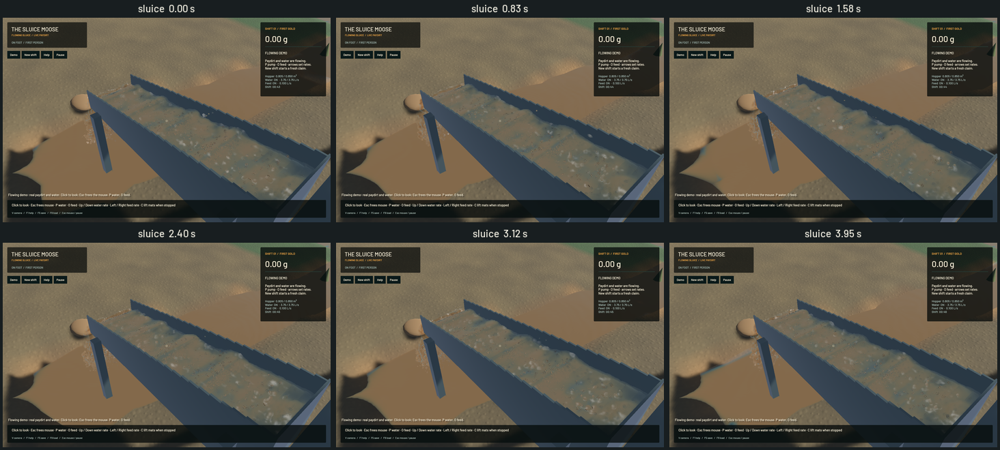

Environmental sediment now settles with elapsed time and particle size, including representable deposits below one millimetre. Scour can wash through a thin cover into the next stratum. The original in-sluice FLIP/APIC, DEM and riffles retain their solver, particles, pressure work and timestep.

[Native sluice, outlet and river motion](2026-10-22-terrain-settling.mp4). The 10.097-second video preserves recorded wall timestamps. Review used six temporal samples per view. Detached water beads, grain stippling and opaque environmental water remain visible; this physics stage does not complete the graphics work. These captures are renderer-owned evidence, not a complete operator playthrough.

The [model notes](../physics/terrain-settling.md) document the well-mixed deposition equation, retained terminal speeds and erosion parameters, time spent clearing exposed layers, numerical reconciliation and limitations. Continuous deposition replaces the old per-step gates and calm boost. Wet-bed stability now uses microseconds, with the old 1.5-second threshold curve retained as an uncalibrated proxy.

Long-residence testing caught a second problem: floating-point donor protection rolled complete deposits back, leaving 65.13% of the test's coarse load suspended. Bounded representable transfers reduce the remaining fraction to 4.48e-8. Repeated exchange then exposed a 2.4–3.0 ppm bias during bed erosion. Persistent signed rounding feedback removes the accumulation without widening the existing one-ppm material limit or adding a material reservoir. It costs one 256 KiB buffer and its readback payload at 128×128, with no additional simulation dispatches.

| 20,000 isolated stages per class | Final residual | Fraction of initial mobile material |
|---|---:|---:|
| Fine sediment | -0.0159 mL | -0.00828 ppm |
| Overburden | +0.0515 mL | +0.0268 ppm |
| Gravel | +0.0291 mL | +0.0152 ppm |
| Paydirt | +0.0964 mL | +0.0502 ppm |

Initial mobile inventory is 1.9200001 m³ per class; background bed volume is excluded from the tolerance. The dilute-column concentration error is at most 1.11e-6 relative to its initial concentration. An independent coupled settling/scour balance converges as timesteps halve: concentration errors decrease from 6.46e-6 to 3.31e-6 to 1.50e-6. A separate f64 control checks 8,192 rounded recipients against final stored bed values. The boundary fixture now counts bed deposits, suspension and exports, resetting each independent initial condition; its tolerance is unchanged.

Version 3 saves explicitly store clock units and rounding feedback. Three CPU persistence controls cover exact roundtrips, one-time migration from real version-2 field conventions and invalid clocks/feedback. The original coupled GPU test exercises nonzero feedback, live save/restore and continued operation. The native app also reloads its actual 29.63 MB version-3 save: all 18 paused capture samples retain the exact saved simulation time, 55.833336245 seconds. That pause is expected, not a presentation stall.

| Sequential loaded native window, 20 seconds each | Before | After |
|---|---:|---:|
| Mean render FPS | 57.78 | 57.95 |
| p95 frame time | 29.95 ms | 29.78 ms |
| Simulation / wall time | 0.623× | 0.644× |
| Whole-run presentation underruns | 0 | 4 |

These windows show no measured rendering regression. Corrected deposition changes the material mixture reaching the plant, so this is not an isolated solver optimisation benchmark or evidence of a throughput gain. Both runs correctly fail the combined real-time gate. The after-run residuals are +12.43 mL bulk material, -8.16 mL world water, zero sluice water and 1.00e-11 g gold. Global short-run budgets do not establish local gold transport or empirical recovery accuracy.

The final live recordings contain 44 sluice, 34 outlet and 33 river frames. All sampled presentation times advance, with no reversals or buffer underruns during recording. The sluice retains travelling waves and connected highlights; the outlet retains its falling discharge. The river still needs optical and environmental art work. The separate loaded benchmark's four underruns remain a performance limitation even though these captures contain none.

Validation passes: 99 focused CPU/domain/application checks and 38 explicitly enabled real-GPU checks, strict focused all-target Clippy, package/scoped formatting, whitespace checks and signed packaging. One profiling microbenchmark remains explicitly ignored. The pre-existing dependency dead-code warning remains; full-workspace CI is not claimed green.

All twelve changed source/test files are included in the verified build over `34084e0`; there is no excluded terrain WIP in this artifact. The [numeric receipt](2026-10-22-terrain-settling.json) records source/binary hashes, controls, failed intermediate trials, saves, native captures and media identities. Heavy jobs ran sequentially with one compiler or encoder job. Every native run drained its final render, and no new panic or WindowServer diagnostic appeared.

The snapshot/settling prerequisite is complete within the documented model domain. `sluice-thin-film-sediment` retains drying/rewetting below the 1 mm water-depth applicability floor. Grain mass, porosity, pore water, physical compaction, hindered settling, flocculation, calibrated shear/bed behaviour, substep-local gold transport, constructed pools, shaker decks, graphics and real-time operation remain part of the [full staged objective](../../plans/2026-10-22-realistic-operation.md).
