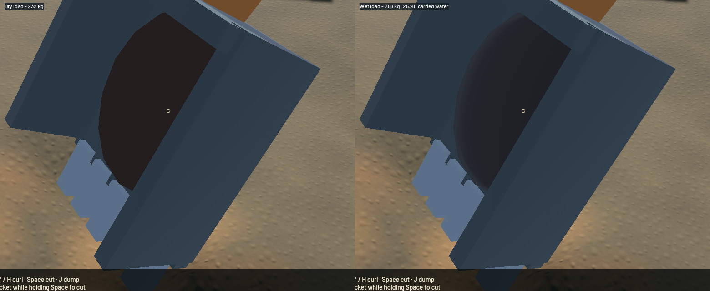

Wet excavation now carries finite pore water through hand/machine buckets, falling loads, hopper admission and overflow. Deposits return it to available pore volume; feeding releases it into actual FLIP particles at the paydirt chute. Wet load mass affects the hydraulic limit and is visible in the HUD. Bucket/hopper colour and roughness respond to carried saturation. This is a Stage 2 custody foundation, not completed saturated-soil dynamics or compaction.

[Native wet/dry load and sluice/outlet/river motion](2026-10-22-wet-material.mp4). The clip preserves all 119 native frames plus a repeated final frame, with every encoded timestamp checked against the millisecond capture cadence. Review covered six samples per water view, full-resolution bucket frames and the earlier frozen captures. The final bucket views run unpaused so the pause panel does not obscure the material. Their diagnostic camera is fixed; their unchanged machine pose is checked. This is renderer-owned evidence rather than an operator input playthrough.

Sixteen actual domain cuts produced 0.120000 m³ of reference material: 232.366 kg dry and 25.852 L of retained water, or 258.218 kg total. The initial bank patch was explicitly conditioned to 0.8 saturation before starting its water budget. Transfers into the diagnostic bucket, hopper and overflow have zero measured water residual and -3.77e-06 kg dry-mass residual. These fixture transfers are not claimed as a manual machine replay. The native load changes from the displayed 232 kg dry to 258 kg wet; the fill mesh remains a coarse proxy.

The independent GPU control supplies only hopper moisture, with the pump stopped before physical steps. It releases 51.321 mL and observes 410 actual FLIP particles, including a live save/restore. Channel-water residual is -9.49e-20 m³; whole-world residual is 0.226 mL. The new chute carrier is separate from river-intake water so its material admission fraction stays correct. The existing particle capacity is reserved before taking a wet load. Grains contain dry solids; moisture belongs to the water solver.

The [soil-water model](../physics/soil-water.md) describes column pore capacity, mixed saturation, exact finite custody and its limits. Expelled water preserves four suspended class loads, horizontal momentum and trace gold when entering the surface. Sub-ULP water remains explicit counted storage until the float surface can receive it. Version 4 saves retain moisture and both water carriers; version 2/3 migration adds no water and retains the bed-age conversion. Earlier binaries reject version 4.

| Sequential native measurement, 20 seconds each | Previous ordinary demo | New ordinary demo | New wet/cut loaded state |
|---|---:|---:|---:|
| Mean render FPS | 55.70 | 57.79 | 57.89 |
| p95 frame time | 30.06 ms | 29.81 ms | 29.83 ms |
| Simulation / wall time | 0.621× | 0.630× | 0.512× |

All three correctly fail the combined real-time gate. The wet case starts from a later loaded save with new cuts and approximately 3313 grains at its endpoint, versus approximately 2767 in the ordinary case; it is not an isolated overhead comparison. Both new runs pass water, reference-bulk, dry-mass and gold gates. The wet result has -0.799 mL whole-water residual, -3.11e-15 m³ channel-water residual, 0.011992 kg dry-mass residual and 1.09e-11 g gold residual. Its native hopper released 15.092 mL of moisture during the measured scenario. The global mass threshold remains one ppm; small independent custody controls remain necessary.

The wet case records more time in the combined terrain phase. Direct profiling of 200 repeated production soil-water reconciliations on its saved endpoint measures 0.111 ms median and 0.118 ms p95 for 425 active columns. That local result does not explain the combined terrain-phase difference or establish full-run speed. Sampled initial/final CFL estimates are both two substeps; transient counts and individual GPU passes were not profiled. Retain this loaded scenario for like-state performance work rather than lowering water/riffle fidelity.

The final water recordings contain 44 sluice, 33 outlet and 30 river frames. All sampled presentation times advance, with no reversals or stalls. Sluice and outlet recordings have no buffer underruns; the river records one. The accepted falling outlet and connected channel crests remain visible. Riverbank art, isolated spray, grain stippling and the loaded-operation performance limit remain open.

Validation passes: 109 CPU/domain/application checks, 39 explicit real-GPU checks, focused strict all-target Clippy, stable package formatting, whitespace and signed packaging. One profiling microbenchmark remains ignored. The bare-rock intake fixture now explicitly starts with dry pores instead of retaining the generated claim's saturated columns; save capacity validation was not relaxed. A final legacy-clock fixture correction resets its initial water baseline after selecting the old dry model, with three focused tests rerun. Full-workspace CI is not claimed green.

The previously outstanding nominal sluice assay was also run on the clean `578e7a4` baseline before these soil edits: requested feed/water achieved, numerical checks and cleanup pass, whole-water residual 1.463 mL. That is a baseline mass/recovery diagnostic, not empirical riffle/recovery calibration.

The existing FLIP/APIC, DEM contact and terrain SWE/erosion/settling equations, grids, pressure work, timesteps, particle limits and water shaders are retained. New moisture custody and source hooks act between those steps. Two standard materials provide wet-load display; soil custody adds two f64 arrays (262144 bytes per populated Site). Heavy jobs were sequential, compiler/encoder jobs were one, native runs drained their final render, and no new panic or WindowServer report appeared. Scoped cleanup left eight shared Playwright MCP and 32 unrelated Node processes untouched. The dirty original checkout and user stash remain preserved.

The [numeric receipt](2026-10-22-wet-material.json) records source, binaries, complete results, media hashes and limitations. `sluice-wet-material` covers this foundation. `sluice-soil-water-flow`, the parent local-soil stage, constructed pads, shaker decks, the pond circuit, calibrated phase exchange, graphics and real-time speed remain required. Initial saturation, mixed column moisture, prescribed chute velocity and drained bed response are explicit approximations; there is no dynamic infiltration, variable porosity/compaction, pore-pressure strength or wet failure-block advection yet.
