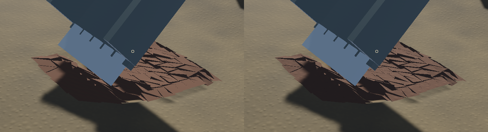
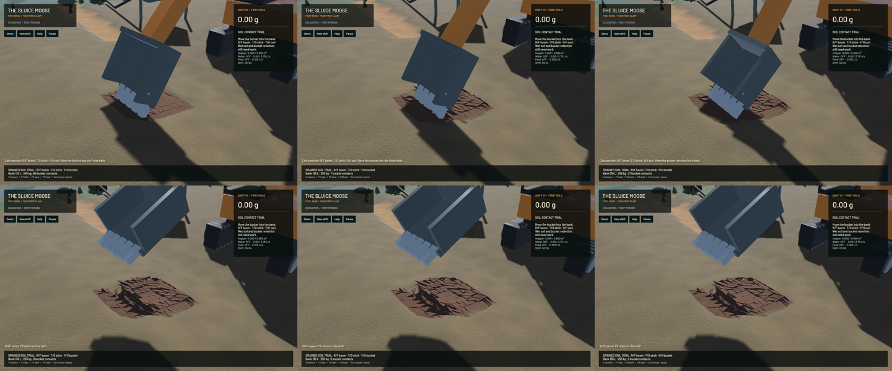
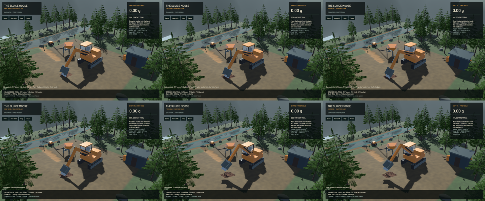

Finite moving soil now reacts through the same contact solve as the articulated excavator in explicit `--active-soil` mode. A prepared bank withdraws real site stock into 304 convex bodies: 135 L, about 255 kg and 1.271 g of trace gold. Each body owns actual geometry, mass moments, orientation and velocity. The old prescribed cutting-force transaction is not used. The bank is an initial condition before the clock starts; this is not a completed mining yield, scoop/dump operation or calibrated soil model.

The final mesh uses metre-scale colour/normal detail shared with terrain. UV scale, tangent handedness, closed volume and outward winding are checked. It adds no physical relief, bodies, material stock or new texture images. The visible improvement is small and the coarse triangular prisms remain obvious. A matched control disproved the earlier suspicion of missing rendering: the original mesh was already visible, and adding attributes alone changed zero image bytes. The material is the verified appearance change.

**208 maintained CPU/application, 84 contact-engine library and 14 explicitly executed actual-GPU tests pass.** The final graphics-only change is rechecked with all 48 application tests and strict maintained all-target Clippy; source fingerprints show no physics change after the larger run. Maintained formatting, task-authored whitespace and signed packaging pass. The full index whitespace check reports two trailing-space documentation comments in the byte-identical published `rigid_body.rs`; the scoped check excludes that unchanged file and checks every authored change. The ordinary command lists 92 ignored tests; 14 run separately, leaving 78 unexecuted. Full workspace CI is not claimed.

Controls cover independent tetrahedral mass moments; finite terrain-to-body stock and geometric refinement; transactional bad/wet activation; free impact momentum/passivity; known incline friction; 120/240/480 Hz physical refinement; exact v9 continuation; and an actuator stroke against an otherwise identical stationary bank. The latter requires over ten percent of the clods to differ by more than 2 cm, so gravity settling alone cannot pass. These checks do not establish bulk strength, cohesive failure, compaction or wet-soil convergence.

The pinned contact engine's radial clipping gave 1.45 m/s after 0.6 seconds in the independent 40° sliding reference, versus approximately 1.18 m/s analytically. The metric Coulomb projection meets the retained speed/displacement controls and refines with physical timestep. It uses the articulated effective-mass Jacobians. Only active-soil worlds enable it; the default remains false. The exact published archive checksum and all 326 original-file hashes are recorded, with six original files modified. A proposed global default change was rejected by automatic review; this explicitly scoped alternative is implemented and tested.

All 178 protected game, DEM and hydraulic source files match `1c9408f`, and non-Rapier lock entries are unchanged. Ordinary and articulated-without-soil controls reproduce 24 full saved states byte for byte against their pre-change reference. A preserved statically linked baseline executable reproduces those reference hashes again; an overwritten cached rlib is not used as a fresh baseline. The final ordinary-water frozen RGB image is byte-identical to the previous delivery.

The final native bank recording retains all 304 bodies and the same material throughout, with up to 112 bucket contacts in a sampled mechanical step. F5 saves a moving v9 state. Eight frozen frames after a separate native restore each check all 304 clods, 9,504 f32 values bit for bit and 5,503 other values exactly, including canonical materials/moments. Separate actual-GPU integration exercises active soil on a dry part of the claim alongside the original flowing water solver and live restore. It does not test immersed mud. Eighteen native ordinary keyboard/mouse/toolbar and F5/F9 checks pass.

[Native motion](2026-10-23-active-soil.mp4) retains all 397 source captures across 20 seconds of bank and 16 seconds of machine view, encoded in 2163 frames at 60 FPS wall timing. Capture targets 12 Hz; repeated display frames are not extra physics. Review covers six temporal samples and the full midpoint frame in each view, plus matched frozen material captures. The entire video and manual OS input were not reviewed. Machine and soil presentation still follow worker snapshots.

| Separate native 20-second windows | Render FPS | p95 frame | Simulation / wall | Real time |
|---|---:|---:|---:|---|
| Pre-soil reference, loaded ordinary water | 55.72 | 26.64 ms | 0.3232× | Failed |
| Candidate ordinary water, before sole clod-material change | 55.95 | 26.68 ms | 0.3031× | Failed |
| Final prepared bank, pump off, no screenshots | 55.81 | 20.78 ms | 0.1866× | Failed |

The bank and loaded-water rows are different workloads. The moving-bank capture advances 0.2707× with a different contact workload; the difference is not attributed to screenshot overhead. No speed improvement or zero-cost ordinary integration is established. The ordinary domain phase measures 3.13 ms versus 3.11 ms in the reference; the measured fluid phase differs more. All native material gates pass. Final bank water residual is 0.0778 mL and gold residual is -3.64e-12 g. Signed ground-contact passivity residuals are diagnostics, not closed machine-energy claims. Full budgets and fingerprints remain in the [receipt](2026-10-23-active-soil.json).

The next physical work is shared bucket-shell/sidewall/tooth geometry with correct steel mass/inertia and retention/spill, followed by contact-consistent material admission. Runtime work must profile world rebuilding, ground changes, contacts and friction without dropping bodies, accuracy, physical cadence or exact continuation. Wet mud, cohesion, compaction, automatic local activation, bulk calibration, pads, shaker decks, sluice beds and constructed settling/recirculation remain required. The [full operation plan](../../plans/2026-10-22-realistic-operation.md) and Stages 2–6 remain open.

Heavy checks ran sequentially with one build job and one encoder thread. All native apps drained their final render frame normally. Scoped cleanup leaves no owned game, encoder, browser or test process; 14 shared Playwright MCP and 56 Node processes remain untouched. No new panic-full or WindowServer report appeared. The original dirty checkout and user stash are preserved. Installed Beads lacks `bd sync`; only the four new task records and two parent-note updates are merged from explicit export.
