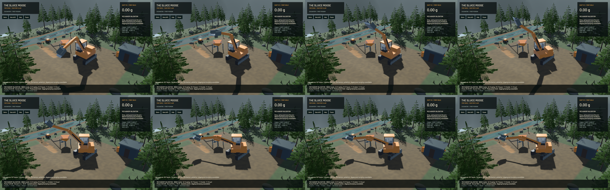
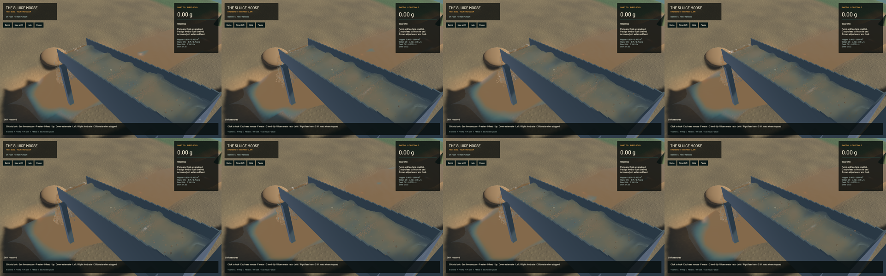

# Articulated excavator foundation and current water review

An explicit `--articulated-machine` validation mode now uses five dynamic bodies and four reduced-coordinate joints. Control input changes finite elastic references under a pump-work budget; the root and links react dynamically. Ordinary gameplay retains its finite cutting/delivery model. Validation-mode cutting and dumping are unavailable until active-soil reactions and payload momentum/work transactions are implemented. Stages 2–6 and the full realistic-operation goal remain open.

The [mechanical model](../physics/articulated-machine.md) states masses, geometry, actuator assumptions, work accounting and limits. This is an elastic/damped angular actuator approximation, with assumed stiffness/damping and force-to-torque levers. It is not measured linkage hydraulics, calibrated digging or a complete engine/fuel/heat budget. Track belts still supply unmetered motor work, and actual reduced-coordinate motor impulses are unavailable rather than reported as zero.

**178 maintained CPU/application checks pass; 89 tests are ignored in the ordinary run. Three explicitly executed real-GPU pipeline modes pass.** Those modes are original water, conservative-phase validation and articulated-machine/original water. They exercise full machine save/restore alongside FLIP/APIC, DEM and terrain flow. Strict maintained all-target Clippy with `--no-deps`, maintained formatting, whitespace and signed packaging pass. The unchanged game dependency still emits its existing dead-code warning; this is not a full-workspace lint or GPU-suite claim.

The 18 mechanical tests include independently weighted COM/FK, ballistic fall, internal recoil, external force/torque, finite pump work, passive energy decay, pressure relief, hard limits, friction-limited driving, exact continuation and refused material exchange. The 0.5-second recoil control has about 41.7 micrometres COM drift, under 1 N s linear residual and about 1.43 N m s intrinsic angular residual. World-origin and COM angular momenta are reported separately; the original fixed world-origin bound did not pass. A conditioned near-origin refinement gives 45.51 / 26.31 / 13.20 micrometres at 120 / 240 / 480 Hz. The remote-origin f32 experiment hit its precision floor rather than monotone convergence. Independent ballistic errors halve from 2.044 to 1.021 to 0.512 mm. These controls do not establish finer soil or full hydraulic convergence.

Retained failed controls led to COM-framed roots, correct pinned inertia interpretation and synchronization of final body velocities from generalized state. No generalized velocity is changed to force a conservation result. Review also strengthened rejection of half-turn mechanism/render save mismatches. Version 7 preserves the complete mechanism; ordinary saves remain version 6, and loaders accept versions 2–7 with the existing material migrations.

All 18 final native synthetic Bevy input/toolbar checks pass, including live v7 F5/F9 restore and mode retention through New shift and Demo. These are native ECS inputs, not OS key delivery or a manual playtest. The initial capture clipped the raised boom and contained generic cutting instructions. The reviewed build widens the diagnostic camera and labels the objective/cab message consistently as mechanism validation.

[Mechanism motion](2026-10-23-articulated-core.mp4) retains all 134 source frames at 60 FPS wall timing. All 133 recorded physics intervals advance, without reset, pause, teleport or material injection. Review covers the eight temporal samples and full midpoint frame. The water-presentation underrun counter increases by 95 during this separate idle-plant machine recording, although all sampled presentation intervals advance. That counter needs a scoped pacing/empty-stream investigation before a whole-scene smoothness claim; it is distinct from the zero-underrun loaded-sluice recording below. This does not establish a loaded scoop/dump replay, and the entire video was not reviewed. Rigid soil contact, approximate equipment shapes, component masses, wet traction and bucket retention remain limits.

The unchanged ordinary cutting replay excavates and delivers **0.418540 m³**, with live restore during a cut, 56.62 FPS and 0.9994× simulation/wall speed while the sluice is idle. It runs on the preserved initial signed binary; the reviewed changes affect save validation and optional-mode messages/camera, not ordinary physical mechanics. Its gold residual is 1.82e-12 g and water residual 2.24e-07 m³. This is excavation/delivery evidence, not completion of the current washing/cleanup loop.

## Crest and muddy-patch verification

The [paired crest/optics correction](2026-10-23-crest-patches.md) remains in the final renderer. The visible interface and additive water/sediment columns share their filters, with slope-aware depth rejection and an independently fitted normal. Rounded particle-cap highlights and isolated tan opacity patches are reduced in the matched comparison. Broad wave bands, muddy suspended water and coarse grain speckling remain. This is not a claim that the complete scene looks realistic. No water, riffle, DEM or terrain solver equation is changed by this mechanism checkpoint; 177 protected solver source files match the base commit.

[Current native water motion](2026-10-23-articulated-core.water.mp4) retains all 67 source frames, encoded with wall-time duplicates at 60 FPS. The recording has 55 physical advances and 11 repeated worker snapshots; all 66 presentation intervals advance, with no rewind or buffer underrun. Review covers eight temporal samples and the full midpoint frame. An initial helper assertion incorrectly required a new physical snapshot per screenshot: its 66 frames and failed assertion remain retained. Analysis found 55 physical advances, ten holds and all 65 presentation intervals advancing. The helper was corrected to distinguish worker and presentation clocks; no simulation gate or equation was relaxed and that first recording was not rerun.

| Separate loaded-water 20-second windows | Render FPS | p95 frame | Simulation / wall | Real time |
|---|---:|---:|---:|---|
| Previous track-contact build | 56.82 | 26.24 ms | 0.3233× | Failed |
| Final ordinary build | 56.83 | 26.36 ms | 0.3196× | Failed |
| Initial articulated-mode build | 56.69 | 26.30 ms | 0.3166× | Failed |

All recorded loaded-water windows pass the bulk/dry-mass and water/gold gates. Their nonzero exit is the failed real-time gate, not a crash. The final ordinary build has water residual -7.82e-06 m³ and gold residual 3.64e-12 g. These short evolving windows establish no throughput improvement. Render FPS and simulation multiplier remain separate.

Source and binary manifests, full frames, timing, failed controls and numerical budgets remain in `/Users/simonheikkila/.codex/visualizations/2026/10/18/01a14ce3-309f-7782-9a7c-ccd0efaf3227/articulated-core-20261023` and the [checkpoint receipt](2026-10-23-articulated-core.json). Each native run uses an isolated save and confirms main-thread final-frame teardown. Heavy jobs and encoders run sequentially with one compiler/encoder job. Scoped cleanup reports zero agent-browser, Playwright test or Chrome-for-Testing processes. Sixteen shared Playwright MCP and 64 Node processes remain untouched; no task-owned game or encoder remains. No new panic-full or WindowServer report appeared. Final remote verification is retained in the artifact landing receipt. The original dirty checkout and user stash are preserved; installed Beads lacks `bd sync`, so only touched project issues are exported into the tracked file.
