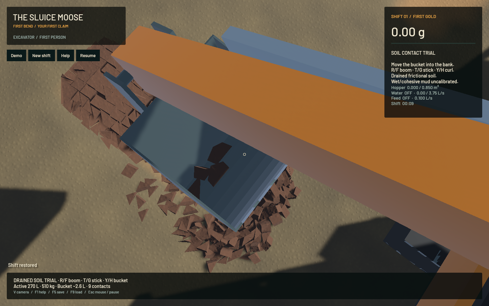
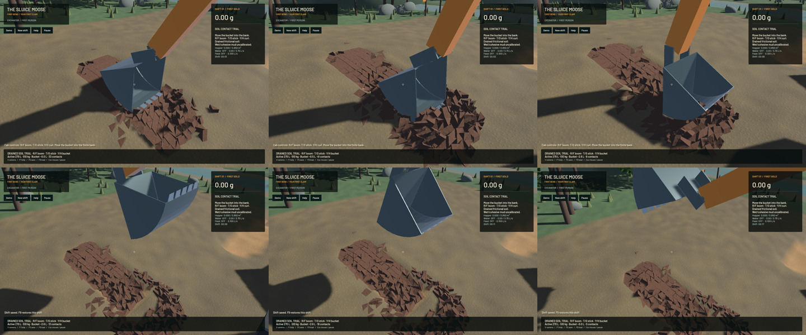

The articulated dry-soil experiment now has an exterior-mounted hollow bucket, shared steel geometry/mass/inertia, stable small-clod registration and narrowly scoped touching-contact repair. This is Stage 2 progress toward the complete mining operation. Ordinary shifts retain their finite-cutting mode; wet/cohesive mud, bulk convergence, construction and the wash plant remain open.

Nineteen nonoverlapping steel components provide the curved back/floor, cheeks, five tangent-entry teeth, two exterior ears and 70 mm pin. Integrated steel is 249.999997 kg at the declared 7850 kg/m3 density, with a 280 litre nominal cavity and 12.707776 mm plate thickness. The 130 mm physical stick and 143 mm visual envelope stay outside the cavity over 316 sampled curl angles, with a 30.303 mm minimum gap; the old mount is a negative control. Registered collider vertices, rendered steel, full inertia and hinge anchors share the same model. This is a generic design, not an OEM calibration.

Two physical defects were reproduced and corrected. Tiny SI inertia tensors previously registered with up to 29.5066% relative tensor error; scale-independent Jacobi registration reduces the checked maximum to 1.101e-7. The default angular-speed clamp separately removed 11.18% of the free-spin control's energy. New-model clods permit fast rotation and apply incremental gyroscopic corrections, preserving the 200 rad/s principal-spin control's energy exactly over 120 steps. Its remaining 20.589 degree phase error is explicitly open in `sluice-soil-angular-step`.

At touching prism edges, the pinned manifold generator fabricated 344 initial penetrations up to 176.777 mm. The new-model dispatcher independently verifies near-touch with complete convex SAT before repairing that narrow degeneracy. Valid penetration/separation cases retain the pinned behavior. The checked complete bank's worst initial penetration is 2.339 micrometres. New rigid-soil contact stiffness prevents the earlier soft-contact escape path. This does not prove bulk contact or soil-strength convergence.

The prepared bank withdraws approximately 270 litres from 24 actual geological nodes into 560 finite clods before time starts. Soil remains independent rigid bodies sharing contacts with machine, substrate and equipment. There is no scalar bucket capture, material injection, suction or prescribed post-start clod pose. A bounded joystick controller crowds, curls, lifts, holds and opens the bucket.

| Evidence | Result |
|---|---|
| Fixed logical 240 Hz cycle | 4.219 L approximate minimum held at 9–10 s; empty at 18 s |
| Native asynchronous cycle | 2.578 L minimum held; empty at 18.0167 simulated s |
| Native source custody | All 560 clods and every source constituent retained |
| Ground escape control | No clod wholly below its actual triangular substrate by 25 mm in all 302 native frames; corresponding full CPU cycle and delayed-input cases pass |
| Native global bulk / dry mass residual | +0.05159 mL / +0.09286 g |
| Native water / gold residual | +0.06823 mL / +6.82e-12 g |
| Frozen restore | All 560 clods, 17,440 f32 values and 10,112 other values checked per frame |
| Genuine v7/v8/v9/v10 continuation | Six complete snapshots per version over 120 controlled steps, byte-identical against the preserved old executable |

The CPU and asynchronous native controller histories differ, so their held volumes are not a matched convergence or productivity comparison. The contents display classifies centroids and can count a partly protruding clod's entire material. The escape metric bounds whole-body loss, not every vertex's penetration. The original native harness used an inconsistent dry-mass limit; the completed capture was rechecked with a 1e-7 m3 volume and 2e-4 kg density-consistent mass bound. Source material equality remains exact, and the game's existing budget gates were not widened.

[Native scoop/hold/spill video](2026-10-23-bucket-mount.mp4) retains 302 source captures at wall timing in a 77.9 second, 30 FPS display stream. Repeated encoded frames are not extra physics. The 18-second physical endpoint took 78.686 wall seconds including capture overhead; this is not real-time performance. Review covers six temporal samples, the full hold frame, discharge and the final frozen close-up; a full manual operator playthrough or whole-video viewing is not claimed.

The old close-up hid all four held clod centres behind the near cheek. Rays through the exact shared steel verify four occlusions from the old camera and zero from the higher camera. The final close-up exposes the load without moving the clods. The cycle-tested binary is retained; the later inspection binary includes the committed continuous-water renderer and camera change. Both binary hashes and all current build-source hashes are in the [receipt](2026-10-23-bucket-mount.json).

**228 maintained CPU checks and five explicitly executed real-GPU pipeline checks pass.** The latest combined app has 51 passing checks; the remaining CPU results and actual-GPU cases cover the unchanged physical implementation. Additional strengthened checks cover every-clod escape throughout the full cycle, warm-cache/cold-restore continuation and nonoverlapping mouth entry. Strict scoped all-target Clippy, maintained-package/vendor formatting and signed packaging pass. Eighteen native synthetic Bevy input checks pass; these do not exercise OS focus or constitute a full operator playthrough. Other ignored suites and full-workspace CI are not claimed.

The ordinary frozen sluice image from the final combined app is pixel-identical to the current committed renderer. FLIP/APIC, riffles, weighted in-sluice DEM and terrain-flow equations/resolution are preserved. The combined moving-soil/GPU controls use a dry bank and do not claim immersed mud. Water/bank benchmark real-time gates remain failed.

Bulk step/resolution convergence, calibrated soil strength, rotational phase, wet/cohesive behavior, continuous activation, compaction, hydraulics, pads, shaker decks, sluice buildup, constructed settling pools and the full operation remain open. `sluice-bucket-shell` and the operation epic remain in progress. No larger-load or full realism claim follows from this checkpoint.

Heavy jobs ran sequentially, with one compiler/encoder job and no new panic-full or WindowServer report. Required cleanup leaves zero owned game/test/browser/encoder processes; 14 shared Playwright MCP and 56 Node processes remain untouched. The original dirty checkout and user stash remain preserved. Installed Beads rejects `bd sync`; only this stage's touched project rows are merged from its export before the scoped commit/push.
