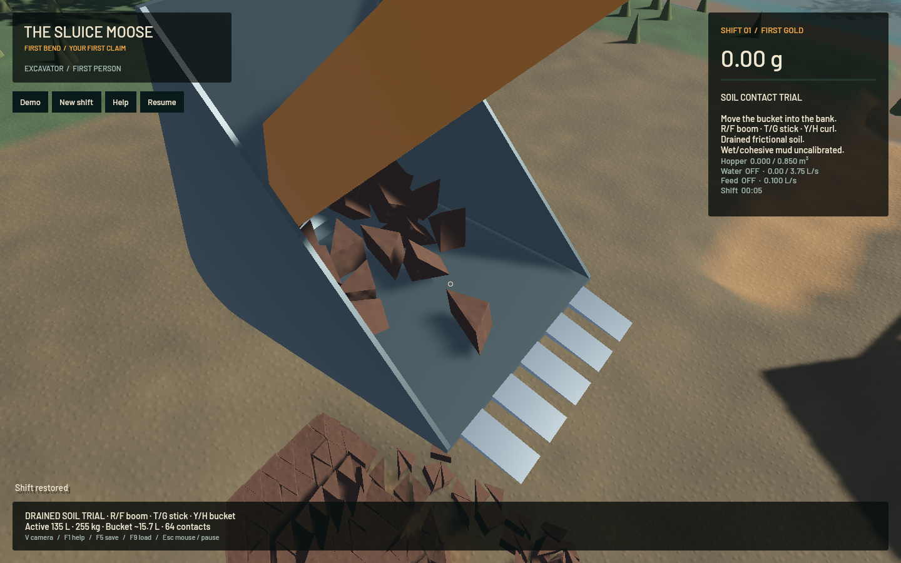
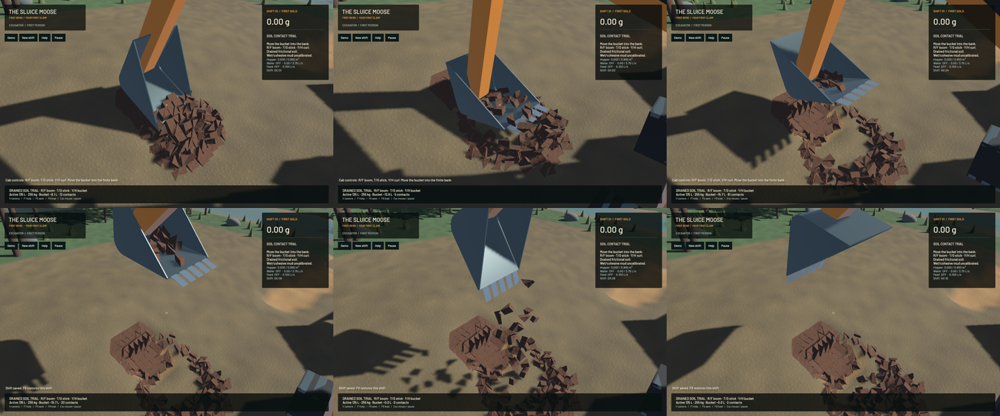

The articulated trial now uses a hollow curved bucket, two cheek plates and five flush-entry teeth, with the same geometry in collision and rendering. Actual finite soil clods can be scooped, lifted, held and emptied by opening the mouth. **The digging stage remains in progress:** native review shows the generic stick end entering the cavity, and bulk filling is strongly sensitive to physical timestep. Those defects must be resolved before realistic or calibrated digging claims.

The declared generic design has an 820 mm outer width, 280 L cavity and 250 kg steel mass at 7,850 kg/m³. Fifteen convex components form the open shell. A bounded thickness solve gives 15.1555 mm plate thickness; signed triangle integration gives steel COM and full central inertia, independently checked against extrusion integrals and the registered body. Density-zero colliders avoid counting steel twice. Multiple tilted poses and loads verify every registered hull vertex against the actual mesh frame. The shell is mounted as a backhoe, with a distinct hinge chart; legacy machines retain their old chart, geometry and arithmetic. Dimensions, pin geometry and constitutive soil parameters remain declared assumptions.

The first tooth design stood 60 mm above the inner floor. Its real-control bank replay lifted empty. A flush ramp corrects that entry obstruction without attraction, capture boxes, contact suppression, prescribed poses or extra soil. The bank is withdrawn from finite site stock before time starts. Independent clods retain their own geometry, material, moments and motion; none enters scalar carried custody or gets counted twice in machine inertia. The read-only HUD estimate classifies clod centres in the nominal cavity. A partly protruding clod can therefore contribute its full stock to the estimate.

| Same 135 L bank; approximate load held after lifting | Retained load | After opening |
|---|---:|---:|
| CPU, 240 Hz mechanics and 60 Hz grade/crowd/curl controller | 4.805 L | 0 L |
| CPU, 480 Hz mechanics and the same macro controller | 12.305 L | 0 L |
| Native, 240 Hz mechanics and rendered joystick-packet controller | 15.703 L | 0 L |

The two CPU runs do not establish converged bulk yield. The native run receives a different feedback/input history, so it is not a matched-timestep comparison with either CPU result. Its F5 save contains 23 counted load clods, with every vertex at least 2.189 m above the actual terrain. Eight frozen frames after one restore check all 304 clods: 9,504 f32 values match bit for bit and 5,504 other canonical values match exactly in each frame, including the shell model. This is one restore inspected eight times, not eight independent restores. Every recorded native frame retains the same soil constituents, and scalar carried custody stays empty.

The static shell fixtures retain eight clods upright and at a 45 degree roll at both 240 and 480 Hz; all eight leave through the inverted mouth. A floor-only negative control loses the rolled load. Separate free-system floor/cheek impacts require actual machine recoil, linear momentum error below 0.003 N s, angular momentum error below 0.03 N m s and no energy gain beyond 0.01 J. These are finite-body mechanical checks, not continuum soil or full-machine energy calibration. The [model description](../physics/bucket-shell.md) states the geometry and the remaining constitutive scope.

New articulated machines write version 10 with an explicit `ShellV1` tag. Old saves retain their original floor model and format. Genuine v7, v8 and v9 saves were continued with the identical 120-step input script in executables built from the prior committed source and the candidate. All 18 sampled complete states match byte for byte: 51,162,555 bytes in total. The statically linked probes and exact prior-source archive are fingerprinted in the [receipt](2026-10-23-bucket-shell.json); overwritten Cargo libraries are not treated as preserved executables.

**215 maintained CPU/application checks and five explicitly executed actual-GPU pipeline checks pass**, with strict scoped all-target Clippy, maintained formatting, whitespace and signed packaging. The GPU controls exercise original FLIP/APIC, DEM, terrain flow and live restore with the shell and dry active soil. Of 93 ordinarily ignored checks, five ran explicitly and 88 did not. Full workspace CI is not claimed. A test-fixture type error, Bevy system-tuple limit and two obsolete new-machine save-version assertions were corrected before the final run; failed attempts remain in the artifact directory.

All 681 other checked Rust/WGSL/manifest/lock sources match the prior `c85f65e` checkpoint. Water, riffle, DEM and terrain solvers retain their source, resolution and cadence. The frozen ordinary-water native PNG is byte-identical to the previous corrected-crest build, preserving that rendering repair. Eighteen separate native synthetic keyboard/mouse/toolbar checks pass; the analog soil replay is not represented as OS keyboard injection or a manual playthrough.

| Separate 20-second native windows | Render FPS | p95 frame | Simulation / wall | Real-time gate |
|---|---:|---:|---:|---|
| Ordinary saved flowing water | 55.75 | 26.78 ms | 0.3266× | Failed |
| Prepared hollow-shell soil bank | 55.62 | 21.03 ms | 0.2316× | Failed |

These are absolute measurements of different workloads, not a speedup comparison. Both material gates pass. The bank's final whole-water residual is 0.111 mL, sluice-water residual is zero and gold residual is -8.19e-12 g. No physics work or resolution is reduced to improve FPS.

[Native scoop, hold and gravity spill](2026-10-23-bucket-shell.mp4) retains all 451 source captures in 3,612 encoded frames at 60 FPS wall timing. The source target is 8 Hz; repeated display frames are not extra physics. All 450 sampled intervals advance. Review covers six temporal samples, full-resolution empty and held frames and the frozen restored close-up, rather than an entire-video watch. The motion camera follows the bank and tool; parts of the raised linkage leave the frame. Coarse triangular clods, stick intrusion, timestep-sensitive yield, wet/cohesive mud, continuous local activation and realtime throughput remain open. The overall operation plan and broader game objective remain active.

For the isolated interactive trial, [launch this checkpoint's digging trial](</Users/simonheikkila/.codex/visualizations/2026/10/18/01a14ce3-309f-7782-9a7c-ccd0efaf3227/bucket-shell-20261023/Launch digging trial.command>). Tab enters the excavator; V changes camera; R/F, T/G and Y/H control boom, stick and curl. F5/F9 use its separate save. The main app retains the ordinary game and flowing-water demo.

Heavy jobs ran sequentially with one compiler/encoder worker. Required scoped cleanup leaves no owned native, encoder, browser or test job; 14 shared Playwright MCP and 56 Node processes remain untouched. No new panic-full or WindowServer report appeared. The original dirty checkout and user stash are preserved. Installed Beads does not support `bd sync`; only the three touched project records are merged from an explicit export. The shared database requires its documented prefix override for these project issue IDs. The shell issue remains in progress with exterior-mount and bulk-convergence follow-ups.
