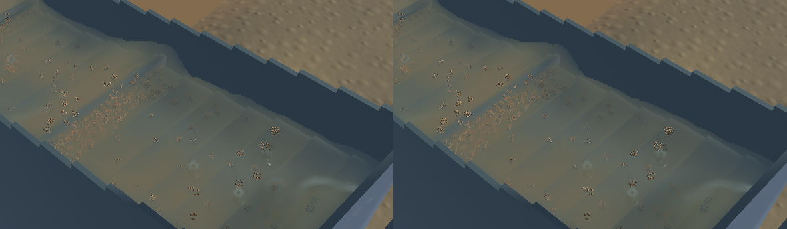
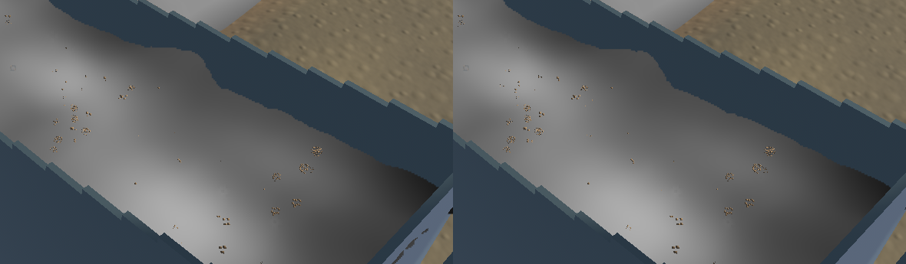
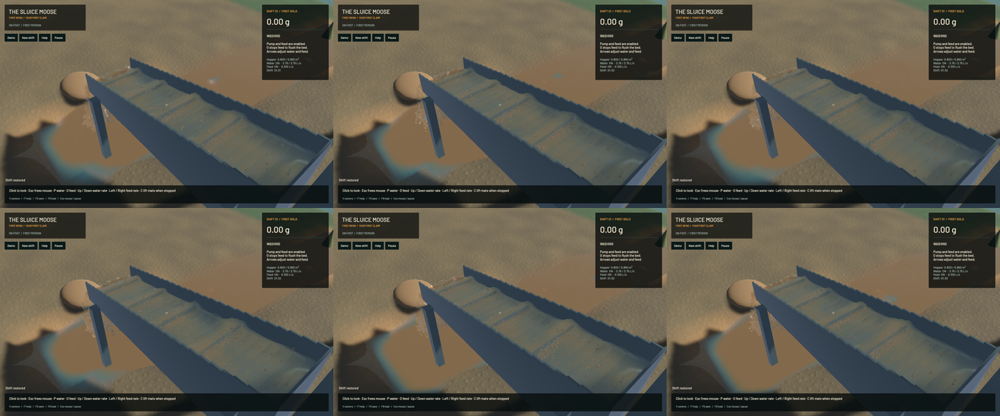

Channel render kernels now vary continuously across reconstruction cells. Previously, moving a particle 0.2 micrometres across a cell face could jump the ellipsoid shape tensor by 1.426; the new curved-sheet regression passes the unchanged 0.001 limit at five boundaries. Continuous cloud-in-cell moments and interpolated covariance replace hard bin selection for channel water. Shared moment stencils are cached. Layer proximity retains the detached-spray regression, and isotropic filled volumes keep full support.

The native comparison reduces some round crest highlights and abrupt optical transitions. The change is modest in a still image; coherent riffle waves, actual sediment variation, isolated drops and grain stippling remain visible. It does not make the river presentation or sediment calibration final.

Only two of 739 tracked Rust/shader/config build sources change relative to `3e7a024`. No water, riffle, terrain or sediment physics, particle count, physical resolution or solver timestep changes. Kernel volume normalization remains in place. All 25 pre-existing unfinished mechanics files are preserved and excluded from this build. Outlet PCA cache ordering stays identical, including its sparse-bin representative.

A native launch exposed a separate startup race: the renderer permanently failed on Bevy's retryable `ShaderNotLoaded` state. It now waits for the two retryable asset states while retaining fatal handling for real shader-processing/module failures. A regression checks both pending states and an actual error variant. The failed candidate/log are preserved; this is not a workstation-crash fix.

**71 scoped CPU checks and ten explicitly executed real-GPU optics checks pass**, together with strict scoped all-target Clippy, maintained-package formatting and signed macOS packaging. The final renderer has 50 passing app checks; 21 unchanged physics CPU checks are from the same isolated source snapshot. The GPU helpers compile the unchanged production shaders. Other ignored suites and full-workspace CI are not claimed.

Matched frozen clocks, solver steps, physical tracks, machine, excavation, delivery and flow fields agree exactly. Accepted outlet and river control crops are byte-identical. Render centres/support are deliberately reconstructed differently. The [receipt](2026-10-23-crest-continuous.json) records the exact source, input, binary and media hashes.

| Same saved input, sequential 20-second native windows | Before | Final |
|---|---:|---:|
| Mean render FPS | 55.93 | 56.19 |
| p95 frame time | 26.67 ms | 25.62 ms |
| Simulation / wall time | 0.3047x | 0.2899x |
| Physical real-time gate | Failed | Failed |

The rendering cost is higher on the surface worker; the windows do not establish a speedup. Final material-budget gates pass; sluice-water residual is 0 m3, whole-water residual -7.787 mL and gold residual 9.09e-13 g. The game is still below physical real time.

[Native sluice and outlet motion](2026-10-23-crest-continuous.mp4) retains all 136 captured source frames in 545 encoded frames at 60 FPS wall timing. Repeated display frames are not extra physics. All recorded presentation intervals advance. Recording underruns: sluice 0, outlet 0. Review covers six temporal samples and a full-resolution midpoint per view, plus frozen normal/extinction/final diagnostics. Full source captures and failed trials are retained locally.

Heavy jobs ran sequentially with one compiler or encoder job. No new panic-full or WindowServer report appeared. Required cleanup leaves zero owned game/test/browser/encoder processes; 14 shared Playwright MCP and 56 Node processes remain untouched. Scoped commit/push preserves the original dirty checkout, active mechanics work and user stash. Installed Beads rejects `bd sync`; only the two touched project rows are merged from its export. Broader water polish remains in progress.
