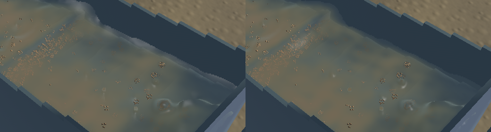
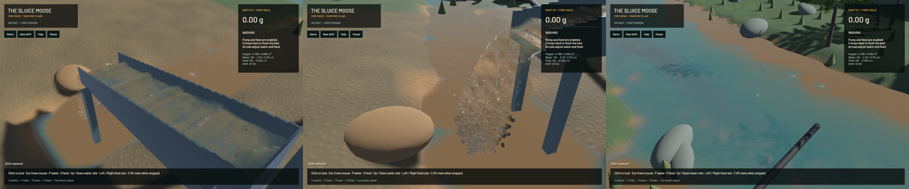

The sluice renderer now rejects detached drops when selecting the connected water surface, tightens bulk kernel support and reconstructs coarse sediment samples into longer downstream plumes. This reduces false caps and round mud blotches. Broad simulated riffle waves and real turbidity remain; the improvement is a bounded rendering correction, not a claim that the whole scene looks realistic.

A real-GPU negative control reproduces a normalized front drop selecting an interface within 5 mm, ahead of a separate bulk layer. Connected-support weighting selects the bulk layer more than 15 mm behind the raw front. Fully supported density, isolated spray silhouettes and integrated optical water remain covered by the existing controls. The channel kernel radius changes from 1.25 to 1.0 cell widths, with represented-volume renormalization. Its support field interpolates between snapshots; capture metadata now calls it `bulk_support`.

Two additional positive streamwise binomial passes preserve optical water, fine volume and grain cross-section, including boundaries. Uniform-mixture extinction is checked across 25 positions and three offsets in both reconstruction modes. The vertical and cross-stream filters retain their earlier response. Outlet concentration is sampled before the channel passes. No physical sediment is removed or diffused by the optical filter. The channel sun direction now matches the terrain light; measured pixel-scale normal variation broadens only unresolved highlights instead of imposing a broad cap on every wave. Sediment colour and radiative transport remain presentation approximations.

**122 distinct CPU checks and eight explicitly executed real-GPU optics checks pass**, plus strict all-target Clippy for mining/mining-sim/mining-physics, maintained-package formatting, whitespace and signed packaging. The affected app checks and optics were repeated after final changes. One profiling test stays ignored. Existing repository-wide Format/Test game debt is not a pass.

All 189 other checked authoritative source files match `001839b`. Only the read-only slurry presentation module changes in the domain sources. FLIP/APIC, DEM, physical grids, pressure work, timestep, riffle geometry and terrain flow retain their existing code. The opt-in conservative phase validation mode is not enabled by this fix.

Frozen simulation/fluid clocks, solver steps, selected physical tracks, flow, machine state, excavation and deliveries match exactly. All 128 sampled render centres also match. The 280×230 falling-outlet control is byte-identical. [Receipts](2026-10-23-crest-detail.json) retain native inputs, source/binary/media fingerprints and budgets.

| Same saved input, separate 20-second native windows | Before | Final |
|---|---:|---:|
| Mean render FPS | 55.32 | 55.54 |
| p95 frame time | 26.63 ms | 26.59 ms |
| Simulation / wall time | 0.2998× | 0.3099× |

These short evolving windows establish no speed improvement. Both real-time gates fail. Final material gates pass: zero sluice-water residual, -7.79 mL whole-water residual, 0.000583 kg dry-mass residual and 1.8e-12 g gold residual.

[Native motion](2026-10-23-crest-detail.mp4) retains all 45/45/44 source frames in 733 encoded frames at 60 FPS wall timing. Source capture is 12 Hz; this is not a 60 Hz physics claim. Every recorded presentation interval advances, with zero recording underruns and first-display delay below 16.62 ms. Review covers six temporal samples per view plus full live sluice/outlet frames and frozen diagnostics, rather than the entire video or a manual operator replay. Coherent raised water, small spray, gravel stippling, coarse outlet detail, river shoreline/art and real-time physics remain open in the full staged objective.

Heavy jobs were serialized with one compiler/encoder job. Scoped cleanup leaves no owned game/test/browser or heavy job; 18 shared Playwright MCP and 72 Node processes remain untouched. No new panic-full or WindowServer report appeared. The original dirty checkout and user stash are preserved. Installed Beads lacks `bd sync`; only the touched project issue is exported for this stage. The complete realistic-operation goal remains active.
