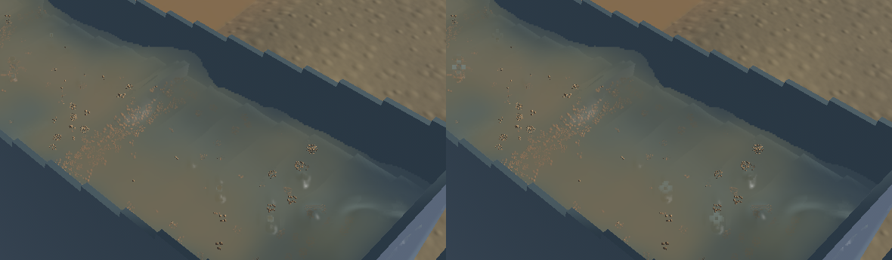
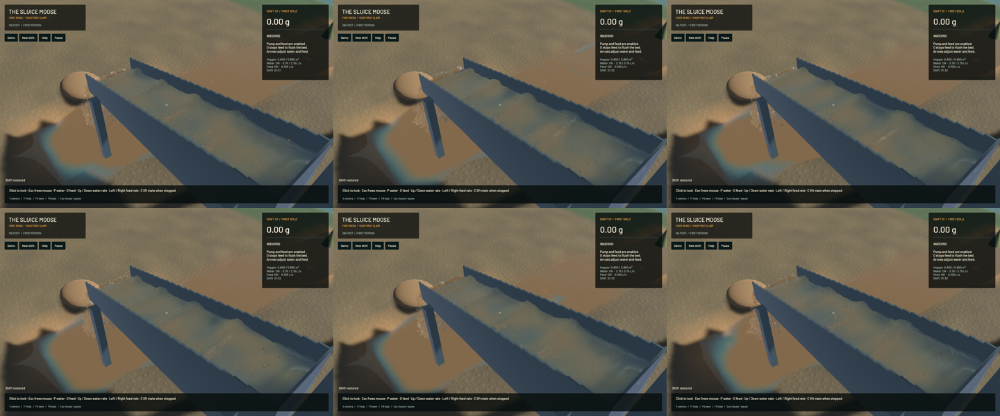

The channel shading and turbidity gather now follow the local projective water slope. Comparing neighbours to one camera-Z depth rejected parts of a continuous inclined sheet. Fitting raw depth also curved an exactly planar sheet, creating false cap normals. The final gather fits reciprocal depth, unprojects its tangent and filters both optical moments around that slope. Subpixel offsets are included in both axes. A smooth visibility taper replaces the abrupt optical cutoff.

This is a modest rendering correction. Matched layer review shows local cap shading and small opacity differences; broad standing waves, actual sediment clouds, visible gravel stippling and coarse spray remain. Their complete appearance is not declared realistic. The correction adds four depth-anchor reads inside the existing gather, with no new render pass, target, particle or simulation filter.

All 389 other tracked source files match `a08d5bb`, including 197 protected solver files. Only the compositor and its GPU regression test change. Frozen simulation/fluid clocks, solver steps, selected physical tracks, all captured surface samples, controls, machine state and material movements match exactly. The opaque scene is identical, and the 280×230 falling-outlet control crop is byte-identical.

**68 CPU/application checks and nine explicitly executed actual-GPU optics checks pass**, with strict all-target Clippy for mining/mining-physics, maintained formatting, whitespace and signed packaging. The ordinary command lists 91 ignored tests; nine optics tests run separately, leaving 82 unexecuted checks. The new GPU control uses an independently calculated inclined plane, a linearly varying water path and uniform suspension across all four full-resolution pixel phases. Its maximum normal-vector error is 6.19e-6 against a 1.5e-4 limit. Optical path and concentration remain within 20 µm and 0.001/m. The old shader fails this control with a 0.00721 normal error at the first sampled point. The GPU acceptance limits were not relaxed.

| Same ordinary saved input, separate 20-second windows | Before | Final |
|---|---:|---:|
| Mean render FPS | 56.20 | 56.15 |
| p95 frame time | 26.73 ms | 26.55 ms |
| Simulation / wall time | 0.3230× | 0.3264× |
| Real-time gate | Failed | Failed |

These evolving windows show no material render-cost change and establish no speed improvement. Both finite-material budget gates pass. Final sluice-water residual is zero; whole-water residual is -7.832 mL and gold residual is 1e-11 g. The [receipt](2026-10-23-crest-film.json) retains complete budgets and source/binary/media fingerprints.

[Native motion](2026-10-23-crest-film.mp4) retains all 110 sluice and 67 outlet source captures in 726 encoded frames at 60 FPS wall timing. Capture rates are 20 and 12 Hz; repeated display frames are not extra physics. All 109/66 recorded presentation intervals advance, with zero recording underruns. Worker snapshots advance only 56/61 times, as expected when the slower solver publishes less often than presentation. Review covers six temporal samples per view, both full midpoint frames and frozen layer diagnostics, not the entire video or manual operation.

Heavy jobs were sequential with one compiler/encoder job. Required scoped cleanup leaves no owned game, encoder, browser or test process. Fourteen shared Playwright MCP and 56 Node processes remain untouched. No new panic-full or WindowServer report appeared. The original dirty checkout and stash are preserved. Installed Beads lacks `bd sync`; this task's record is exported separately. The broader realistic-operation objective remains open.
