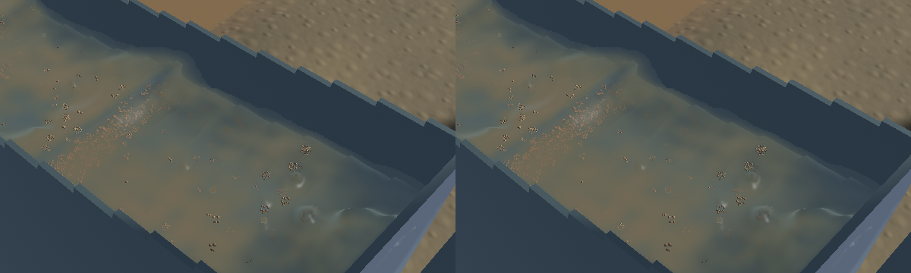
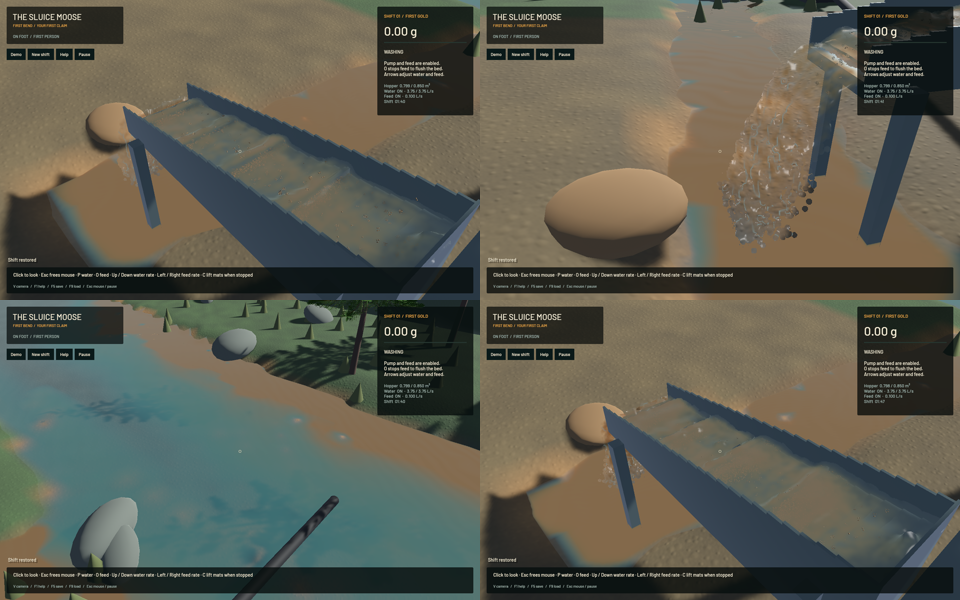

The connected-water filter now uses the same eight density probes as surface selection. Previously a bulk crest beginning beyond 12 mm received the detached-drop filter even though the interface had been reconstructed as connected water. The GPU regression places bulk support at 35 mm and checks that it receives the connected filter; sparse outlet water retains the original response.

Channel sediment optics now gather positive cubic water, fine-volume and cross-section moments before dividing. This removes the optical-cell slope discontinuities of trilinear sampling while preserving a uniform mixture. The stored projected moments and authoritative inventories are unchanged. The larger presentation footprint smooths some subcell colour variation; it is not physical sediment diffusion. The falling outlet keeps its earlier sample.

The visible improvement is smoother sediment transitions and a less rounded highlight at the near-end crest. Broad physical riffle waves and turbidity remain. Sparse spray, gravel proxies and river art still need refinement; this is not a claim that the whole scene looks realistic.

**146 application/CPU checks, 127 sim3d checks and eight explicitly executed GPU optics checks pass.** The preceding boundary work also passes 23 separately executed GPU test functions. The ordinary run lists 85 ignored checks; these are not all claimed as executed. Maintained all-target Clippy and formatting pass. Legacy game/sim3d lint has 108 existing diagnostics and none on changed primary spans. Signed packaging and whitespace checks pass. Repository-wide legacy formatting debt remains open.

The frozen simulation/fluid clocks, solver steps, sampled physical tracks, render centres, flow, machine, excavation and delivery fields match exactly. A 280×230 falling-outlet crop is byte-identical. The renderer adds no target, draw pass or instances; channel optics use 64 field taps instead of eight on the existing surface worker.

[Native motion](2026-10-23-crest-flow.mp4) retains all 44/44/44/45 source frames in 971 encoded frames at 60 FPS wall timing. Capture is 12 Hz; duplicated display frames do not imply 60 Hz physics. Every view has an advancing presentation clock and passes the live-capture check. Review covers six temporal samples per view plus full frozen sluice/outlet frames, rather than the whole video or a manual operator replay. Per-view underruns and timing are retained in the receipt.

| Native window | Ordinary, 20 wall seconds | Conservative, 40 wall seconds |
|---|---:|---:|
| Mean render FPS | 55.46 | 55.69 |
| p95 frame time | 27.01 ms | 27.12 ms |
| Physical / wall time | 0.3265× | 0.2091× |
| Contact pause | None | None |
| Real-time gate | Failed | Failed |

These windows use different saved inputs and lengths. They establish no comparative speed improvement. Both material gates pass. Ordinary input is the established grown demo; the conservative input reproduces the earlier contact failure and advances 8.367 physical seconds without that pause after the shared distance-field correction. Water, gold, bulk and dry-mass residuals are retained separately in the receipt. The [boundary checkpoint](2026-10-23-hydrostatic-boundary.md) records the shared geometry and experimental solver work; the rendering changes do not simplify the water, terrain or riffle simulation.

[Exact receipts](2026-10-23-crest-flow.json) pin all 20 changed code files and the signed app. The experimental mode stays opt-in; real-time throughput, full physical validation and operation stages 2–6 remain open.

Heavy jobs were serialized with one compiler/encoder job. Scoped cleanup leaves no owned game/test/browser running; 18 shared Playwright MCP and 73 Node processes remain untouched. No new panic-full or WindowServer report appeared. The original dirty checkout and user stash are preserved. Installed Beads lacks `bd sync`; a scoped export updates only seven touched project IDs.
