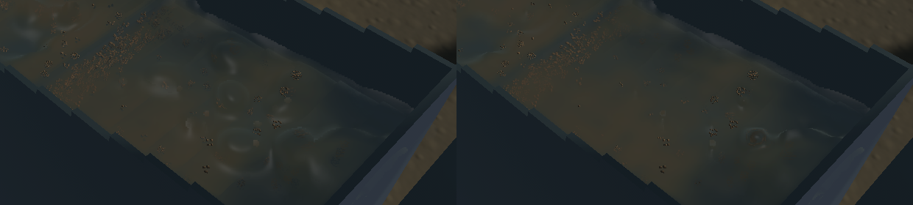
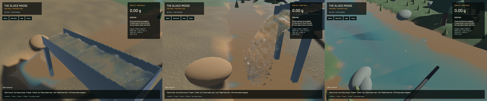

Connected sluice crests use an eight-sample density profile, and detached spray must have local water support before receiving a broad bulk silhouette. The same pre-clipped optical column now retains its opacity while the surface is reconstructed. These changes reduce the rounded caps and false muddy patches seen in the native game.

The old covariance neighbourhood classifies a detached sample 12.5 mm above a dense sheet as fully bulk (`bulk=1`). A new regression reproduces that failure before the fix. Continuous local represented-volume support rejects that borrowed silhouette; thin sheets, sparse spray, coincident subdivision, orthogonal axes and kernel volume checks still pass. Kernel normalization retains represented water when the render radius changes.

The previous two density probes span only 4–12 mm behind the nearest ellipsoid. Eight additive probes now span 0–51 mm and select the first half-density crossing, including a connected interface deeper than a front sample. Vacuum, near/deep ramps, multiple layers, submerged fronts, far crossings and sparse transitions execute on the real GPU. Two reusable half-resolution RGBA16F textures add about 4.94 MiB at 1440×900 and no additional particle draw or simulation grid. The four optical-pass targets total 32 attachment bytes per pixel. Spray and the accepted outlet retain their reconstruction branch.

Optical accumulation already clips each kernel against opaque equipment and the bed. Clipping that column again using the smoothed interface changes its transmitted colour as the reconstructed crest moves. Channel shading now uses the already-clipped path once; normal and optical gathers follow the joined surface while excluding separate surfaces. A fixed-column GPU control verifies invariant transmission across changing reconstructed gaps. Sediment cross sections, concentration, source colours and optical coefficients remain presentation approximations; this is not a calibration of soil turbidity.

**41 app CPU checks and seven explicitly executed GPU optics checks pass**, along with strict focused all-target Clippy, maintained-package formatting, whitespace, signed packaging and native Metal rendering. One CPU profiling test remains ignored. This is not a full-workspace or unrelated GPU-suite pass. All 185 checked simulation/physics source files match `0aa94b3`; FLIP/APIC, DEM, riffles, timestep, physical grids and terrain flow are unchanged.

Frozen comparisons match simulation/fluid clocks, solver steps, selected authoritative particle tracks, flow, machine, excavation and deliveries exactly. The 128 tracked crest render centres also match; seven sample radii change. A 280×230 falling-outlet crop matches byte for byte against the old native build. Full frames and hashes remain in the [receipt](2026-10-23-crest-mud.json).

| Same accumulated-bed input; separate 20-second native windows after warm-up | Before | Final |
|---|---:|---:|
| Mean render FPS | 55.67 | 56.83 |
| p95 frame time | 26.76 ms | 26.20 ms |
| Simulation / wall speed | 0.308× | 0.295× |

These evolving short windows establish no speed gain; the simulation remains below real time. Final numerical gates pass: zero sluice-water residual, -7.80 mL whole-water residual, 0.307 mL reference-bulk residual, 0.000553 kg dry-mass residual and 7.3e-12 g gold residual.

[Native motion](2026-10-23-crest-mud.mp4) retains all 45/45/44 source frames in 60 FPS wall timing. Every recorded presentation interval advances, with zero recording underruns and first-display delay below 16.60 ms. Review covers six temporal samples per view, full final sluice/outlet frames and the matched frozen crop; it is not an entire-video or operator-replay claim. Large triangular river patches remain visible and open in `sluice-river-surface-facets`; no river shading change is claimed. Broad environment art, grain stippling, remaining coherent raised water and real-time physics remain part of the larger active objective.

Heavy work is serialized. The original dirty checkout and user stash are preserved. Installed Beads does not support `bd sync`; only touched project issues are exported into the tracked issue file. Scoped cleanup leaves zero owned game/test/browser or heavy jobs; 20 shared Playwright MCP and 81 Node processes remain untouched. No new panic-full or WindowServer report appeared.
