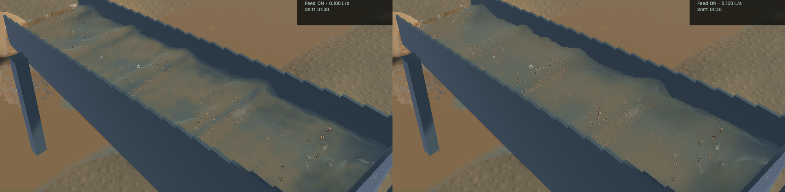
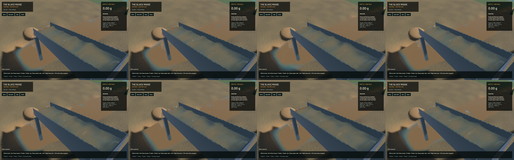

The renderer now filters the visible water shape and its additive water/sediment optical columns together. Previously four depth passes smoothed the shape while a smaller raw-column footprint left separate muddy islands. The two existing half-resolution ping/pong targets now carry depth and paired optical moments in RGBA32F. Concentration is formed after the shared filters. There is no additional render pass or particle; the target increase is 7.42 MiB at 1440×900. This read-only presentation filter preserves a homogeneous mixture; it does not claim conservation of the screen-space optical integral.

Connected-water depth filtering now estimates the local projective slope before rejecting depth differences. Comparing all taps to centre depth mistook an oblique sheet for a sharp edge and retained kernel caps. Harmonic depth averaging retains a projective plane in the controlled interior stencil. A valid fitted normal no longer depends on a front spray particle supplying a nonzero gradient. Detached water keeps the original arithmetic filter and optical path. Channel and outlet columns cannot lend each other opacity.

Layer-by-layer and final-frame review shows less rounded crest shading and fewer isolated tan opacity patches. The rendered interface moves within its reconstruction footprint; physical particle positions and the riffle solver do not change. Broad standing-wave envelopes, suspended sediment, grain stippling and coarse spray remain. This is a targeted correction, not a claim that the complete scene looks realistic.

**146 CPU/application checks and eight explicitly executed real-GPU optics checks pass.** The ordinary run still lists 88 ignored tests; these are not all claimed as executed. The strengthened GPU controls cover an inclined plane with an independently calculated old-filter cap, uniform and patchy optical moments, cross-column isolation, no invented dry coverage, and both biased and absent front gradients. A centre-anchored tangent initially failed the inclined-sheet control; the retained failed logs led to the endpoint tangent correction. Strict all-target Clippy for the maintained packages, maintained formatting, whitespace and signed packaging pass. An initial lint command included dependencies and hit ten unchanged sim3d diagnostics; scoped lint passes. Existing workspace Format/Test game CI debt remains separate.

All authoritative simulation sources match `08504b0`. The frozen clocks, solver steps, sampled physical tracks, render centres/support, flow controls, machine state, excavation and delivery fields match exactly. The saved input is identical. The 280×230 falling-outlet crop and a 180×85 river crop are byte-identical; this is a crop control, not a whole-view identity claim.

| Separate 20-second native windows, same ordinary saved input | Before | After |
|---|---:|---:|
| Mean render FPS | 56.09 | 54.37 |
| p95 frame time | 26.28 ms | 28.41 ms |
| Simulation / wall time | 0.3214× | 0.3256× |
| Real-time gate | Failed | Failed |

These short evolving windows establish no speed improvement. The final render window is slightly slower. Both material-budget gates pass; final sluice water residual is zero, whole-water residual is -7.819 mL and gold residual is 1.36e-12 g. Full budgets remain in the [receipt](2026-10-23-crest-patches.json). No physics resolution, pressure work, particle count or cadence is reduced.

[Native motion](2026-10-23-crest-patches.mp4) retains all 91 source frames across sluice and outlet in 487 encoded frames at 60 FPS wall timing. Capture is 12 Hz; display duplicates are not extra physics frames. All 44/45 recorded presentation intervals advance, recording underruns are zero, and first display delay stays below 16.64 ms. Review includes eight temporal samples and full midpoint frames in each view; the entire video and manual operation were not reviewed. The water and sediment progress downstream, and the outlet continues onto wet ground.

Heavy jobs ran sequentially with one compiler/encoder job. Scoped cleanup leaves no owned native game/encoder, no Playwright tests or Chrome-for-Testing. Eighteen shared Playwright MCP and 72 Node processes remain untouched. No new panic-full or WindowServer report appeared. The original dirty checkout and stash remain intact. Installed Beads lacks `bd sync`; only this task's issue is exported into the tracked file. The broader realistic-operation goal remains active.
