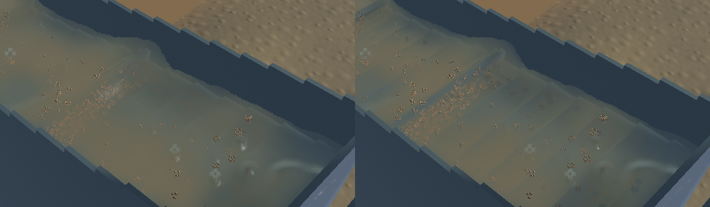
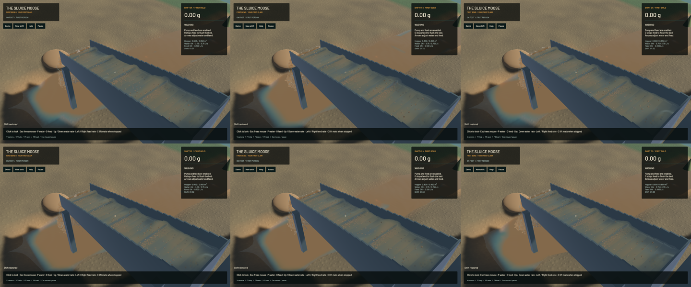

The sluice has tighter crest highlights and clearer shallow water over the riffles. A continuous normal fit removes the residual shading jump; dielectric GGX reflection replaces the broad additive crest lobe. Water and suspended-sediment optical moments are clipped together when the reconstructed visible interval is shorter than the raw particle-volume integral. This keeps concentration while preventing shallow geometry from shading with a deeper muddy column. It supersedes the earlier assumption that a column must retain its full pre-reconstruction optical length.

The change is confined to the compositor and its GPU tests. All 391 other tracked crate/root sources match `c7bac6f`; water, riffle, DEM, terrain and mechanical solvers are unchanged. Frozen simulation/fluid clocks, solver steps, sampled physical tracks, rendered particle support, machine, flow, excavation and delivery fields match exactly. The 280×230 outlet crop and 400×180 river crop are byte-identical. These crop checks do not claim that every pixel in those views is identical.

The old 35 mm normal-fit cutoff changes the normal by about 0.03572 when a test surface moves only four micrometres. The final shader changes it by 0.00000951, below the unchanged 0.0001 whole-vector continuity limit. The old shader also fails the independent shallow-interval optical-depth check. The final ten actual-GPU controls pass, including projective planes, suspension/volume integration, clipping, detached drops, continuity, and finite reciprocal dielectric reflection. The sun intensity and unresolved roughness remain presentation approximations.

**69 CPU/application checks and ten explicitly executed GPU checks pass**, along with strict scoped all-target Clippy, maintained formatting, authored whitespace and signed macOS packaging. The ordinary test run lists 93 ignored checks; after the ten explicit optics checks, 83 remain unexecuted. Full workspace CI is not claimed.

| Separate 20-second windows from the same saved input | Before | Final |
|---|---:|---:|
| Mean render FPS | 55.61 | 55.68 |
| p95 frame time | 26.73 ms | 26.80 ms |
| Simulation / wall time | 0.3198× | 0.3215× |
| Real-time gate | Failed | Failed |

The short evolving windows establish no speedup. Both material-budget gates pass; final sluice-water residual is zero, whole-water residual is -7.819 mL and gold residual is 1.36e-12 g. No simulation work, resolution, particle count or cadence is reduced, and no render pass, particle or target is added.

[Native sluice, outlet and river motion](2026-10-23-crest-repair.mp4) retains all 192 source captures in 848 encoded frames at 60 FPS wall timing. Capture targets are 20/12/12 Hz; repeated display frames are not extra physics. Presentation advances at all 103/43/43 recorded intervals, with zero recording underruns and at most 16.52 ms first-display delay. Review covers six temporal samples and one full-resolution midpoint per view plus the frozen layers, rather than the entire encoded video or manual operator control. Broad physical wave bands, coarse gravel speckles and sparse spray remain; complete water realism remains tracked by the existing water-polish work.

All heavy jobs ran sequentially. Required scoped cleanup leaves zero owned native/encoder/browser/test processes; 14 shared Playwright MCP and 56 Node processes were left untouched. No new panic-full or WindowServer report appeared. The original dirty checkout and user stash are preserved. Installed Beads rejects `bd sync`; only the changed project issues are merged from its export. The [receipt](2026-10-23-crest-repair.json) records source, binary, media and numeric evidence. Broader operation and real-time work remain open.
