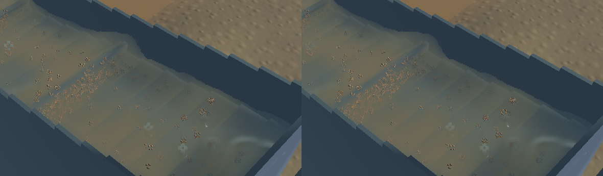
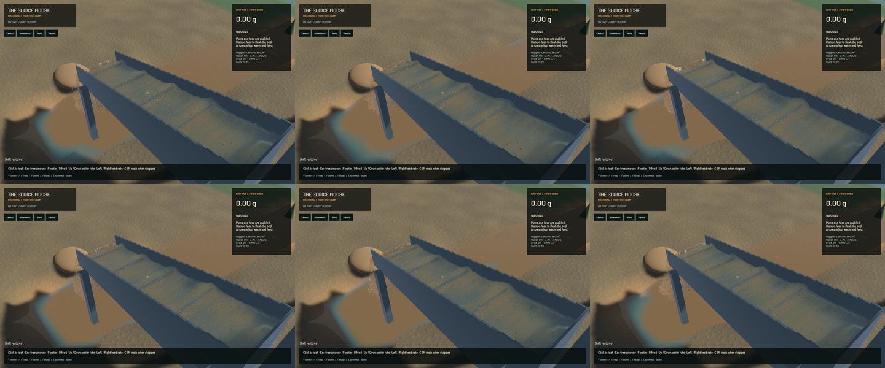

The final sluice-water filter now measures its footprint on the actual inclined water surface. At grazing angles, the previous circular screen-space gather spread sediment and crest normals over too much water. The correction uses 30 mm optical and 45 mm normal e-folding scales, with a minimum image-space antialiasing footprint. It sharpens crest shading and reduces muddy smearing; the visual improvement in the matched native state is modest. Broad physical waves, cloudy suspension, individual spray and grain stippling remain.

Only the compositor and its GPU test change. All 724 other tracked build sources in the isolated snapshot match `c68fd92`. Water, riffle, DEM, terrain and machine solvers are unchanged. The active checkout's 15 unfinished bucket/mechanics files and original dirty checkout are preserved. Matched frozen clocks, solver steps, physical tracks, rendered support, machine, flow and material fields agree exactly. Outlet and river control crops are byte-identical. This does not claim that every pixel in those views is identical.

A real-GPU inclined-plane control reproduces distant sediment crossing the old gather: a clear column with extinction 10/m becomes 15.332742/m beside a muddy stripe more than 12 cm away. The final filter returns 9.999996/m under the same input. All ten explicitly executed GPU optics functions pass, including the existing subpixel continuity and analytic-plane limits. The first candidate failed the unchanged subpixel sediment check; increasing only the minimum antialiasing support fixed it. Failed and final trials remain in the artifact directory. **69 CPU/application checks**, strict maintained all-target Clippy, maintained formatting and signed macOS packaging also pass. The ordinary run lists 93 ignored checks; 83 remain unexecuted after the ten explicit optics functions. Full workspace CI is not claimed.

| Separate 20-second windows from the same saved input | Before | Final |
|---|---:|---:|
| Mean render FPS | 55.69 | 55.68 |
| p95 frame time | 26.55 ms | 26.84 ms |
| Simulation / wall time | 0.3200x | 0.3248x |
| Physical real-time gate | Failed | Failed |

These short evolving windows establish no speedup. Both material-budget gates pass. Final whole-water residual is -7.825 mL, sluice-water residual is 0.000 mL, and gold residual is 1.36e-12 g. No simulation resolution, work or cadence is reduced; no render pass, texture target or particle is added.

[Native sluice, outlet and river motion](2026-10-23-crest-tangent.mp4) preserves all 198 captured source frames in 850 encoded frames at 60 FPS wall timing. The source targets are 20/12/12 Hz; repeated encoded frames are not additional physics. Review covers six temporal samples and one full-resolution midpoint per view, alongside the frozen layers, rather than the whole video or manual operator input. The [receipt](2026-10-23-crest-tangent.json) records exact source, binary, native capture, timing and material evidence. Heavy jobs run sequentially. Broader water art and real-time work remain open.

Required scoped cleanup leaves zero owned heavy jobs; 14 shared Playwright MCP and 56 Node processes remain untouched. No new panic-full or WindowServer report appeared. Installed Beads rejects `bd sync`; only the two touched project rows are merged from its export.
