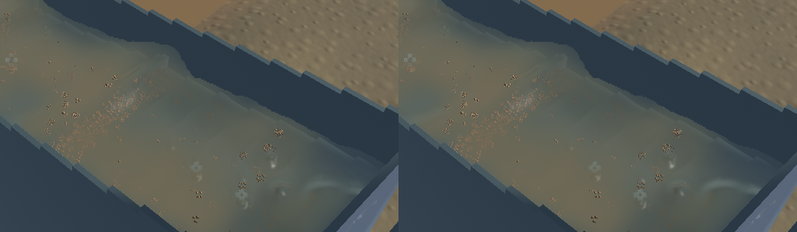
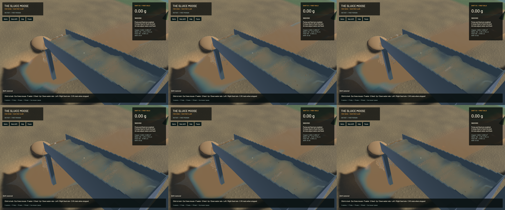

Connected-water smoothing now has a physical footprint bound, and final upsampling preserves a projective water sheet. A fixed pixel blur spread over progressively more water at oblique angles, broadening crests and optical features into rounded patches. The new tangent metric bounds the existing paired depth/optical filter to a 30 mm e-folding length per pass. Its strength fades continuously with connected-water confidence. Reciprocal-depth upsampling also prevents small repeated curvature and excludes neighbouring outlet columns from the connected interface.

The visual improvement is modest: local crest shading retains tighter detail and some broad optical smoothing is reduced. Native review still shows broad waves, cloudy suspension, grain stippling and coarse detached spray. Complete water realism remains open under `sluice-water-surface-art`. No new render pass, target or particle is added. This is a read-only presentation filter; it does not claim conservation of the screen-space optical integral.

**68 CPU/application checks and nine explicitly executed real-GPU optics tests pass**, with strict maintained all-target Clippy, formatting, whitespace and signed packaging. The ordinary command lists 91 ignored checks; nine run separately, leaving 82 unexecuted. Existing solver-resolution, shallow-film, uniform-mixture, dry-coverage, outlet and projective-plane limits remain. A real-projection threshold control verifies continuous dilute-film behaviour. An independent optical impulse has 16.64 mm spread with the new filter; the old shader fails at 111.55 mm against the unchanged 30 mm bound. The old upsampler also fails the strengthened plane test at its first sample with 94.29 µm depth error against a 1 µm bound.

The signed delivery was built from `030e6d7` plus exactly the three rendering/test paths, excluding the existing unfinished soil work. All 388 other tracked sources match that commit, including 197 protected solver files. Frozen clocks, solver steps, sampled physical tracks, machine/flow controls, material movements and captured surface samples match exactly. The opaque-scene crop and 280×230 falling-outlet control crop are byte-identical.

| Separate 20-second native windows, same ordinary saved input | Before | Final |
|---|---:|---:|
| Mean render FPS | 56.64 | 55.88 |
| p95 frame time | 26.32 ms | 26.77 ms |
| Simulation / wall time | 0.3299× | 0.3264× |
| Real-time gate | Failed | Failed |

These short windows establish no performance improvement; the final render window is slightly slower. Both material-budget gates pass. Final sluice-water residual is zero, whole-water residual is -7.819 mL and gold residual is 1.36e-12 g. Full budgets and source/binary fingerprints remain in the [receipt](2026-10-23-crest-upsample.json).

[Native motion](2026-10-23-crest-upsample.mp4) includes all 132 captured source frames across six seconds in each view, encoded in 722 frames at 60 FPS wall timing. Capture is 12 Hz; repeated display frames are not additional physics. All 65 presentation intervals advance in each view, with zero recording underruns. Review covers six temporal samples and the full midpoint frame in each view, plus frozen layers; the entire video and manual operation were not reviewed.

Heavy jobs ran sequentially, with one compiler/encoder job and one encoder thread. Scoped cleanup leaves no owned game, encoder, browser or test process. Fourteen shared Playwright MCP and 56 Node processes remain untouched. No new panic-full or WindowServer report appeared. The original dirty checkout and user stash are preserved. Installed Beads lacks `bd sync`; the two task records are exported separately. The broader realistic-operation objective remains active.
