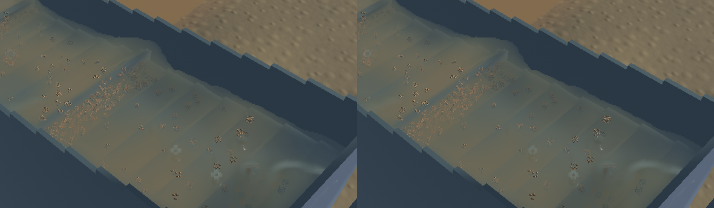
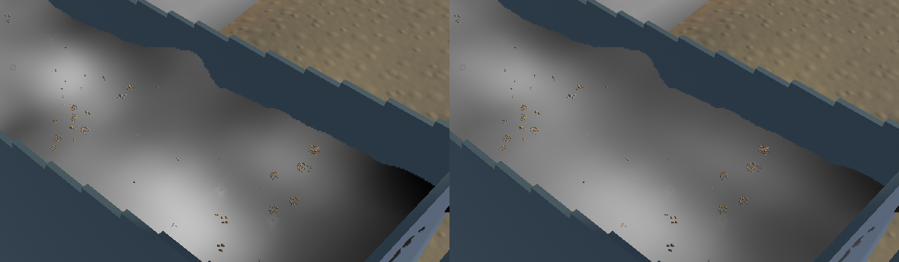
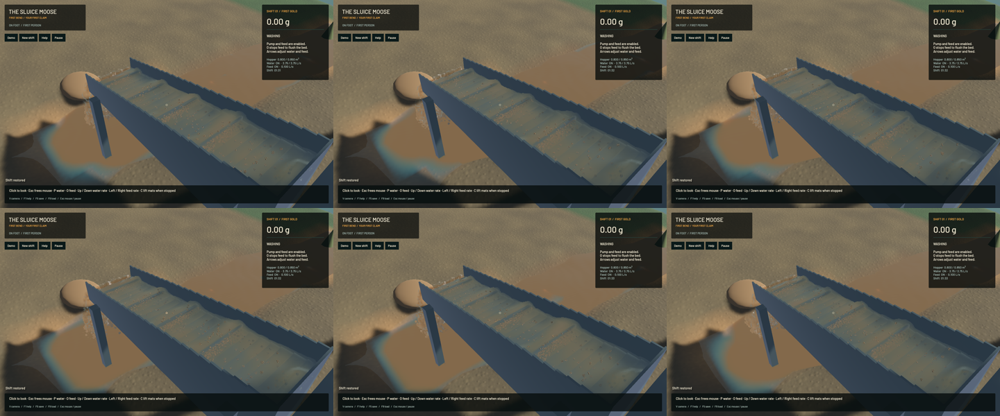

The sluice filter now rejects depth differences in the water tangent's normal direction and stabilizes nearly one-dimensional normal fits using a separately sampled projective tangent. The old fit could return a particle's round normal on an exactly planar grazing sheet. Stabilization requires both tangent anchors, so isolated spray retains its curved normal. The visible crest change in this saved scene is modest; broad simulated riffle waves remain.

Sparse fine-grain optical parcels now reconstruct into longer streamwise streaks, with approximately 8 cm streamwise versus 3 cm cross-stream standard deviation away from boundaries. The positive conservative filter preserves water, suspended fine volume and grain cross-section, including clamped boundaries. It preserves vertical stratification and the existing outlet sample. This is read-only optical reconstruction, not physical diffusion or a calibrated sediment model. No particle, physical grid, solver work, timestep or pressure iteration is changed. All 734 other tracked Rust/shader/config build sources in the isolated snapshot match `1c0414f`. The 23 pre-existing unfinished mechanics files are preserved and excluded from this rendering build.

**76 CPU checks and ten explicitly executed real-GPU optics checks pass**, with strict scoped all-target Clippy, maintained-package formatting, whitespace and signed macOS packaging. The negative GPU control reproduces a 1.34125 normal-vector error on the old shader; the final shader passes the unchanged 0.001 limit across all four pixel phases. Existing analytic-plane, subpixel continuity, shallow columns, optical-volume and outlet controls also pass. The first, less grazing fixture did not reproduce the rank failure; that trial is retained. Other ignored suites and full-workspace CI are not claimed.

Frozen simulation/fluid clocks, solver steps, physical tracks, render centres/support, machine, flow, excavation and delivery fields agree exactly. The outlet and river control crops are byte-identical; this is not a whole-view identity claim. The [receipt](2026-10-23-crest-volume.json) records source, binary, saved input and media hashes.

| Same saved input, separate 20-second native windows | Before | Final |
|---|---:|---:|
| Mean render FPS | 55.76 | 55.73 |
| p95 frame time | 26.88 ms | 26.79 ms |
| Simulation / wall time | 0.3230x | 0.3183x |
| Physical real-time gate | Failed | Failed |

These short evolving windows show essentially unchanged render performance and establish no speedup. Both material-budget gates pass. Final sluice-water residual is zero; whole-water residual is -7.811 mL and gold residual is 4.55e-13 g.

[Native sluice and outlet motion](2026-10-23-crest-volume.mp4) retains all 143 captured source frames in 546 encoded frames at 60 FPS wall timing. Source targets are 20/12 Hz; repeated display frames are not extra physics. All 109/32 recorded presentation intervals advance, with zero recording underruns. Review covers six temporal samples and a full-resolution midpoint per view plus frozen diagnostics. Broad waves, individual spray, grain stippling, river art, sediment calibration and real-time throughput remain open in the broader water-polish work.

Heavy jobs ran sequentially with one compiler or encoder job. Required scoped cleanup leaves zero owned game/test/browser/encoder processes; 14 shared Playwright MCP and 56 Node processes remain untouched. No new panic-full or WindowServer report appeared. The original dirty checkout and user stash are preserved. Installed Beads rejects `bd sync`; only the two touched project rows are merged from its export. Broader water polish stays in progress.
