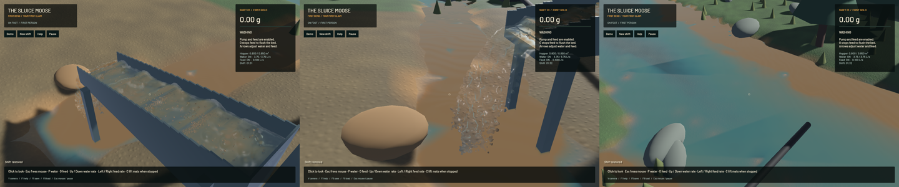

The plant keeps actual water and paydirt delivery after passing 4,096 grains. The former grain-count guard could stop intake while source water remained available. Derived particle storage now grows with the live population and retains each parcel, pressure state and contact history. This enables sustained-admission studies; physical packing, hydraulic restrictions, calibrated recovery and real-time speed remain open.

| Same near-quota save; 120 measured domain ticks after 12 warm-up ticks | Before | Final |
|---|---:|---:|
| Grain-limit blocked ticks | 75 | 0 |
| Requested carrier water | 7.500 L | 7.500 L |
| Admitted carrier water | 2.812315 L | 7.499489 L |
| Final retained grains | 4,091 | 4,389 |

Both young and accumulated-bed runs below the former guard match the complete old saved physical state exactly. Only the three unordered contact-map arrays are sorted for comparison; no particle arrays are reordered and no float tolerance is used. A separate 600-tick loaded run reaches 4,308 grains with zero admission blocks and 37.497495 L admitted out of 37.500002 L nominal. Preallocating 8,192 slots, growing 4,096→8,192 and enabling actual GPU pass timestamps all produce the same complete physical state. The ordinary growth constructor/encoding takes 13.94 ms on the CPU; that value does not include GPU completion. Short sequential wall timings establish no overall speed gain.

The [storage contract](../physics/particle-storage.md) details complete reuploads, parameter/obstacle/pressure/timer retention, adapter and planning checks, explicit worker refusal, save limits and bounded contact scratch. Large hash sweeps stream the original ordered contacts; both active mask arrays are bounded before allocation. Independent old-order, 8,194-body isolated-contact and oversized-row controls pass. Existing physical grain sizes, grading, material volume/mass, water reservation, grid, timestep, pressure iterations and contact equations remain. Capacity is derived metadata, absent from saves.

Validation passes: **339 distinct CPU/unit/integration checks and four explicitly executed real-GPU checks**. The two growth controls were repeated with reduced per-buffer device limits so the largest combined staging request is rejected before construction. Controls also cover nondefault coefficients, pressure warm starts with projection enabled/disabled, gravel obstacles, a complete large live save/continuation, constant-flow APIC transfer and the original excavation/pump/camera/restore pipeline. The worker refusal control retains actual excavated stock and a valid serialized shift while pausing before a packet's second tick. Other ignored suites remain unrun. Strict focused all-target Clippy, maintained-file and changed-legacy-region formatting, whitespace, signed packaging and Metal rendering pass. Game/sim3d library Clippy completes with 110 warnings and no diagnostic primary span on changed code; full-workspace Format/Test game debt remains separate.

| Same loaded accumulated-bed input; separate 60-second native windows after warm-up | Before | Final |
|---|---:|---:|
| Mean render FPS | 54.12 | 52.30 |
| p95 frame time | 33.89 ms | 37.67 ms |
| Simulation / wall speed | 0.2539× | 0.2543× |
| Final grains | 4,091 | 4,618 |
| Final water particles | 84,895 | 117,305 |
| Final delivered water | 0.0000 L/s | 3.7497 L/s |
| Reported peak process RSS | 525.70 MiB | 506.78 MiB |

The final population is doing more fluid/material work; these evolving windows do not isolate a performance gain. Both combined real-time gates fail. Native RSS comes from Darwin `time -l` and is not total Metal residency, a software-budget guarantee or an optimization result. The ordinary final run records one presentation-buffer underrun. Source/asset rendering matches de258bc except operating guidance, which now derives from pump/feed/live inventory before historical setup milestones. Restored running, flushing and stopped operation no longer receive an instruction to start an already-running pump.

Final numerical gates pass: zero sluice-water residual, -7.78 mL whole-water residual, 0.726 mL reference-bulk residual, 0.001307 kg dry-mass residual and 5e-12 g gold residual. Conservation and allocation invariance do not establish calibrated dense-slurry dynamics or packed-bed convergence. `sluice-dense-intake-capacity` remains in progress for that physical-model/lifecycle work.

[Native motion](2026-10-23-grain-storage.mp4) retains all **38/44/44 source captures** in a 60 FPS wall-timed clip, with first-display delay below 16.44 ms. Review covered six temporal samples per view and full-resolution final sluice/river frames. All recorded presentation intervals advance with zero recording underruns. This is diagnostic-camera evidence rather than an operator replay or an entire-video review. Falling outlet discharge and travelling channel ridges remain visible. Coarse grain stippling, raised silhouettes, opaque banks and newly documented large triangular river patches remain in the broader graphics goal; `sluice-river-surface-facets` tracks a frozen depth/normal/terrain investigation.

All heavy jobs were serialized, with one compiler/encoder job. One lint command initially used a separate target cache; it finished before a verified stop attempt could reach it, and no process was killed. Its 131 MiB generated cache was removed after ownership/use checks; the shared target is preserved. Scoped cleanup leaves no owned game/browser/test process; 16 shared Playwright MCP and 70 Node processes were left untouched. No new panic-full or WindowServer report appeared. The original dirty checkout and user stash remain preserved. The installed Beads version rejects `bd sync`; only the changed project records are exported for commit. The full pads/soil/machine/wash-plant/water-circuit/graphics objective stays active.
