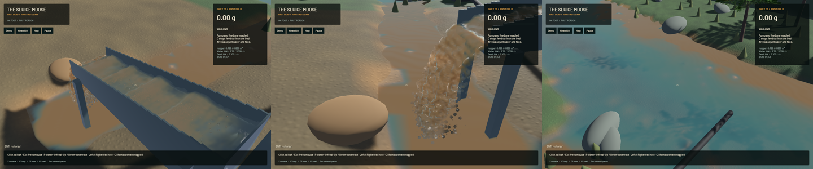

The experimental sluice now pairs scatter and gather across internal voxel faces. This removes artificial wall-parallel flow loss and much of the false gravity circulation without changing particles, grid resolution, timestep or the normal 120 pressure sweeps. The exact SDF/corner and fine-grid convergence gates remain failed, so conservative phases stay opt-in and the full operation goal remains open.

Uniform wall-parallel flow previously lost about five percent of tangent momentum in a PIC step; water also failed freefall while comoving grains retained gravity. Both transfers now use the same immutable voxel mask, original virtual offsets and odd-normal/even-tangent extension. Valid interior nodes skip extra mask queries. A solid wall reaching the computational edge owns that outer face too. Finite block corners are not filled by extending a plane through open fluid. This uses the planar reflection idea in [Ding, Shinar and Schroeder, Section 4.1](https://escholarship.org/content/qt0vc0g86n/qt0vc0g86n.pdf); it does not implement their irregular cut-cell/MLS construction.

Solid flags occupy the high bit of the existing water-marker plane; water counts retain the low 31 bits. The metadata binding limit bounds capacity below 2^28. No large buffer or storage binding is added. An intermediate candidate omitted the geometry region from gather's bound U prefix: independent affine/freefall controls exposed it. The final binding covers the marker plane. A second control exposed the solid outer-face case. All failed receipts are retained.

The exact 894bdf1 baseline fails all 18 internal affine, eight mixed-phase freefall and 18 shear/momentum/energy cases; the final solver passes all 44 at the original thresholds. Maximum affine error is 1.95e-06/s, freefall error is 7.47e-08 m/s and relative tangent-momentum error is 4.37e-08. Energy does not increase beyond float tolerance. These tests cover planar free-slip faces rather than a calibrated rough or no-slip boundary layer.

| Matched gravity matrix, 0.1 physical seconds | Baseline max m/s | Final max m/s | Final original gate |
|---|---:|---:|---:|
| Computational exterior walls | 0.002164 | 0.002164 | 11/12 |
| Voxel box | 0.183785 | 0.002121 | 11/12 |
| Voxel box, valid SDF seeds | 0.183814 | 0.053664 | 0/12 |
| Voxel box and internal block | 0.191313 | 0.019989 | 0/12 |
| Block, valid SDF seeds | 0.189730 | 0.050888 | 0/12 |

The unchanged gate is maximum speed below 1 mm/s and drift below 0.02 cell. All six short source-enabled voxel-box cases pass. Over 0.5 seconds only 10/12 voxel-box cases pass: the fine source-enabled case drifts 0.110 mm against a 0.100 mm limit, and fine pressure-only flow is worse. The 480-sweep reference converges for planar boxes; gameplay retains 120 sweeps. SDF and block matrices still fail every case even at reference work. Seed exclusions and all geometry/particle/time/source tunables match the baseline exactly. Fractional SDF geometry, convex corners and pressure-volume consistency remain necessary; increasing sweep count alone does not close them.

The full operation test then found a separate gravel-contact pause immediately after live restore. The actual trilinear field had a ridge at x=0.695 m; single-gradient Newton steps made negligible progress and left 3.96 percent radius penetration. An exact 5³ sample/body fixture reproduces the failure. Only when Newton backtracking stalls, a bounded local sampled-gradient search seeks a common ascent direction, followed by another eight-check line search against the unchanged scalar field. The eight completion passes, one-percent refusal threshold and smooth-step path remain. The fixture now clears without added kinetic energy or rotation/time integration and is idempotent; an infeasible pocket still refuses. This is a numerical safeguard, not a coupled packed-bed convergence solution. Its relation to sampled-gradient research and limits are recorded in [the model contract](../physics/phase-response.md).

**146 application/CPU checks, 129 sim3d checks and 26 explicitly executed GPU test functions pass.** Both actual dig/pump/camera/720-fluid-step pipelines, live restoration, growth, custody/refusal and independent phase controls are included. The ordinary run lists 88 ignored checks; these are not all counted as executed. Strict maintained all-target Clippy and formatting pass. Legacy game/sim3d has 108 diagnostics with none on changed primary spans. Thirteen ordinary coupling receipts remain exactly unchanged, including known failures; thirteen conservative momentum controls pass. Signed packaging and changed-region formatting/whitespace are verified separately from legacy workspace Format debt.

The initial isolated baseline reused a shared-target candidate binary because archived source mtimes were older. Its unexpected pass was rejected. Refreshing only the isolated source timestamps forced a verified baseline rebuild and reproduced all 44 failures. The candidate was then explicitly rebuilt from its own source before final diagnostics, GPU tests and packaging; both executables and eight changed code files are fingerprinted. No shared cache was deleted.

| Separate 40-second native windows, same saved input | Prior solver | Final |
|---|---:|---:|
| Render FPS | 40.25 | 56.52 |
| p95 frame time | 38.93 ms | 26.97 ms |
| Physical / wall time | 0.1474× | 0.2233× |
| Contact pause | None | None |
| Real-time gate | Failed | Failed |

Background work varied, so these windows establish no speed improvement. Material gates pass in both; detailed water, gold, bulk and dry-mass residuals are retained. A same-state frozen falling-outlet crop remains byte-identical, and frozen clocks, tracks, render centres, flow, machinery and deliveries match. Renderer code is unchanged by this checkpoint.

[Native motion](2026-10-23-internal-wall.mp4) retains every 45/45/44 source frame in 728 encoded frames at 60 FPS wall timing. Capture is 12 Hz and frames are duplicated for display, not synthesized physics. Every presentation interval advances, recording underruns are zero and first-display delay stays below 16.66 ms. Review covers six temporal samples per view and full sluice/outlet frames. Waves and slurry travel through the riffles; the outlet falls and reaches wet ground. Broad wave envelopes, gravel/spray proxies and terrain/water art remain coarse. The whole video and a manual operator replay were not reviewed.

[Receipts](2026-10-23-internal-wall.json) pin exact sources, executable, matched matrices, contact/negative controls, native budgets and media. Heavy jobs were sequential with one compiler/encoder job. Scoped cleanup leaves no owned game/encoder; one unrelated Playwright test, 19 shared Playwright MCP and 73 Node processes remain untouched. No new panic-full or WindowServer report appeared. The dirty original checkout and user stash are preserved. Installed Beads lacks sync; only touched project issue records are exported.

SDF/corner closure, fine-grid pressure convergence, full pressure/contact work and clipping budgets, dense-bed/recovery calibration, real-time physics and stages 2–6 remain open. This checkpoint does not complete the full objective.
