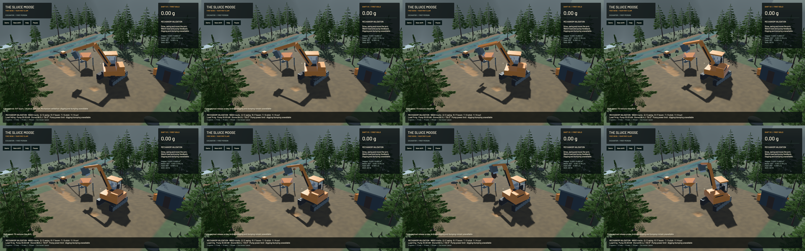

# Spatial payload exchange checkpoint

The optional articulated mechanism now has finite capture/release transactions with actual carried COM/inertia, a generalized momentum solve, inherited release velocity/spin and persistent rigid free flight. The [model](../physics/payload-exchange.md) states the assumptions and equations. Ordinary digging remains available under its existing model. **Normal articulated digging/dumping remain unavailable:** active-soil geometry, failure/contact, retention/spill and contact-consistent admission are unfinished. Stages 2–6 and the full operation remain open.

**198 maintained CPU/application checks pass.** Ninety tests are ignored in the ordinary run; they are not claimed as executed. **Four explicitly executed real-GPU pipeline modes pass**, including spatial payload state and v8 restore alongside original FLIP/APIC, DEM and terrain water. Strict maintained all-target Clippy with `--no-deps`, maintained formatting, whitespace and signed packaging pass. The unchanged game dependency retains its existing dead-code warning. This is not a full-workspace or complete GPU-suite claim.

The 19 new mechanics controls cover independently integrated spatial moments, off-axis capture, co-moving capture, intrinsic spin, finite partial custody, velocity/spin inheritance, repeat splitting, transactional refusals, tiny positive inventory, frame translation, relative covariance validation, the ellipsoid projection, free flight, exact continuation and incompatible saves. An 84.00032 kg capture loses 95.879317 J through the independently calculated inelastic projection; the measured kinetic residual is about -3.16 microjoules. Co-moving capture reports about 1.09e-10 J loss and a 1.88e-5 J registration residual. No velocity or timestep is rescaled to force these results.

The asymmetric free-body orientation errors are 4.9330e-5 / 1.2333e-5 / 3.0813e-6 rad at 15 / 30 / 60 steps over 0.5 s against a 2,048-step reference. Energy errors likewise quarter. This is physical-time refinement for the stated rigid free-flight model, not soil/contact or terrain-grid convergence. Canonical double-precision body state and checked f32 projections survive exact saved continuation. A worker-protocol test saves/restores an airborne v8 load. Ordinary saves remain v6, unexchanged articulated saves v7, and spatial state v8; the loader accepts 2–8 with previous material migrations.

[Native motion](2026-10-23-payload-exchange.mp4) retains all **224 source frames** across 723 encoded frames at 60 FPS wall timing. Display duplicates are not extra physics frames. All 223 recorded physical and 223 presentation intervals advance with no rewind. First display delay remains below 16.62 ms. Review covers the eight event-focused samples and full pre-release/flight frames; the entire video and manual operation were not reviewed.

The probe starts with a finite **initial condition**, withdrawn from real site inventory and placed in a declared volume-aware bucket distribution through capture. That preparation is not proof of pickup work or real scooping. Bevy joint controls open the bucket before explicit worker release events; measured floor-normal Y is about -0.423 at separation, so gravity points away from the floor. This plane-clearance check does not replace complete bucket/equipment collision, retention or granular spill. The ellipsoids are read-only moment-equivalent aggregate visuals, not literal soil packing or colliding clods.

Two parcels of 74.295230 kg each inherit lateral velocity and spin, follow the declared ballistic law to floating-point roundoff, and reach the fixed terrain boundary. The largest native event residuals are 0.000157 N s linear, 0.0021 N m s angular and 0.000304 J kinetic. Received boundary momentum and kinetic energy are saved explicitly; they are not a fabricated closed heat budget. Repacking potential energy, contact shape and the static-boundary approximation remain limits. All recorded bulk/dry-mass, water and gold gates pass.

The native F5 save contains an airborne rigid body and a retained half load. A separate native process restores it without a model-selection flag and passes bounded motion/material gates. All 18 final native synthetic Bevy input/toolbar checks also pass; their existing F5/F9 sequence uses the ordinary unexchanged mechanism. Those checks do not exercise OS key delivery or constitute a manual playtest.

The first native fixture used the old v7 floor-distributed load and rendered a thin plate. That evidence and binary remain retained; the compatibility approximation is not relabelled as accurate bulk soil. Its first helper also assumed both parcels would land on terrain, but one reached the hopper and the other terrain; both were correctly ledgered. The final fixture starts through actual spatial capture and uses gravity-cleared release. Only its explicit preparation/controller changes after the four GPU checks; all physical library/GPU sources match. The final CPU/lint/build and native checks run after that refinement.

The ordinary native replay still excavates and delivers **0.418540 m³**, with live restore during a cut, 55.93 FPS and 0.99995× simulation/wall speed while the sluice is idle. It uses the retained initial signed binary; final changes affect only the explicit payload fixture/controller. This verifies existing excavation/delivery, not the complete current-model wash/cleanup operation.

| Separate loaded-water 20-second windows | Render FPS | p95 frame | Simulation / wall | Real time |
|---|---:|---:|---:|---|
| Previous build | 56.10 | 26.72 ms | 0.3215× | Failed |
| Final build | 56.03 | 26.51 ms | 0.3282× | Failed |

The final water/solid/gold budget gates pass. These short evolving windows establish no throughput improvement. 177 protected original solver sources match the base commit; water shaders, physical grids, particles, pressure work and riffles are unchanged. The idle-plant probe still records 74 water-presentation underruns despite advancing sampled intervals; `sluice-idle-surface-pacing` remains open. No whole-scene smoothness or real-time claim is made.

The [receipt](2026-10-23-payload-exchange.json) links source/binary hashes, complete budgets and the retained artifact directory `/Users/simonheikkila/.codex/visualizations/2026/10/18/01a14ce3-309f-7782-9a7c-ccd0efaf3227/payload-exchange-20261023`. Initial compile and lint failures remain in their logs. Heavy jobs and encoders are serialized with one compiler/encoder job. Scoped cleanup reports zero task-owned game/encoder/compiler, agent-browser, Playwright test or Chrome-for-Testing processes. Fourteen shared Playwright MCP and 56 Node processes remain untouched. No new panic-full or WindowServer report appeared. Original-checkout preservation, scoped Beads export and remote landing evidence remain in the artifact landing receipt. The payload and soil issues stay in progress; this checkpoint does not close their complete acceptance criteria or the full goal.
